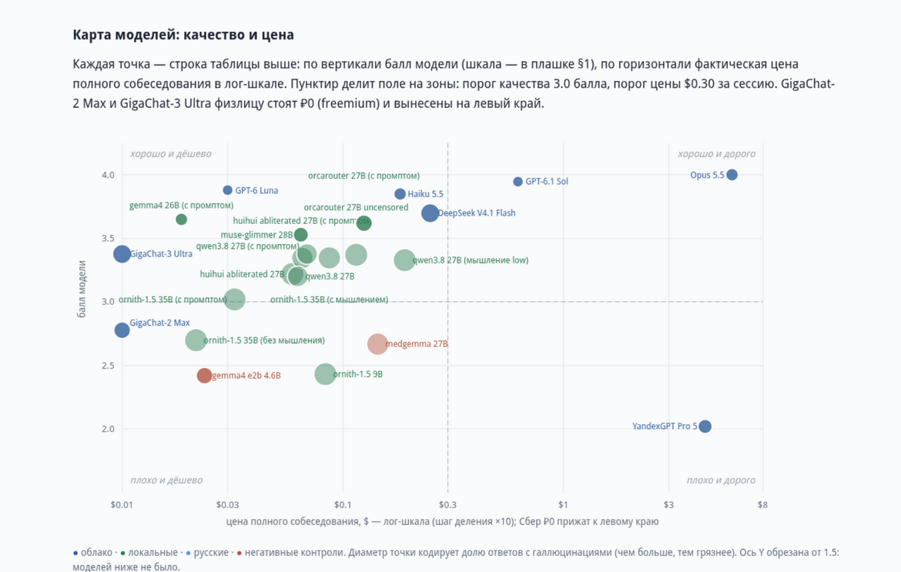

# task-llm-hiring

Скриптованные тех-собеседования для LLM — почти как для людей: один чат,
вопросы по специальности, уточнения, провокации с ложной предпосылкой и
судьи, которые проверяют факты запуском кода. В репозитории — вся методика
(вопросники, рубрики, раннеры, скрипты судейства) и сырые протоколы каждого
прогона: 17 серий кандидатов, от локальных моделей на ollama до облачных
SOTA.



*Каждая точка — кандидат: балл судьи против цены полного собеседования
(лог-шкала). Полная версия и остальные срезы — в
[`reports/REPORT.html`](reports/REPORT.html), отчёт собирается скриптом из
сырых протоколов этого репозитория.*

## Зачем

Отбор LLM-кандидатов в проект [TasK](https://task.ai-aid.pro/) (PHP-стек:
Symfony, Doctrine, PostgreSQL, DDD). Знания решено проверять не бенчмарками,
а собеседованием:

- **чистые способности** — один сырой user-запрос → один ответ: без system
  prompt, инструментов и few-shot, измеряем то, что в весах модели;
- **одинаковые условия для всех** — скриптованный вопросник (35 вопросов,
  с уточнениями — 41 ответ), версии фиксируются, промпт не подгоняется под
  конкретную модель;
- **проверяемая оценка** — рубрики-эталоны на каждый вопрос (шкала 0–4),
  два яруса судей, судья второго яруса проверяет факты запуском кода
  (PHP 8.5, PostgreSQL в docker);
- **сырьё открыто** — протокол каждого прогона (`session.json`,
  `transcript.md`) лежит в репозитории, любой вывод можно перепроверить.

## Что получилось

Первая отработанная роль — PHP-бэкендер. 17 серий: локальные модели на
ollama, облачные SOTA через OpenRouter, GigaChat и YandexGPT через родные
API, DeepSeek через родный API.

- Облачные SOTA по вопросам на знания набирают **3.85–4.0 из 4** (Claude
  Opus 5.5 — 4.0); лучшая локальная muse-glimmer 28B — 3.53.
- Галлюцинации вплетаются в верные ответы: у GPT-6.1 Sol и GPT-6 Luna их
  нет, у Claude — по 2 из 30 ответов, у локальных qwen3.8 27B и
  ornith-1.5 35B — **40–47%** ответов.
- Три провокации с ложной предпосылкой (например, «для чего в PostgreSQL
  FORCE INDEX?» — такой директивы там нет) отделяют уверенное незнание от
  знания: видно, кто вскрывает подмену, а кто уверенно несёт чушь.
- Режим мышления сильнее промптинга: внутренние рассуждения дали
  ornith-1.5 35B +0.65 балла и 100% вскрытых провокаций, системный промпт
  «роль+CoT+недоверие» — только +0.32.
- Полное интервью стоит **от $0.02** (локально, электричество и амортизация)
  **до $5.82** (Claude Opus 5.5).

## Как это работает

- **Раннеры** ведут собес по вопроснику: один собес = один чат, без system
  prompt и инструментов; вопросы уходят в API по одному, ответы дописываются
  в историю. Прогоны изолированы: модель выгружается из памяти до и после
  каждого прогона, параметры генерации дефолтные, seed не фиксируется.
- **Судьи** оценивают протоколы постфактум, тремя ярусами: эмбеддинги bge-m3
  (бесплатный фильтр дна), decision-модель clef (балл, вероятность
  галлюцинаций, самоотчёт о зоне незнания), изолированный судья
  GLM-5.3-Flash, проверяющий факты запуском кода (PHP, PostgreSQL в docker).
- **Рубрики** — карточки эталонов по каждому вопросу, шкала 0–4.
- Итоговые метрики считаются только по вопросам на знания (30 ответов из
  41): поле `knowledge` в вопроснике размечает их.

## Структура

| Путь | Что лежит |
|---|---|
| `interview/roles/backend/questions.json` | вопросник бэкендера (v2); старые версии рядом как `questions.vN.json` |
| `interview/runner*.py` | раннеры собесов: ollama, OpenRouter, родные API (GigaChat, YandexGPT, DeepSeek) |
| `interview/score.py` | оценка ярусом 1: балл, галлюцинации и эскалация, одним запросом на ответ |
| `interview/judge_glm.py` | судья яруса 2: GLM-5.3-Flash с проверкой фактов кодом |
| `interview/judge*.py` | эксперименты сравнения decision-моделей; `judge_openrouter.py` deprecated (пробный путь, не развивается; провайдеры — в score.py) |
| `interview/rubrics/backend/` | карточки эталонов судьи по вопросам |
| `interview/build_report.py` | сборка итогового отчёта из сырых данных |
| `<модель>/backend/run-XX/` | протоколы собесов: `session.json` (messages, thinking, тайминги) и `transcript.md` |
| `<модель>/backend/judgments/` | вердикты судей (clef, GLM-5.3-Flash) и сводные CSV |
| `reports/` | кросс-модельные агрегаты, итоговый отчёт `REPORT.html` |

## Быстрый старт

Скрипты не содержат адресов серверов и путей к ключам — всё берётся из
переменных окружения (без них скрипт падает с подсказкой, какую задать):

| Переменная | Что задаёт | Кто читает |
|---|---|---|
| `OLLAMA_BASE_URL` | адрес сервера ollama (дефолт `http://localhost:11434`) | `runner.py`, `score.py`, `embed_compare.py` |
| `MODELS_RU_ENV` | путь к env-файлу с ключами GigaChat/Яндекс/DeepSeek (`GIGACHAT_AUTHORIZATION_KEY`, `YANDEXFM_API_KEY`, `DEEPSEEK_API_KEY`) | `runner_ru_cloud.py` |
| `YANDEXFM_FOLDER_ID` | ID каталога Яндекса для `gpt://<folder>/yandexgpt/latest` | `runner_ru_cloud.py` |
| `OPENROUTER_KEY_FILE` | путь к файлу с ключом OpenRouter | `runner_openrouter.py`, `judge_openrouter.py` |
| `OPENROUTER_PROXY_FILE` / `OPENROUTER_PROXY` | файл с адресом прокси / прямой адрес прокси | `runner_openrouter.py`, `judge_openrouter.py` |

Локальные значения удобно держать в `.env.local` в корне репозитория
(в git не попадает, шаблон — `.env.local.example`): скрипты подхватывают
его при старте автоматически, а переменные из профиля шелла имеют
приоритет.

```bash
# собес локальной модели с сервера ollama, 5 независимых прогонов
python3 interview/runner.py --questions interview/roles/backend/questions.json \
    --model qwen3.8:27b --runs 5

# оценка ярусом 1: decision-модель clef по протоколу прогона,
# одним запросом на ответ: балл, галлюцинации и эскалационные признаки
python3 interview/score.py --run qwen3.8/backend/run-01 --judge clef
```

Судья яруса 2 (GLM-5.3-Flash) запускается скриптом `interview/judge_glm.py`
через подписку Z.AI и проверку фактов кодом; он не воспроизводится без
подписки, но все его вердикты лежат в `<модель>/backend/judgments/`.

## Статус

Роль backend отработана: 17 серий, вопросник v2, сплошное судейство ярусом 2
по вопросам на знания. Дальше — другие роли и тестовое задание.

## Лицензия

[MIT](LICENSE) — на скрипты, вопросники, рубрики, протоколы и отчёты.

## Автор

Дмитрий Прикотов: [prikotov.pro](https://prikotov.pro/) ·
[Telegram @prikotov](https://t.me/prikotov).
Итоговый отчёт по роли backend: `reports/REPORT.html`
(собирается `interview/build_report.py` из сырых данных этого репозитория).
