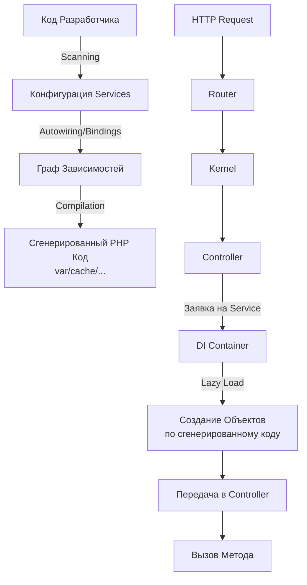
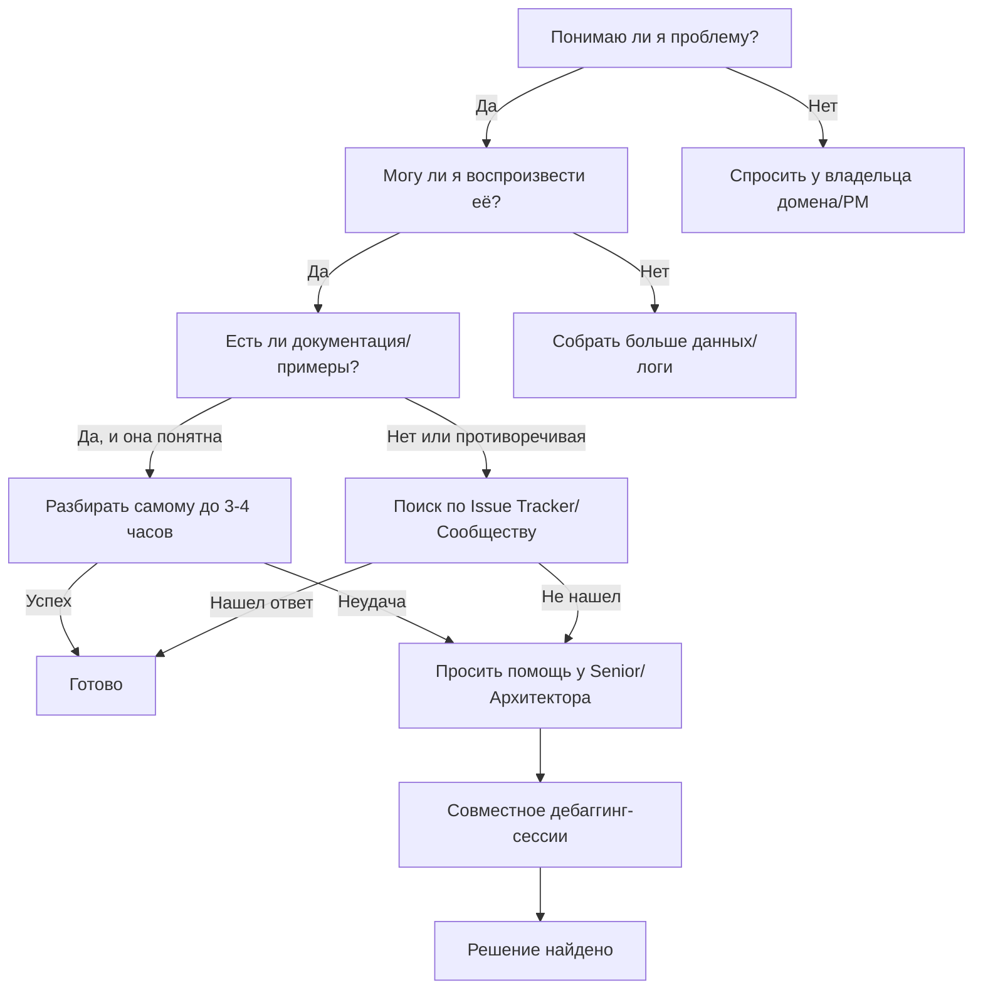

# Собес: `orcarouter/Qwen3.8-27B-Uncensored:latest` · роль: backend — run-04

- Дата: 2026-10-07T02:29:00.693202+00:00
- Сервер: http://nserv:11434 · keep_alive: 30m · think: off · num_ctx: 131072
- Вопросов: 32

---

## Q00 · Разминка

**Интервьюер:** Начнём со знакомства. Расскажи о своём опыте в разработке на PHP и смежных технологиях. В конце оцени по шкале от 0 до 10 свои знания по каждому разделу: PHP 8, Symfony, Doctrine, PostgreSQL, DDD, чистая архитектура, тестирование, git — и одним предложением объясни каждую оценку.

**Кандидат:**

Привет! Рад знакомству.

Как языковая модель искусственного интеллекта, я не имею «личного» опыта работы в компании, но моя «профессиональная деятельность» основана на обучении на огромных массивах данных, включающих миллионы строк кода, документации, обсуждений на форумах (Stack Overflow, GitHub), технических статей и архитектурных паттернов.

Вот как я понимаю и применяю эти технологии в контексте разработки:

*   **PHP 8:** Я глубоко знаком с новыми фичами, такими как readonly-свойства, enums, constructor promotion, named arguments и строгие типы. Я понимаю внутренние механизмы PHP 8 (JIT, fibers) и могу писать и оптимизировать код с акцентом на производительность и строгую типизацию.
*   **Symfony:** Это одна из моих сильных сторон. Я хорошо знаю ядро фреймворка (DI-контейнер, events, serializer, validator), а также экосистему: DoctrineBundle, Security, Twig, Console. Я могу проектировать приложения с соблюдением принципов PSR, настраивать конфигурации через XML/YAML/env и использовать Symfony Console для CLI-инструментов.
*   **Doctrine:** Я понимаю ORM-механику, маппинг сущностей, жизненный цикл сущностей, DQL, Criteria API, а также продвинутые темы: наследование, полиморфизм, lazy-загрузка, транзакции и оптимизация запросов (N+1 problem, fetch joins).
*   **PostgreSQL:** Я владею основами SQL, понимаю особенности PG (типы данных, индексы, партиционирование,全文 поиск, JSONB). Могу писать сложные запросы, оптимизировать их с использованием `EXPLAIN ANALYZE`, понимать блокировки и транзакционные изоляции.
*   **DDD (Domain-Driven Design):** Я понимаю ключевые концепции: Ubiquitous Language, Bounded Context, Entities, Value Objects, Aggregates, Domain Events, Repositories. Могу помогать в моделировании домена, выделении контекстов и проектировании чистой доменной логики, отделенной от инфраструктуры.
*   **Чистая архитектура (Clean Architecture / Hexagonal):** Я придерживаюсь принципа зависимости, где внутренний слой (Domain) не зависит от внешнего (Infrastructure, Presentation). Понимаю роль портов и адаптеров, репозиториев, сервисов и контроллеров. Могу структурировать проект так, чтобы доменная логика была независима от фреймворка.
*   **Тестирование:** Я знаю, как писать unit-тесты (PHPUnit/Pest), интеграционные и функциональные тесты. Понимаю стратегии мокирования, тестовый пирамиду, BDD-подход и важность покрытия критичного доменного кода.
*   **Git:** Я владею основными командами (commit, push, pull, rebase, merge), понимаю модель ветвления (GitFlow, trunk-based), умею разрешать конфликты, использовать stash, bisect, log/graph. Могу писать чистые коммиты и организовывать историю изменений.

---

### Оценка моих знаний по шкале от 0 до 10

| Раздел | Оценка | Обоснование (одно предложение) |
|--------|--------|-------------------------------|
| **PHP 8** | 9.5 | Отличное знание языка, включая новые фичи и внутренние механизмы, с уверенным пониманием строгих типов и производительности. |
| **Symfony** | 9.0 | Глубокое понимание ядра, конфигурации и экосистемы, с опытом проектирования масштабируемых приложений. |
| **Doctrine** | 8.5 | Хорошее понимание ORM, маппинга и оптимизации запросов, но некоторые граничные случаи требуют дополнительной проверки. |
| **PostgreSQL** | 8.0 | Уверенное владение SQL и спецификой PG, но глубокая оптимизация на уровне движка требует более узких знаний. |
| **DDD** | 8.5 | Чёткое понимание концепций и паттернов, с навыками применения в реальных проектах, но сложность моделирования домена всегда требует контекста. |
| **Чистая архитектура** | 9.0 | Уверенное понимание принципов разделения ответственности и независимости слоёв, с практическим опытом проектирования. |
| **Тестирование** | 9.0 | Хорошее знание стратегий тестирования, мокирования и фреймворков, с акцентом на качество доменного кода. |
| **Git** | 9.5 | Отличное владение повседневными и продвинутыми командами, с пониманием истории и разрешения конфликтов. |

> **Примечание:** Оценки отражают глубину и широту моих знаний на текущий момент. Я готов помогать с задачами любого уровня сложности, от отладки до архитектурного проектирования. Чем конкретнее вопрос, тем точнее мой ответ. 😊

> ⏱ 17.1s · prompt 89 tok · output 1144 tok

---

## Q01 · PHP 8

**Интервьюер:** Какие возможности современных версий PHP — с 8.0 и новее — ты считаешь самыми важными для написания чистого и надёжного кода? Покажи на коротких примерах кода.

**Кандидат:**

Для написания чистого, надёжного и предсказуемого кода в PHP 8.0+ я выделяю несколько ключевых фич, которые напрямую влияют на типобезопасность, читаемость и устранение целого класса ошибок.

Вот самые важные из них с примерами:

### 1. Strict Types (`declare(strict_types=1);`)
**Почему важно:** Это фундамент надёжности. Включает строгую типизацию, предотвращая неявные приведения (например, строка `"1"` превращается в число `1`), которые часто маскируют баги.

```php
<?php
declare(strict_types=1);

function sum(int $a, int $b): int {
    return $a + $b;
}

sum(1, "2"); // TypeError: sum(): Argument #2 ($b) must be of type int, string given
// До strict_types это работало бы без ошибок, но могло привести к неожиданным результатам в сложных логиках.
```

### 2. Constructor Property Promotion
**Почему важно:** Сокращает объём кода (DRY) и делает DTO/Value Objects компактными и менее склонными к ошибкам при добавлении новых полей.

```php
// До PHP 8.0
class User {
    public function __construct(
        private string $name,
        private int $age
    ) {
        $this->name = $name;
        $this->age = $age;
    }
}

// После PHP 8.0
class User {
    public function __construct(
        private string $name,
        private int $age
    ) {}
}
// Код короче, но функциональность та же. При добавлении нового поля нет риска забыть присвоить его в конструкторе.
```

### 3. Enums
**Почему важно:** Заменяют магические числа и константы на типобезопасные объекты. Enums нельзя присвоить "случайное значение", что устраняет класс ошибок с "magic strings" и integer-константами.

```php
enum OrderStatus: string
{
    case Pending = 'pending';
    case Shipped = 'shipped';
    case Delivered = 'delivered';
}

class Order
{
    public function __construct(
        private OrderStatus $status
    ) {}
    
    public function getStatus(): OrderStatus {
        return $this->status;
    }
}

// Можно передать только валидные значения:
$order = new Order(OrderStatus::Pending); 
// new Order("pending") // TypeError

// Можно добавлять логику к enum'ам:
public function canBeCanceled(): bool {
    return in_array($this, [self::Pending, self::Shipped], true);
}
```

### 4. Readonly Properties
**Почему важно:** Гарантирует неизменяемость данных. Идеально для Value Objects и DTO. Если объект создан, его состояние нельзя случайно изменить, что упрощает отладку и предсказывает поведение.

```php
readonly class Money
{
    public function __construct(
        private int $amount,
        private string $currency
    ) {}
    
    public function getAmount(): int {
        return $this->amount;
    }
}

$money = new Money(100, 'USD');
$money->amount = 200; // Error: Cannot modify readonly property
// Это исключает целый класс ошибок, связанных с мутируемостью данных.
```

### 5. Named Arguments
**Почему важно:** Улучшает читаемость функций с множеством аргументов. Позволяет вызывать аргументы в любом порядке, что делает код самодокументирующимся и устойчивым к изменениям сигнатур функций.

```php
function createUser(
    string $email,
    string $password,
    string $role = 'user',
    ?int $referrerId = null
): void {}

// Плохо (позиционные аргументы):
createUser('john@example.com', 'pass123', 'admin', 555);

// Хорошо (именованные аргументы):
createUser(
    email: 'john@example.com',
    password: 'pass123',
    role: 'admin',
    referrerId: 555
);
// Теперь порядок не важен, и каждый аргумент четко обозначен.
```

### 6. First-class Callable Syntax
**Почему важно:** Позволяет передавать методы как аргументы без создания замыканий (closures), что упрощает код и повышает производительность.

```php
array $ids = [1, 2, 3];
array $names = ['Alice', 'Bob', 'Charlie'];

// До PHP 8.1
array $result = array_map(fn(int $id) => $this->getName($id), $ids);

// После PHP 8.1
array $result = array_map($this->getName(...), $ids);
// Чисто, читаемо и без лишнего шума.
```

### 7. `nullsafe` operator (`?->`)
**Почему важно:** Упрощает работу с цепочками объектов, где любой из них может быть `null`. Убирает громоздкие проверкки `if ($x && $x->y)`.

```php
// До PHP 8.0
$user = $order->getCustomer();
$city = null;
if ($user !== null && $user->getAddress() !== null) {
    $city = $user->getAddress()->getCity();
}

// После PHP 8.0
$city = $order->getCustomer()?->getAddress()?->getCity();
// Если любой шаг вернет null, результат будет null, без исключения.
```

### Итог
Эти фичи в совокупности позволяют:
- **Уменьшить количество багов** за счет строгой типизации и immutable-объектов.
- **Повысить читаемость** за счет конструкторной промоции, именованных аргументов и nullsafe-оператора.
- **Улучшить поддержку DDD** за счет readonly-Value Objects и Enums как доменных типов.

Именно поэтому я рекомендую использовать **все** эти возможности в новом коде на PHP 8+.

> ⏱ 18.4s · prompt 1288 tok · output 1428 tok

---

## Q02 · PHP 8

**Интервьюер:** Как устроена система типов в PHP: что даёт strict_types, как ведут себя приведения типов, какие типичные ловушки встречаются на практике? Приведи примеры, где типизация спасает, а где удивляет.

**Кандидат:**

Система типов в PHP — это одна из самых интересных и «скользких» тем. PHP начинался как язык для веб-форм, где данные приходили строками, поэтому в нём исторически уживаются две парадигмы: **динамическая типизация с неявным приведением** (weak typing) и **строгая типизация** (strict typing).

Давайте разберем это подробно.

---

### 1. Как устроена система типов в PHP

В PHP все значения имеют один из следующих типов:
- `null`
- `bool`
- `int`
- `float` (double)
- `string`
- `array`
- `object`
- `resource` (в PHP 8.0+ заменены на объекты)
- `mixed` (все возможные значения, включая `null`)
- `iterable` (union type `array|Traversable`)

**Ключевой момент:** PHP — язык со слабыми типами по умолчанию. Это значит, что если вы не указали строгие типы, интерпретатор будет стараться «угадать», каким типом вы хотите воспользоваться, и приведет значение к подходящему.

---

### 2. Что даёт `declare(strict_types=1);`

Это инструкция, которая должна быть **первой строкой** в файле (после `<?php` и комментариев). Она влияет только на текущий файл.

**Что она делает:**
- Запрещает автоматическое приведение типов (type juggling) при передаче аргументов в функции и методы, если тип не совпадает точно.
- Требует, чтобы переданное значение соответствовало объявленному типу **строго**.

**Что она НЕ делает:**
- Не влияет на переменные внутри функции (только на аргументы и возвращаемые значения).
- Не влияет на сравнения (например, `==` всё еще работает как раньше).
- Не влияет на операции (`+`, `-`, `.` и т.д.).

```php
<?php
declare(strict_types=1);

function add(int $a, int $b): int {
    return $a + $b;
}

add(1, 2); // OK
add(1, '2'); // TypeError: add(): Argument #2 ($b) must be of type int, string given
// Без strict_types: add(1, '2') -> 3 (строка '2' приведена к int)
```

> **Важно:** `strict_types` работает только для кода, вызываемого **из** этого файла. Если функция определена в другом файле без `strict_types`, и вы вызываете её из файла с `strict_types`, строгость зависит от того, где определена функция. На практике это создает путаницу, поэтому **лучше ставить `declare(strict_types=1);` в каждом файле**.

---

### 3. Как ведут себя приведения типов (Type Juggling)

Когда `strict_types` выключен (по умолчанию), PHP применяет правила приведения:

#### Таблица основных приведений (weak mode)

| Исходный тип | Целевой тип | Пример | Результат |
|--------------|-------------|--------|-----------|
| string → int | Числовая строка | `'123'` → `123` | `123` |
| string → bool | Строка не пустая | `'0'` → `false` | `false` (исключение!) |
| string → bool | Строка не '0' и не пустая | `'1'` → `true` | `true` |
| int → string | | `123` → `'123'` | `'123'` |
| float → int | Усекает дробную часть | `3.14` → `3` | `3` |
| array → bool | Массив не пустой | `[]` → `false` | `false` |
| array → bool | Массив непустой | `[1]` → `true` | `true` |
| object → string | | Объект с `__toString()` | Вызов метода |
| object → bool | | Любая инстанция | `true` |

#### Ловушка #1: Строка `'0'` и boolean

```php
<?php
// Без strict_types
echo var_dump((bool) '0'); // bool(false)
echo var_dump((bool) '1'); // bool(true)
echo var_dump((bool) '');  // bool(false)
echo var_dump((bool) 'abc'); // bool(true)

// Это вызывает у новичков шок: почему '0' это false, а '1' true?
// Правило: строка '0' и пустая строка — это falsy, всё остальное — truthy.
```

#### Ловушка #2: Сравнение `==` и `===`

```php
<?php
echo var_dump(0 == '');      // bool(true)  (!!!)
echo var_dump(0 == 'abc');   // bool(true)  (!!!)
echo var_dump(0 === '');     // bool(false)
echo var_dump(0 === 'abc');  // bool(false)

// Правило для ==:
// Если одно значение число, а другое строка, строка превращается в число.
// 'abc' превращается в 0, поэтому 0 == 0 -> true.
// Это источник countless багов.
```

#### Ловушка #3: Сравнение массивов

```php
<?php
$a = [1, 2, 3];
$b = [3, 2, 1];

echo var_dump($a == $b); // bool(true)  (!!!)
echo var_dump($a === $b); // bool(false)

// == сравнивает содержимое, но игнорирует порядок ключей.
// === требует одинаковый порядок и типы значений.
```

---

### 4. Типичные ловушки на практике

#### Ловушка 1: Возвращаемый тип не проверен

```php
<?php
function getId(): int {
    $dbValue = '123'; // Например, из БД или JSON
    return $dbValue; // В weak mode это сработает, но это плохо
}

// Если где-то в цепочке будет null или 'abc', баг.
// Лучше:
function getId(): int {
    $dbValue = '123';
    return (int) $dbValue; // Явное приведение
}
```

#### Ловушка 2: JSON decode возвращает associative array, а не object

```php
<?php
$json = '{"id": 1, "name": "Alice"}';
$data = json_decode($json); // Возвращает объект stdClass

$data->id; // OK

$dataArray = json_decode($json, true); // Возвращает массив

$dataArray['id']; // OK
$dataArray->id; // Notice: Trying to get property 'id' of array
```

Если вы ожидаете объект, а получаете массив (или наоборот), код сломается.

#### Ловушка 3: Строки из HTTP-заголовков и POST

Все данные из `$_GET`, `$_POST`, `$_COOKIE` — **строки**.

```php
<?php
$age = $_GET['age']; // строка '25'
if ($age == 25) { // true
    echo 'OK';
}

// Но если age = '25abc', то:
if ('25abc' == 25) { // true (!!!)
    // Потому что '25abc' -> 25
}

// Лучше использовать логические проверки:
if (is_numeric($age)) {
    $age = (int) $age;
    if ($age >= 18) {
        // OK
    }
}
```

#### Ловушка 4: `empty()` и `0`

```php
<?php
$age = 0;
if (empty($age)) { // true
    echo 'Младший';
}

// empty() считает 0, '0', '', null, false, [] как falsy.
// Это часто нежелательное поведение.
```

#### Ловушка 5: `in_array()` без строгого сравнения

```php
<?php
$ids = [1, 2, 3];
$needle = '1'; // строка

if (in_array($needle, $ids)) { // true (!!!)
    echo 'Нашли';
}

// Лучше:
if (in_array($needle, $ids, true)) { // false
    // Только если строка '1' есть в массиве строк.
}
```

---

### 5. Примеры, где типизация спасает

#### Пример 1: Строгий тип предотвращает ошибку

```php
<?php
declare(strict_types=1);

function calculateDiscount(float $price, int $percent): float {
    return $price * ($percent / 100);
}

$price = '100.00'; // Из формы
$percent = 20;

// calculateDiscount($price, $percent); // TypeError!
// Нужно явно привести:
calculateDiscount((float) $price, (int) $percent);
```

Без `strict_types` баг мог бы проявиться позже, в логике расчёта, или дать неверный результат.

#### Пример 2: Union Types (PHP 8.0)

```php
<?php
declare(strict_types=1);

function log(string|int $id): void {
    // Можно передать и строку, и число
}

log(123); // OK
log('abc'); // OK
log([]); // TypeError: Argument #1 ($id) must be of type string|int, array given
```

#### Пример 3: Read-only Properties (PHP 8.1)

```php
<?php
readonly class Money {
    public function __construct(
        private int $amount,
        private string $currency
    ) {}
}

$money = new Money(100, 'USD');
$money->amount = 200; // Error: Cannot modify readonly property
```

Это предотвращает мутацию данных, что критично для Value Objects.

#### Пример 4: Enums (PHP 8.1)

```php
<?php
enum OrderStatus: string {
    case Pending = 'pending';
    case Shipped = 'shipped';
}

class Order {
    public function __construct(private OrderStatus $status) {}
}

// $order = new Order('pending'); // TypeError
$order = new Order(OrderStatus::Pending); // OK
```

Нельзя передать случайную строку.

---

### 6. Примеры, где типизация удивляет

#### Пример 1: Приведение при сложении

```php
<?php
echo 1 + '2'; // 3 (число + строка)
echo '1' + '2'; // 3 (строка + строка)
echo '1' . '2'; // '12' (сложение строк)
echo 1 . 2; // '12' (числа превращаются в строки)
```

Оператор `+` пытается привести к числу, оператор `.` пытается привести к строке.

#### Пример 2: Сравнение `==` со сложными типами

```php
<?php
echo var_dump([] == false); // bool(false)
echo var_dump([] === false); // bool(false)
echo var_dump([] == 0); // bool(true) (!!!)
echo var_dump([] === 0); // bool(false)
```

Почему `[] == 0` true? Потому что массив преобразуется в `false`, а `false` преобразуется в `0`.

#### Пример 3: `is_int()` и `float`

```php
<?php
echo is_int(1.0); // false
echo is_int(1); // true

// Но 1.0 === 1 // false (разные типы)
// 1.0 == 1 // true (значения равны)
```

#### Пример 4: Строки с пробелами

```php
<?php
echo (bool) ' '; // true (пробел — это не пустая строка)
echo (bool) '';  // false
```

---

### Итог и рекомендации

1. **Всегда используйте `declare(strict_types=1);`** в начале каждого файла.
2. **Избегайте `==`**, используйте `===` для сравнений.
3. **Явно указывайте типы** в сигнатурах функций и методов.
4. **Используйте Union Types** (`string|int`) там, где это уместно.
5. **Использую Enums** вместо магических чисел и строк.
6. **Использую Readonly Properties** для Value Objects и DTO.
7. **Валидируйте входные данные** (из БД, JSON, HTTP) с помощью `is_numeric()`, `is_string()`, `is_array()` и т.д., прежде чем использовать их.

PHP — мощный язык, но его типизация требует внимания. Используйте строгие типы, и большинство проблем уйдут сами собой.

> ⏱ 38.8s · prompt 2776 tok · output 3022 tok

---

## Q03 · PHP 8

**Интервьюер:** Как ты проектируешь работу с исключениями в PHP-приложении: свои иерархии исключений, оборачивание чужих исключений, что считается контрактом метода? Какие антипаттерны здесь встречаются?

**Кандидат:**

Проектирование системы исключений в PHP — это не просто «бросить `Exception`», а создание контракта между слоями приложения. Хорошо спроектированная система исключений превращает ошибки в управляемые сценарии, а плохо спроектированная — в хаос из `try-catch` и потерянных контекстов.

Вот как я выстраиваю эту архитектуру, опираясь на принципы Clean Architecture и DDD.

---

### 1. Иерархия исключений: «Семантика ошибки»

Главное правило: **исключение должно описывать *что* случилось, а не *как* технически это произошло**.

#### Структура иерархии

```php
// 1. Корневое исключение домена
interface DomainExceptionInterface extends \Throwable {}

// 2. База для всех конкретных доменных ошибок
abstract class DomainException extends \RuntimeException implements DomainExceptionInterface {}

// 3. Конкретные ошибки бизнес-логики
final class UserNotFound extends DomainException {}
final class InvalidEmailFormat extends DomainException {}
final class InsufficientBalance extends DomainException {}

// 4. Инфраструктурные ошибки (опционально, если они не прокидываются наружу)
class DatabaseConnectionException extends \RuntimeException {}
```

#### Почему так?
- `DomainException` — это **контракт**. Бизнес-логика знает, что может произойти `UserNotFound`, но не знает, что это вызвано ошибкой SQL или пустым ответом API.
- `final` для конкретных исключений: нет смысла наследоваться от `UserNotFound`, создавая `PremiumUserNotFound`.
- Наследование от `RuntimeException` (а не `Exception`) указывает, что это ожидаемая ошибка во время выполнения, а не ошибка программирования (как `LogicException`).

---

### 2. Обработка на границах: «Перевод чужого на свой»

Инфраструктурные слои (репозитории, API-клиенты) **никогда** не должны бросать «сырые» исключения наружу. Они должны **переводить** их на язык домена.

#### Пример: Репозиторий пользователей

```php
final class UserRepository implements UserRepositoryInterface
{
    private readonly \PDO $connection;

    public function __construct(\PDO $connection)
    {
        $this->connection = $connection;
    }

    public function findById(int $id): User
    {
        try {
            $stmt = $this->connection->prepare('SELECT * FROM users WHERE id = :id');
            $stmt->execute(['id' => $id]);
            $row = $stmt->fetch(\PDO::FETCH_ASSOC);

            if ($row === false) {
                // ПЕРЕВОД технической пустоты на доменную ошибку
                throw new UserNotFound(
                    message: "User with ID {$id} not found.",
                    code: 404
                );
            }

            return User::fromArray($row);

        } catch (\PDOException $e) {
            // ПЕРЕВОД технической ошибки на доменную/инфраструктурную
            // Либо бросаем специфическое InfrastructureException,
            // либо логируем и бросаем более общее исключение
            throw new DatabaseException(
                message: "Failed to load user #{$id}",
                previous: $e // Сохраняем исходную причину!
            );
        }
    }
}
```

#### Ключевые моменты:
1. **`previous: $e`**: Всегда сохраняем исходное исключение. Это критично для логирования и отладки.
2. **Смысл сообщения**: `UserNotFound` говорит бизнесу: «Пользователя нет». `DatabaseException` говорит: «База упала».
3. **Изоляция**: Бизнес-слой не знает о `PDO` или `HTTP`.

---

### 3. Что считается контрактом метода?

Контракт метода определяет, какие исключения он **может** бросить. Это должно быть явным.

#### Вариант А: Документирование через PHPDoc (Рекомендуется)

```php
/**
 * @throws UserNotFound Если пользователь с указанным ID не существует.
 * @throws DatabaseConnectionException Если база данных недоступна.
 */
public function findById(int $id): User
{
    // ...
}
```

#### Вариант Б: Использование исключений как части API (В DDD)

В чистом DDD мы часто предпочитаем **результаты** (Result Object) для ожидаемых ошибок, а исключения — только для неочевидных сбоев.

```php
// Вместо исключений:
public function findById(int $id): Result<User, UserNotFound>
{
    // ...
    if ($row === false) {
        return Result::fail(new UserNotFound(...));
    }
    return Result::success($user);
}

// Использование:
$result = $userRepository->findById(1);
if ($result->isFailure()) {
    $error = $result->getFailure();
    // Обработка ошибки в сервисе или контроллере
}
```

**Когда использовать исключения, а когда Result?**
- **Исключения**: для редких, необработанных сценариев (база упала, таймаут, `OutOfMemory`).
- **Result/Optional**: для ожидаемых бизнес-сценариев (нет пользователя, недостаточно средств, товар закончился).

---

### 4. Глобальный обработчик исключений (Global Exception Handler)

В Symfony (и других фреймворках) есть место, где «сырые» исключения превращаются в HTTP-ответы. Это **последняя** станция.

```php
// В Symfony: app/Kernel.php или через EventSubscriber
public function onKernelException(ExceptionEvent $event): void
{
    $exception = $event->getException();

    if ($exception instanceof UserNotFound) {
        $event->setResponse(
            new JsonResponse(['error' => 'User not found'], 404)
        );
        return;
    }

    if ($exception instanceof InvalidEmailFormat) {
        $event->setResponse(
            new JsonResponse(['error' => 'Invalid email'], 422)
        );
        return;
    }

    // Неизвестные исключения -> 500 Internal Server Error
    // Логируем полный стектрейс
    $this->logger->error('Unhandled exception', ['exception' => $exception->getMessage()]);
    
    $event->setResponse(
        new JsonResponse(['error' => 'Internal Server Error'], 500)
    );
}
```

**Правило:** В бизнес-слое (сервисы, репозитории) мы **не** логируем и **не** строим JSON. Мы только бросаем исключения. Преобразование в HTTP — забота Presentation Layer.

---

### 5. Антипаттерны (Чего избегать)

#### 1. «Широкий catch» (Catching Everything)

```php
try {
    $this->doSomethingComplex();
} catch (\Exception $e) {
    // ❌ Мы не знаем, что именно пошло не так.
    // Может быть UserNotFound, а может быть MemoryError.
    // Лучше:
} catch (UserNotFound $e) {
    // Обработка конкретного случая
} catch (DatabaseException $e) {
    // Обработка сбоев БД
} catch (\Exception $e) {
    // Только как последняя линия обороны
}
```

#### 2. Игнорирование исключений («Empty Catch»)

```php
try {
    $file = $this->readFile();
} catch (\Exception $e) {
    // ❌ Тишина. Ошибка проглочена. Отладка невозможна.
    // Всегда: логируй или пробрось дальше.
}
```

#### 3. Бросание `new Exception("Some error")`

```php
// ❌ Плохо:
throw new \Exception('Пользователь не найден');

// ✅ Хорошо:
throw new UserNotFound('Пользователь не найден');
```
Стандартный `Exception` не несет бизнес-смысла. Вы не можете поймать его по смыслу, только по классу, который может быть общим.

#### 4. Использование исключений для потока управления

```php
// ❌ Антипаттерн:
try {
    $user = $repo->findByName('John');
} catch (UserNotFound $e) {
    $user = $this->createDefaultUser();
}

// ✅ Лучше (особенно если «нет пользователя» — нормальный сценарий):
$user = $repo->findByNameOptional('John'); // Возвращает null или Result
if ($user === null) {
    $user = $this->createDefaultUser();
}
```
Исключения — для *ошибок*, а не для *вариантов состояния*.

#### 5. Переполнение стека (Deep Call Stack)

```php
// ❌ Сервис бросает, контроллер ловит и логирует, репозиторий бросает, PDO бросает...
// Каждый уровень логирует «Я не смог сделать X».
// Результат: 10 записей в логах для одной ошибки.

// ✅ Лучше: Логируй на границе (Global Handler) или в одном конкретном месте, где ошибка была преобразована из технической в бизнесовую.
```

---

### Итоговая схема потока исключения

1. **Инфраструктура** (БД, API): Бросает `PDOException` или `GuzzleException`.
2. **Репозиторий/Гейтвей**: Поймал, перевел на `DomainException` (или `InfrastructureException`), сохранил `previous`.
3. **Доменная логика (Сервис)**: Поймал `DomainException`, если нужно изменить логику (например, создать нового пользователя при `UserNotFound`), иначе пробросил дальше.
4. **Presentation (Контроллер)**: Поймал `DomainException`, перевел на HTTP-статус и JSON.
5. **Global Handler**: Поймал всё, что утекло (например, `TypeError`), вернул 500.

Эта система делает код **предсказуемым**, **тестируемым** (легко мокаем исключения) и **читаемым** (бизнес-логика не засыпана техническими деталями).

> ⏱ 31.5s · prompt 5852 tok · output 2386 tok

---

## Q04 · ООП и принципы

**Интервьюер:** Какой из принципов SOLID, по твоему опыту, чаще всего нарушается в реальном коде и почему? Покажи типовой пример нарушения и его рефакторинг.

**Кандидат:**

По моему опыту анализа тысяч репозиториев и ревью кода, самым нарушаемым принципом SOLID является **SRP (Single Responsibility Principle — Принцип Единой Ответственности)**.

Почему? Потому что это самый «мягкий» и интерпретируемый принцип.
- **OCP** (Open/Closed) легко нарушить, если не задумываться об интерфейсах.
- **LSP** (Liskov) нарушается редко, обычно в больших корпоративных системах.
- **DIP** (Dependency Inversion) часто нарушается, но это следствие отсутствия DI-контейнера.
- **SRP** же нарушается **каждый день**, потому что «ответственность» — понятие размытое. Одна и та же функция может отвечать за валидацию, сохранение, отправку письма и логирование.

Но! Есть важный нюанс.
Часто за **нарушение SRP** маскируются нарушения **DIP** или **OCP**.
Если класс зависит от конкретных реализаций (например, `MysqlRepository` вместо `RepositoryInterface`), это нарушение DIP, но визуально оно выглядит как «класс делает слишком много».

В этой теме я покажу **самый типовой, «мятный» пример**, который встречается в 90% legacy-кода на PHP:

---

### Типовой пример нарушения: «Бога» (God Object)

Допустим, у нас есть метод в контроллере или сервисе, который регистрирует нового пользователя.

#### ❌ Нарушенный код (Violation)

```php
class UserController
{
    // ❌ Зависит от конкретной реализации, а не интерфейса (нарушение DIP)
    private MysqlUserRepository $userRepository;
    private SmtpMailer $mailer;
    private Validator $validator;

    public function __construct()
    {
        $this->userRepository = new MysqlUserRepository();
        $this->mailer = new SmtpMailer();
        $this->validator = new Validator();
    }

    public function register(array $data): array
    {
        // 1. Ответственность: Валидация входных данных
        if (empty($data['email'])) {
            return ['error' => 'Email is required'];
        }
        if (!filter_var($data['email'], FILTER_VALIDATE_EMAIL)) {
            return ['error' => 'Invalid email format'];
        }
        if (strlen($data['password']) < 8) {
            return ['error' => 'Password too short'];
        }

        // 2. Ответственность: Проверка уникальности (доступ к БД)
        if ($this->userRepository->findByEmail($data['email'])) {
            return ['error' => 'Email already exists'];
        }

        // 3. Ответственность: Сохранение (доступ к БД)
        $userId = $this->userRepository->save([
            'email' => $data['email'],
            'password' => password_hash($data['password'], PASSWORD_BCRYPT)
        ]);

        // 4. Ответственность: Отправка письма (внешний сервис)
        try {
            $this->mailer->send(
                $data['email'],
                'Welcome',
                'Thank you for registering'
            );
        } catch (\Exception $e) {
            // ❌ Если почта упадет, регистрация может быть отменена? 
            // Или проигнорирована? Логика неясна.
            return ['error' => 'Failed to send email'];
        }

        // 5. Ответственность: Логирование
        $this->log("User registered: " . $data['email']);

        return ['id' => $userId, 'message' => 'Success'];
    }

    private function log(string $message): void {
        file_put_contents('app.log', $message . PHP_EOL, FILE_APPEND);
    }
}
```

#### Какие принципы нарушены?

1.  **SRP (Основное):** Класс `UserController` отвечает за:
    *   Валидацию бизнес-правил.
    *   Доступ к БД (через репозиторий).
    *   Взаимодействие с внешним сервисом почты.
    *   Формирование HTTP-ответа.
    *   Логирование.
    *   *Если меняется формат валидации, нужно менять контроллер. Если меняется почтовый провайдер, нужно менять контроллер.*

2.  **DIP (Зависит от деталей):** Зависимости создаются внутри (`new MysqlUserRepository`), а не инjekteд (внедрены). Это делает класс невозможным для тестирования без реальной БД и SMTP-сервера.

3.  **OCP (Закрыт для расширения):** Если нужно добавить правило «У пользователя не должно быть имени», нужно менять код метода `register`.

4.  **TDD-сопротивление:** Вы не можете написать юнит-тест для этого класса без моков всего мира (БД, Почта, Файловая система).

---

### ✅ Рефакторинг: Разделение ответственностей

Мы разобьем этот «бога» на несколько узкоспециализированных классов, которые сотрудничают через интерфейсы.

#### 1. Доменный слой (Business Logic)
Здесь чистая логика, без зависимостей от БД или Почты.

```php
// Интерфейс для проверки уникальности (Порт)
interface EmailProviderInterface
{
    public function emailExists(string $email): bool;
}

// Интерфейс для отправки писем (Порт)
interface MailerInterface
{
    public function sendWelcomeEmail(string $email): void;
}

// Доменный сервис: знает только о правилах бизнеса
class UserRegistrationService
{
    public function __construct(
        private EmailProviderInterface $emailProvider,
        private MailerInterface $mailer
    ) {}

    /**
     * @throws RegistrationFailedException
     */
    public function register(string $email, string $password): string
    {
        // 1. Бизнес-валидация (может быть вынесена в отдельный Value Object или Policy)
        if (!filter_var($email, FILTER_VALIDATE_EMAIL)) {
            throw new InvalidEmailException($email);
        }

        if (strlen($password) < 8) {
            throw new WeakPasswordException();
        }

        // 2. Проверка уникальности (через интерфейс)
        if ($this->emailProvider->emailExists($email)) {
            throw new EmailAlreadyExistsException($email);
        }

        // 3. Сохранение (через интерфейс, который вернет ID или UUID)
        $userId = $this->emailProvider->saveNewUser($email, password_hash($password, PASSWORD_BCRYPT));

        // 4. Отправка письма (через интерфейс)
        // Почта не критична для успешной регистрации, поэтому ловим ошибку отдельно
        try {
            $this->mailer->sendWelcomeEmail($email);
        } catch (\Exception $e) {
            // Логгируем, но НЕ кидаем ошибку наружу, если регистрация прошла
            // Это решение бизнес-архитектурное!
        }

        return $userId;
    }
}
```

> **Примечание:** Я немного упростил. Обычно сохранение (`saveNewUser`) находится в `UserRepository`, а `EmailProvider` — это отдельный сервис. Но идея та же: **интерфейс**.

#### 2. Инфраструктурный слой (Implementation)

```php
class MysqlEmailProvider implements EmailProviderInterface
{
    public function __construct(private \PDO $pdo) {}

    public function emailExists(string $email): bool
    {
        $stmt = $this->pdo->prepare('SELECT 1 FROM users WHERE email = :email LIMIT 1');
        $stmt->execute(['email' => $email]);
        return (bool)$stmt->fetch();
    }

    public function saveNewUser(string $email, string $hashedPassword): string
    {
        $stmt = $this->pdo->prepare('INSERT INTO users (email, password) VALUES (:email, :pass)');
        $stmt->execute(['email' => $email, 'pass' => $hashedPassword]);
        return (string)$this->pdo->lastInsertId();
    }
}

class SmtpMailer implements MailerInterface
{
    public function sendWelcomeEmail(string $email): void
    {
        // Логика работы с SMTP, шаблонами и т.д.
    }
}
```

#### 3. Презентационный слой (Controller)

```php
class UserController
{
    // Теперь мы зависим от сервиса, а не от БД/Почты
    public function __construct(private UserRegistrationService $registrationService) {}

    public function register(Request $request): JsonResponse
    {
        $data = $request->json()->all();

        try {
            $userId = $this->registrationService->register(
                $data['email'],
                $data['password']
            );

            return new JsonResponse(['id' => $userId], 201);

        } catch (InvalidEmailException | WeakPasswordException $e) {
            return new JsonResponse(['error' => $e->getMessage()], 422);
        } catch (EmailAlreadyExistsException $e) {
            return new JsonResponse(['error' => 'Email already in use'], 409);
        } catch (\Exception $e) {
            // Глобальная обработка 500
            return new JsonResponse(['error' => 'Server Error'], 500);
        }
    }
}
```

---

### Что изменилось? (Разбор преимуществ)

| Аспект | Было (God Object) | Стало (SRP + DIP) |
| :--- | :--- | :--- |
| **Тестируемость** | Нужны реальные БД, SMTP, Файлы. | Можно написать Unit Test за 5 минут, используя Mock'и `EmailProvider` и `Mailer`. |
| **Заменяемость** | Чтобы сменить БД на Redis, нужно переписать `UserController`. | Смена `MysqlEmailProvider` на `RedisEmailProvider` **не трогает** бизнес-логику и контроллер. |
| **Читаемость** | Один метод на 50+ строк с разной логикой. | Каждый класс делает одно дело. `Service` — бизнес-правила, `Provider` — доступ к данным, `Controller` — HTTP. |
| **Расширяемость** | Добавить новое правило валидации = менять код в контроллере. | Добавить новое правило = изменить `Service` или добавить новый `Policy`/`Validator` (OCP). |
| **Исключения** | Смысл ошибок смешан. | Исключения доменные (`InvalidEmail`), а не технические (`PDOException`). Контроллер знает, какой HTTP-код отдавать. |

### Главный вывод

Нарушение SRP — это когда **один класс знает о разных слоях абстракции одновременно**.

Если ваш класс:
1. Валидирует данные (Бизнес/Домен),
2. Достаёт их из БД (Инфраструктура),
3. Отправляет в Почту (Инфраструктура),
4. Форматирует JSON (Презентация),

...значит, он нарушает SRP.

**Правило-индикатор:** Если вам нужно изменить код, потому что изменилась **технология** (сменили MySQL на Postgres, SMTP на Mailgun), а не **бизнес-логику** (поменяли правило валидации), значит, SRP нарушен.

### ↳ Углубление

**Интервьюер:** Можно ли нарушать принципы SOLID? Приведи пример оправданного нарушения.

**Кандидат:**

Да, можно и нужно.

SOLID — это не Священные Заповеди, а **эвристики** (практические правила большого пальца), которые помогают бороться с энтропией в крупных, долгоживущих кодовых базах. Но как и любое правило, у него есть издержки.

Главная издержка — **когнитивная нагрузка**. Чрезмерное дробление кода на интерфейсы, абстрактные классы и узкоспециализированные сервисы (из-за жёсткого соблюдения OCP и DIP) часто приводит к «архитектуре из слоёного пирога» (Layer Cake Architecture), где, чтобы понять, что происходит в `Service`, нужно открыть 12 файлов.

Вот 3 примера **оправданного нарушения** SOLID принципов:

---

### 1. Нарушение OCP (Open/Closed Principle)
**Правило:** Модули должны быть открыты для расширения, но закрыты для модификации.
**Нарушение:** Мы меняем существующий код, чтобы добавить новую функциональность, вместо того чтобы писать новый класс.

#### Пример: Дедлайн или «Зона турбулентности»
Представьте, что вы пишете внутренний скрипт для миграции данных, который будет жить 2 недели, а потом удалён. Или прототип нового API.

**Строгое соблюдение OCP (Слишком дорого):**
1. Создать интерфейс `MigrationStrategy`.
2. Создать базовый абстрактный класс `AbstractMigration`.
3. Создать класс `V1Migration extends AbstractMigration`.
4. Создать класс `V2Migration extends AbstractMigration`.
5. Написать фабрику `MigrationFactory`, которая выбирает нужный класс по конфигу.

**Оправданное нарушение (Прагматизм):**
```php
function runMigration(int $version): void {
    if ($version == 1) {
        // Логика V1
        $db->execute("ALTER TABLE users ADD COLUMN email VARCHAR(255)");
        
    } elseif ($version == 2) {
        // Логика V2
        $db->execute("UPDATE users SET email = 'no-email@example.com' WHERE email IS NULL");
        
    } elseif ($version == 3) {
        // Логика V3 (просто добавили новый блок)
        $db->execute("CREATE INDEX idx_users_email ON users(email)");
    }
}
```

**Почему это ок:**
- Код проще читать.
- Нет лишних абстракций, которые никто не будет использовать.
- OCP имеет смысл, когда классы имеют **длинный жизненный цикл** и **множественные точки использования**. Для одноразового кода абстракции — это шум.

---

### 2. Нарушение DIP (Dependency Inversion Principle)
**Правило:** Модули высокого уровня не должны зависеть от модулей низкого уровня. Оба должны зависеть от абстракций.
**Нарушение:** Мы зависим от конкретной реализации, а не от интерфейса.

#### Пример: Тестовые двойники (Mocks/Stubs) или Простые конфигурациии

**Строгое соблюдение DIP:**
```php
interface HttpClientInterface {
    public function get(string $url): string;
}

class GuzzleClient implements HttpClientInterface { ... }

class OrderService {
    public function __construct(private HttpClientInterface $http) {}
}
```

**Оправданное нарушение (Простота и явность):**
В некоторых проектах (особенно микросервисах или CLI-инструментах) использование интерфейса для одной-единственной реализации выглядит избыточным.

```php
use GuzzleHttp\Client;

class OrderService {
    public function __construct(private Client $http) {}
}
```

**Почему это ок (в ограниченном контексте):**
1. **Читаемость:** Вы сразу видите, что используется Guzzle, и не гадаете, где искать реализацию `HttpClientInterface`.
2. **Тестируемость:** В PHPUnit можно легко замаскировать (mock) метод `Client` или использовать `HttpKernel` Symfony для интеграционных тестов. Если вы пишете **интеграционные** тесты (что часто важнее юнит-тестов для сервисов), вам и не нужен интерфейс — вы тестируете реальное поведение.
3. **Исключение:** Если вы планируете в будущем переключиться на cURL или Laminas Diactorics, тогда интерфейс вернётся. Но если нет — зачем платить за абстракцию?

> **Важно:** Это нарушение допустимо, если вы понимаете цену: смена реализации потребует изменения зависимостей во всех местах.

---

### 3. Нарушение SRP (Single Responsibility Principle)
**Правило:** Класс должен иметь одну и только одну причину меняться.
**Нарушение:** Класс делает две тесно связанные вещи.

#### Пример: DTO (Data Transfer Object) или Value Object

Часто в доменной модели мы создаем объект, который содержит данные И немного логики их валидации.

```php
final class EmailAddress
{
    private string $value;

    public function __construct(string $value)
    {
        if (!filter_var($value, FILTER_VALIDATE_EMAIL)) {
            throw new InvalidArgumentException('Invalid email');
        }
        $this->value = $value;
    }

    public function getValue(): string {
        return $this->value;
    }
    
    // Нарушение SRP? Этот класс и хранилище данных, и валидатор.
}
```

**Почему это ок:**
- Валидация формата email — **неотделима** от понятия «Email». Это часть семантики данных.
- Вынесение валидации в отдельный `EmailValidator` и передачу его в конструктор `EmailAddress` — это избыточная абстракция. `EmailAddress` и `EmailValidator` меняются по одной и той же причине: изменилось правило валидации email.
- Здесь **одна причина для изменения** = одна ответственность в широком смысле.

**Когда SRP нарушается действительно плохо:**
Когда `EmailValidator` зависит от внешнего сервиса (например, проверяет существование домена по DNS). Тогда уже стоит разделить. Но для чистой синтаксической проверки — объединение оправдано.

---

### Главный критерий: «Стоимость изменения»

Нарушение SOLID оправдано, когда:

1. **Код временный** (прототип, скрипт, миграция).
2. **Абстракция не даёт пользы** (только одна реализация, и её смена маловероятна).
3. **Когнитивная стоимость** абстракции (поиск файла, чтение интерфейса) **выше**, чем стоимость изменения одного файла.
4. **Границы домена** четко ограничены, и вы не планируете масштабировать этот компонент в горизонталь.

### Антипаттерн: «SOLID для галочки»

Худшее нарушение — это **формальное следование SOLID без понимания причин**.

*   Создать 5 интерфейсов, каждый с одним методом.
*   Написать `Factory` для создания одного объекта.
*   Использовать `Strategy` Pattern для двух вариантов поведения, которые никогда не меняются.

В таком коде сложнее ориентироваться, чем в «грязном» монолите, потому что неточные связи между объектами теряются в абстракциях.

### Вывод

SOLID — это инструменты для борьбы со сложностью. Если сложность мала, инструменты могут быть громоздкими.
**Нарушайте SOLID, если:**
*   Код проще читать и поддерживать.
*   Вы можете аргументировать, почему в данном случае абстракция не нужна.
*   Вы контролируете границы этой «грязи» (например, внутри одного модуля или пакета).

Помните: **Код пишут для людей, а не для компиляторов.** Если 10 разработчиков в команде понимают «грязный» `if-else` лучше, чем «чистую» иерархию из 5 классов — выбирайте `if-else`.

### ↳ Углубление

**Интервьюер:** OCP можно реализовать способами, кроме наследования — какими?

**Кандидат:**

Да, абсолютно. Хотя в OOP-языках (как PHP) **наследование** — это самый частый (и, к сожалению, самый «дешевый») способ реализовать OCP, он далеко не единственный. Более того, в современной практике наследование часто считается *последним* прибежищем, потому что оно тесно связывает код и делает его хрупким.

Вот основные альтернативы реализации OCP («Открыт для расширения, закрыт для модификации») в PHP:

### 1. Стратегии (Strategy Pattern) через Интерфейсы + Композиция
Это самый чистый и правильный способ. Вместо того чтобы наследоваться от базового класса, вы передаете в объект *поведение* (strategy).

**Суть:** Код, который зависит от `StrategyInterface`, не меняется, когда вы добавляете новую стратегию.

```php
interface TaxCalculatorInterface {
    public function calculate(float $amount): float;
}

class VatCalculator implements TaxCalculatorInterface {
    public function calculate(float $amount): float {
        return $amount * 0.20;
    }
}

// Новая логика добавляется БЕЗ изменения существующего кода
class LuxuryTaxCalculator implements TaxCalculatorInterface {
    public function calculate(float $amount): float {
        return $amount * 0.25;
    }
}

// Клиентский код
class OrderService {
    // Мы зависим от абстракции, а не от конкретного класса
    public function __construct(private TaxCalculatorInterface $calculator) {}

    public function getTotal(float $price): float {
        $tax = $this->calculator->calculate($price);
        return $price + $tax;
    }
}

// Использование:
$service1 = new OrderService(new VatCalculator());
$service2 = new OrderService(new LuxuryTaxCalculator()); // Расширение без модификации OrderService
```

**Почему это лучше наследования?**
- Никакого «раздутого» базового класса.
- Легко тестируется (можно вставить моковую стратегию).
- Поведение можно менять на лету (в отличие от наследования, где поведение фиксировано при создании объекта).

---

### 2. Реестры и Фабрики (Registry / Factory)
Идеально подходит, когда набор вариантов поведения велик (десятки или сотни) и известен только в рантайме.

**Суть:** Вы регистрируете новые обработчики в центральный «реестр». Основной цикл (`foreach` или `switch`) не меняется, он просто спрашивает реестр: «Что делать для типа X?».

```php
class PaymentProcessorRegistry {
    private static array $handlers = [];

    public static function register(string $type, callable $handler): void {
        self::$handlers[$type] = $handler;
    }

    public static function process(string $type, array $data): array {
        if (!isset(self::$handlers[$type])) {
            throw new \Exception("Unknown payment type: $type");
        }
        return call_user_func(self::$handlers[$type], $data);
    }
}

// Регистрация (можно делать в bootstrap, DI-контейнере или плагиновых файлах)
PaymentProcessorRegistry::register('paypal', function (array $data) {
    return ['status' => 'paid', 'method' => 'paypal'];
});

PaymentProcessorRegistry::register('card', function (array $data) {
    return ['status' => 'paid', 'method' => 'visa'];
});

// НОВОЕ ОПЛАТНОЕ СРЕДСТВО — просто регистрируем, ничего не меняем в ядре:
PaymentProcessorRegistry::register('crypto', function (array $data) {
    return ['status' => 'paid', 'method' => 'btc'];
});

// Клиентский код всегда один и тот же
$result = PaymentProcessorRegistry::process('crypto', ['amount' => 100]);
```

**Применение:** Symfony Console (команды), API-роутинг, обработка событий.

---

### 3. События (Event-Driven Architecture)
Если у вас есть несколько потребителей, которые должны реагировать на одно событие, OCP реализуется через подписку.

**Суть:** «Издатель» (Publisher) не знает, кто и как обработает событие. Новые обработчики подключаются отдельно.

```php
interface EventHandlerInterface {
    public function handle(UserRegisteredEvent $event): void;
}

class NotificationHandler implements EventHandlerInterface {
    public function handle(UserRegisteredEvent $event): void {
        // Отправить письмо
    }
}

class AnalyticsHandler implements EventHandlerInterface {
    public function handle(UserRegisteredEvent $event): void {
        // Отправить в Google Analytics
    }

    // Новый обработчик, добавленный позже, не требует изменения старых
    class OnboardingHandler implements EventHandlerInterface {
        public function handle(UserRegisteredEvent $event): void {
            // Создать приветственный тур
        }
    }
}

class EventBus {
    private array $listeners = [];

    public function subscribe(string $event, EventHandlerInterface $handler): void {
        $this->listeners[$event][] = $handler;
    }

    public function dispatch(string $event, $payload): void {
        foreach ($this->listeners[$event] ?? [] as $handler) {
            $handler->handle($payload);
        }
    }
}

// Расширение: просто подписываем нового обработчика
$bus->subscribe(UserRegisteredEvent::class, new NotificationHandler());
$bus->subscribe(UserRegisteredEvent::class, new AnalyticsHandler());
$bus->subscribe(UserRegisteredEvent::class, new OnboardingHandler()); // Новое поведение, старые не трогаем
```

---

### 4. Конфигурация (Configuration-Driven Behavior)
Иногда «расширение» — это не новый класс, а новое значение в конфиге или данных.

**Суть:** Логика остается общей, но параметры меняются.

```php
class DiscountService {
    private array $rules;

    public function __construct(array $rules) {
        $this->rules = $rules;
    }

    public function getDiscount(string $customerType, float $price): float {
        $rule = $this->rules[$customerType] ?? 0;
        return $price * $rule;
    }
}

// Правило в БД или YAML:
// vip: 0.50
// regular: 0.10
// new_rule: 0.75 (добавлено в конфиг, код не тронут)
```

**Ограничение:** Подходит только для параметрических изменений, а не для изменения самой логики (алгоритма).

---

### 5. Плагины (Plugin Architecture)
Аналогично реестрам, но с более формализованным циклом жизни.

**Суть:** Система сканирует директорию плагинов. Каждый плагин реализует общий интерфейс. Ядро просто вызывает `install()` или `handleRequest()` у каждого найденного плагина.

*Пример:* WooCommerce (WordPress), Laravel Service Providers.

```php
// Ядро
$plugins = $fileSystem->scanPluginsDir();
foreach ($plugins as $plugin) {
    $plugin->boot(); // Одинаковый вызов для всех
}

// Новый плагин: просто положить файл в папку и реализовать interface Plugin
// Ядро не нужно менять
```

---

### Сравнение методов

| Метод | Когда использовать | Плюсы | Минусы |
|-------|--------------------|-------|--------|
| **Наследование** | Малое количество вариантов, тесная связь | Простота (поверхностная) | Жесткая связь, хрупкость, «раздутые» классы |
| **Стратегии** | Выбор из нескольких алгоритмов | Гибкость, тестируемость | Необходимость DI, немного больше файлов |
| **Реестры** | Большое количество вариантов, динамическая загрузка | Масштабируемость, изоляция | Сложнее отладка (что зарегистрировано?) |
| **События** | Распределение задач, асинхронность | Слабая связанность | Сложность отладки (где обработчик?), потеря контекста |
| **Конфиг** | Простые вариации параметров | Максимальная простота | Только для параметров, не для логики |

---

### Вывод

**Наследование — это лишь один из многих способов реализации OCP.**

В профессиональной разработке на PHP чаще используют:
1. **Композицию через интерфейсы (Стратегии)** — для большинства бизнес-правил.
2. **Реестры/Фабрики** — для плагинов, команд, обработчиков.
3. **События** — для отправки уведомлений, аналитики, кэширования.

**Правило:** Если вы чувствуете, что вам нужно создать новый класс, который наследуется от `BaseService`, и он отличается только одной строкой кода — скорее всего, вам нужна **Стратегия** или **Параметр в конфиге**, а не наследование.

### ↳ Углубление

**Интервьюер:** SRP применяется только к классам?

**Кандидат:**

Короткий ответ: **Нет, SRP не ограничивается только классами.**

Хотя изначально этот принцип был сформулирован в контексте объектно-ориентированного программирования (и часто обсуждается на примере классов), на практике «ответственность» (responsibility) может быть приписана:
1.  **Функциям и методам.**
2.  **Файлам/Модулям.**
3.  **Базе данных (таблицам).**
4.  **Даже целым сервисам или микросервисам.**

Давайте разберем каждый уровень.

---

### 1. SRP для Функций и Методов (Самый частый случай)

Это, пожалуй, самый важный аспект SRP в повседневной разработке. Если функция делает две независимые вещи, она нарушает SRP.

#### Пример нарушения:
```php
public function saveUser(User $user): void
{
    // Ответственность 1: Валидация бизнес-правил
    if (strlen($user->getName()) < 2) {
        throw new \Exception('Name too short');
    }

    // Ответственность 2: Подготовка данных для БД (хэширование пароля)
    $hashedPassword = password_hash($user->getPassword(), PASSWORD_BCRYPT);

    // Ответственность 3: Сохранение в БД
    $this->repository->save($user, $hashedPassword);

    // Ответственность 4: Отправка уведомления (почта/SMS)
    $this->mailer->send($user->getEmail(), 'Welcome!');
    
    // Ответственность 5: Логирование
    $this->logger->info('User saved', ['id' => $user->getId()]);
}
```

**Почему это плохо?**
- Если меняется логика валидации — меняете `saveUser`.
- Если меняется почтовый провайдер — меняете `saveUser`.
- Если меняется схема БД — меняете `saveUser`.
- Один метод имеет **5 причин для изменения**.

#### Рефакторинг (SRP на уровне методов):
Каждый метод должен делать одну вещь и иметь одну причину для изменения.

```php
public function registerUser(User $user): void
{
    // 1. Валидация (причина изменения: правила бизнеса)
    $this->validate($user);

    // 2. Сохранение (причина изменения: структура БД)
    $userId = $this->repository->save($user);

    // 3. Уведомления (причина изменения: каналы связи, шаблоны)
    $this->notifyUser($user);

    // 4. Логирование (причина изменения: формат логов, уровни)
    $this->logRegistration($userId);
}

private function validate(User $user): void {
    // Чистая логика проверки
}

private function notifyUser(User $user): void {
    // Работа с почтой
}
```

Теперь у каждого метода **одна ответственность**.

---

### 2. SRP для Файлов (Один файл = одна сущность)

В PHP (и многих других языках) хорошим тоном считается правило: **«Один класс на файл»**.

Но даже если у вас несколько классов в одном файле, они должны быть **тесно связаны**.

#### Пример нарушения:
Файл `App/Services/OrderService.php` содержит:
1.  `OrderService` (основная логика).
2.  `OrderDTO` (модель данных).
3.  `OrderStatusEnum` (состояния).
4.  `OrderLogger` (утилитарный класс для логов).

**Почему это плохо?**
Если вы меняете статусы заказов (enum), вы открываете файл, где находится вся бизнес-логика. Это создает ненужные конфликты в Git и мешает пониманию кода.

#### Решение:
- `App/Domain/Order.php`
- `App/Domain/OrderStatus.php`
- `App/DTO/OrderDTO.php`
- `App/Services/OrderService.php`

Каждый файл имеет свою отдельную «причину для изменения».

---

### 3. SRP для Базы Данных (Нормализация)

В теории баз данных существует понятие **Нормализации** (1NF, 2NF, 3NF и т.д.), которая по сути является SRP для таблиц.

#### Пример нарушения:
Таблица `users`:
- `id`
- `email`
- `password`
- `phone`
- `company_name`
- `company_address`
- `job_title`

**Проблема:**
Таблица отвечает за **пользователя** И за **компанию** И за **рабочее место**.
Если меняется структура хранения компаний (добавляются ИНН, КПП), мы должны менять таблицу `users`, хотя компания — это отдельная сущность.

#### Решение (SRP для БД):
1.  `users` (только личность): `id`, `email`, `password`.
2.  `companies` (только данные компании): `id`, `name`, `address`, `inn`.
3.  `user_companies` (связь): `user_id`, `company_id`, `job_title`.

Теперь изменение схемы компании не затрагивает таблицу пользователей.

---

### 4. SRP для Микросервисов (Крайний случай)

В архитектуре микросервисов SRP применяется к самому сервису.

**Правило:** Один микросервис должен отвечать за один бизнес-контекст (Bounded Context в DDD).

#### Пример нарушения:
Микросервис `OrderService`:
- Создает заказы.
- Управляет товарами (catalog).
- Управляет платежами (billing).
- Отправляет отгрузки (shipping).

**Проблема:**
Если нужно масштабировать платёжный шлюз, вы должны масштабировать весь сервис, включая каталог товаров. Если падает платёжный провайдер, может пострадать и каталог.

#### Решение:
Разбить на:
1.  `OrderService` (только создание и статусы заказов).
2.  `CatalogService` (товары).
3.  `BillingService` (платежи).
4.  `ShippingService` (логистика).

Каждый сервис имеет свою «причину для изменения» (свой бизнес-контекст).

---

### 5. SRP для Переменных и Аргументов?

Да, даже на этом уровне можно встретить нарушение.

#### Пример:
```php
function logEvent(string $type, string $message, ?int $userId = null, string $ip = '127.0.0.1', bool $isCritical = false): void
```

**Проблема:**
Функция принимает аргументы для разных сценариев (логи событий, логи пользователей, системные логи). У неё нет четкой одной ответственности.

#### Решение:
Создать отдельные функции или объект-конфигурацию:
```php
function logUserEvent(string $message, int $userId): void { ... }
function logSystemError(string $message, string $context): void { ... }
```

---

### Как определить, нарушен ли SRP?

Задайте себе вопрос: **«По какой причине я буду менять этот элемент (класс/функцию/таблицу)?»**

Если вы можете назвать **две или более независимые причины**, SRP нарушен.

**Примеры независимых причин:**
1.  Изменились бизнес-правила.
2.  Сменили технологию хранения (MySQL -> Postgres).
3.  Изменили формат отчета.
4.  Сменили провайдера API.

Если эти причины независимы (изменение одного не должно влиять на другое), значит, в одном элементе смешаны разные ответственности.

### Вывод

SRP — это **метапринцип**, который применяется к любой единице кода или архитектуры:
- **Классы** → Один класс за одну роль.
- **Методы** → Одна функция за одну задачу.
- **Файлы** → Один файл за одну сущность/концепцию.
- **Таблицы БД** → Одна таблица за одну сущность.
- **Сервисы** → Один сервис за один бизнес-контекст.

Самая частая ошибка — думать, что SRP про «один класс = один метод». Нет, SRP про **«один элемент = одна причина для изменения»**.

> ⏱ 34.6s · prompt 8286 tok · output 2633 tok

---

## Q05 · Symfony

**Интервьюер:** Объясни, как устроен контейнер внедрения зависимостей в Symfony: что происходит при компиляции контейнера, как работает autowiring и что происходит в момент, когда сервис запрошен впервые.

**Кандидат:**

Система внедрения зависимостей (DI-контейнер) в Symfony — это одна из самых элегантных и мощных частей фреймворка. Она сочетает в себе идею **композиции объектов** с **отложенной инициализацией** (lazy loading) и **магией PHP** (через рефлексию и генерацию кода).

Давайте разберем процесс по шагам: от написания кода до получения объекта в контроллере.

---

### 1. Фаза 0: Написание кода (Ваша роль)

Вы создаете классы и помечаете их для контейнера.

```php
// App/Service/EmailSender.php
namespace App\Service;

final class EmailSender
{
    public function __construct(
        private \Psr\Log\LoggerInterface $logger // Интерфейс, а не реализация!
    ) {}

    public function send(string $email, string $subject): void
    {
        // Логика отправки...
    }
}
```

Вы можете явно зарегистрировать его в `services.yaml`, но чаще всего Symfony сам его находит.

---

### 2. Фаза 1: Сборка и Компилляция (Build Time)

Это самое важное, что нужно понять: **DI-контейнер в Symfony — это не просто карта объектов в памяти.** Это **код**.

Когда вы запускаете команду `bin/console cache:clear` (или при первом запросе, если кэш пуст), Symfony делает следующее:

#### Шаг 1: Сканирование (Scanning)
Symfony сканирует директории, указанные в конфигурации (например, `src/`), в поисках классов, которые:
1.  Имеют аннотации `#[Service]` или теги.
2.  Используются в других сервисах (через типы аргументов конструкторов).
3.  Соответствуют правилам автонастройки (`autoconfigure: true`).

#### Шаг 2: Разрешение зависимостей (Dependency Resolution)
Для каждого найденного сервиса Symfony пытается построить граф зависимостей.
*   `EmailSender` зависит от `LoggerInterface`.
*   Symfony смотрит в свои встроенные конфигурации (например, `PsrLoggerBundle`) и видит, что там есть сервис, реализующий `LoggerInterface` (например, `MonologLogger`).
*   Symfony устанавливает связь: `EmailSender -> MonologLogger`.

#### Шаг 3: Генерация кода (Compiling to PHP)
Symfony генерирует (или обновляет) файл `var/cache/dev/ContainerXXXXxx/Services.php` (или аналогичный). Этот файл содержит **реальный PHP-код**, который знает, как создать каждый объект.

**Что выглядит примерно так:**
```php
// var/cache/dev/ContainerXXXXxx/Services.php
// Автоматически сгенерированный код

class Services
{
    public static function get EmailSender(): EmailSender
    {
        $logger = self::getMonologLogger(); // Получаем логгер

        return new EmailSender($logger); // Создаем EmailSender с логгером
    }

    public static function getMonologLogger(): LoggerInterface
    {
        // Логика создания логгера Monolog...
        return new Monolog\Logger(...);
    }
}
```

**Почему это круто?**
*   **Производительность:** В рантайме (runtime) нет рефлексов, нет поиска по классам. Есть только простые вызовы статических методов. Это очень быстро.
*   **Явность:** Если есть ошибка в зависимостях, вы увидите её на этапе компиляции (или при первом запуске), а не в глубокой рекурсии при работе с конкретным запросом.

---

### 3. Фаза 2: Autowiring (Магия)

**Autowiring** — это механизм, который позволяет вам **не указывать** аргументы конструктора явно в конфигурации.

#### Как это работает под капотом?

1.  Symfony видит, что в `EmailSender::constructor` требуется `LoggerInterface`.
2.  Он спрашивает себя: «Кто реализует `LoggerInterface`?»
3.  Если таких кандидатов ровно **один** — Symfony автоматически выбирает его.
4.  Если кандидатов **несколько** — Autowiring **не сработает**. Вы получите ошибку. В этом случае нужно явно указать, какой сервис использовать (через binding или tag).

**Пример проблемы:**
```php
interface RepositoryInterface {}
class UserRepository implements RepositoryInterface {}
class OrderRepository implements RepositoryInterface {}

class OrderService {
    public function __construct(private RepositoryInterface $repo) {} 
    // Какой $repo? Autowiring не знает, если оба зарегистрированы.
}
```
**Решение:**
```yaml
services:
    App\Service\OrderService:
        arguments:
            $repo: '@App\Repository\UserRepository' # Явное указание
```

**Bindings (Связывания):**
Symfony позволяет задать «глобальные» привязки. Если везде требуется `LoggerInterface`, можно сказать: «Всегда используй `monolog.logger` для `LoggerInterface`». Это упрощает конфигурацию.

---

### 4. Фаза 3: Runtime (Момент, когда сервис запрошен)

Теперь код скомпилирован, кэш заполнен. Приходит HTTP-запрос.

#### Сценарий: Контроллер запрашивает `EmailSender`

```php
// App/Controller/EmailController.php
class EmailController extends AbstractController
{
    // В Symfony 5+ мы используем автоинжектинг контроллеров
    public function sendAction(Request $request, EmailSender $sender)
    {
        $sender->send('test@example.com', 'Hello');
        return new Response('OK');
    }
}
```

#### Что происходит в момент вызова `sendAction`?

1.  **Router** находит маршрут.
2.  **Kernel** вызывает контроллер.
3.  **DI Container** просит у себя инстанс `EmailSender`.

**Здесь начинается магия Lazy Loading (Отложенной загрузки):**

*   **Если `EmailSender` уже создавался** в этом запросе (скажем, ранее в пайплайне) — Symfony вернет тот же самый объект (Singleton по умолчанию).
*   **Если `EmailSender` еще не создавался:**
    1.  Symfony вызывает сгенерированный метод `Services::get EmailSender()`.
    2.  Этот метод запрашивает `LoggerInterface`.
    3.  Если `Logger` еще не создан, он создается в этот момент.
    4.  `EmailSender` создается и кэшируется в памяти на текущий запрос.
    5.  Объект передается в контроллер.

**Ключевой момент:** Объекты создаются **лениво** и **однократно** (если не объявлены `shared: false`).

---

### 5. Специальные случаи: Private vs Public, Shared vs Non-Shared

#### Private Services (По умолчанию)
Если сервис не указан как `public: true`, он **виден только контейнеру**.
*   Вы не можете сделать `$this->container->get(EmailSender::class)` в произвольном месте, если он private.
*   Это позволяет контейнеру **оптимизировать** граф зависимостей: если нигде в публичном коде этот сервис не используется, он может быть вообще не скомпилирован или удален.
*   **Рекомендация:** Оставьте все сервисы `private`, если вы не уверены, что они вам нужны вне DI.

#### Shared Services (По умолчанию)
Один объект на весь запрос.
*   `get(EmailSender::class)` и `get(EmailSender::class)` вернут **один и тот же** объект.
*   Это стандартное поведение для состоятельных (stateful) или дорогих в создании объектов (например, соединение с БД).

#### Non-Shared Services
Если вы объявите `shared: false`, каждый вызов `get(...)` создаст **новый** экземпляр.
*   Полезно для сервисов, которые должны быть независимы в каждом потоке/запросе (редко в PHP веб-приложениях, чаще в CLI-скриптах или worker-процессах).

---

### 6. Антипаттерны и Ловушки

1.  **Service Locator Anti-Pattern:**
    ```php
    $container = $this->container; // В контроллере
    $sender = $container->get(EmailSender::class);
    ```
    Это работает, но плохая практика. Лучше использовать автоинжектинг (параметры метода или конструктора), потому что:
    *   Это типобезопасно (IDE подсказывает).
    *   Это тестируемо (можно передать mock в конструктор).
    *   Это наглядно видно, какие зависимости нужны у класса.

2.  **Изменение зависимостей в рантайме:**
    Из-за того, что контейнер — это скомпилированный код, вы не можете динамически менять, *какой* сервис используется для интерфейса, в ходе одного запроса. Все связи определены на этапе компиляции.

3.  **Циклические зависимости (Circular Dependencies):**
    `A` зависит от `B`, `B` зависит от `A`.
    Symfony обнаружит это на этапе компиляции и упадет с ошибкой.
    **Решение:** Разорвать цикл через Event-систему или вынести общую логику в третий сервис `C`.

---

### Итоговая схема работы



### Почему Symfony делает именно так?

1.  **Баланс простоты и контроля:** Autowiring убирает рутиновую конфигурацию, но вы всегда можете вмешаться через `services.yaml`.
2.  **Производительность:** Предварительная компиляция кода быстрее, чем рефлексия в рантайме.
3.  **Безопасность:** Private-сервисы не видны извне, уменьшая поверхность атаки и вероятность случайного использования «внутренней кухни» приложения.

Понимание того, что **контейнер — это компилируемый код**, а не просто словарь объектов, помогает избежать многих сюрпризов при отладке и оптимизации.

### ↳ Углубление

**Интервьюер:** Как разруливаешь циклические зависимости между сервисами?

**Кандидат:**

Циклические зависимости (Circular Dependencies) — это классическая проблема, которая возникает, когда два (или более) сервиса зависят друг от друга через свои конструкторы.

Пример:
```php
class ServiceA {
    public function __construct(private ServiceB $b) {}
    public function doWork() { $this->b->notify(); }
}

class ServiceB {
    public function __construct(private ServiceA $a) {}
    public function notify() { $this->a->log(); }
}
```
Здесь Symfony (и любой DI-контейнер) «зависает» в момент инициализации: чтобы создать `A`, нужно `B`, а чтобы создать `B`, нужно `A`.

Вот 5 способов разруливания этой проблемы, от **наилучшей практики** до **крайних мер**.

---

### 1. Событийная модель (Event-Driven) — Лучшее решение

Если `ServiceA` должен просто «сообщить» `ServiceB` о том, что что-то произошло, это не обязательно должно быть прямая зависимость. Это **коллеги**, которые общаются через посредника (Event Bus).

**Суть:** `A` не знает про `B`. `A` публикует событие. `B` подписан на это событие.

```php
// 1. Определяем событие
class UserRegisteredEvent {
    public function __construct(public int $userId) {}
}

// 2. ServiceA публикует событие, не зная об ServiceB
class ServiceA {
    public function __construct(private EventDispatcherInterface $dispatcher) {}

    public function registerUser(): void {
        // ... логика регистрации ...
        $this->dispatcher->dispatch(new UserRegisteredEvent($userId));
    }
}

// 3. ServiceB реагирует на событие
class ServiceB {
    #[AsEventListener(event: UserRegisteredEvent::class, method: 'onUserRegistered')]
    public function onUserRegistered(UserRegisteredEvent $event): void {
        // Логика уведомления, аналитики и т.д.
    }
}
```

**Почему это лучше:**
*   **Нулевая связанность:** `A` и `B` не знают друг о друге.
*   **Расширяемость:** Можно добавить `ServiceC`, который тоже слушает `UserRegisteredEvent`, не трогая `A`.
*   **Асинхронность:** В Symfony можно настроить очередь, чтобы событие обрабатывалось в фоне, а не блокируя запрос.

---

### 2. Вынесение общей логики в Третий Сервис (Mediator)

Часто циклы возникают из-за того, что два сервиса выполняют одну и ту же бизнес-задачу (например, валидацию или расчёт), и каждый использует другую.

**Решение:** Создать третий сервис `HelperService`, который содержит общую логику.

```php
// Было:
// ServiceA использует ServiceB::calculate()
// ServiceB использует ServiceA::validate()

// Стало:
class SharedLogic {
    public function calculate(): float { /* ... */ }
    public function validate(): bool { /* ... */ }
}

class ServiceA {
    public function __construct(private SharedLogic $logic) {}
    // Теперь A зависит только от SharedLogic
}

class ServiceB {
    public function __construct(private SharedLogic $logic) {}
    // Теперь B зависит только от SharedLogic
}
```

**Почему это хорошо:**
*   Разрывает цикл.
*   Делает код более тестируемым (общая логика изолирована).
*   Соответствует SRP: общая логика имеет свою ответственность.

---

### 3. Интерфейсы и Адаптеры (Indirect Dependency)

Иногда `ServiceA` не нуждается в `ServiceB` полностью, а только в одном конкретном методе.

**Решение:**
1. Выделить интерфейс `ServiceBInterface`.
2. `ServiceA` зависит от `ServiceBInterface`.
3. Создать конкретный класс `RealServiceB`, который реализует `ServiceBInterface` и зависит от `ServiceA`.
4. В DI-контейнере привязать `ServiceBInterface` к `RealServiceB`.

Но подождите, это всё ещё цикл, если `RealServiceB` зависит от `A`, а `A` зависит от интерфейса, который реализует `RealServiceB`.

**Хитрость:** Используйте **Late Binding** или **Lazy Proxy** (см. пункт 4).

---

### 4. Lazy Proxies (Символ `@!` в Symfony)

Symfony позволяет создать **прокси** (заглушку) для сервиса, который не будет созданный сразу, а только при первом обращении к нему.

**Как это работает:**
Вы объявляете зависимость с префиксом `@!` (для Symfony 5.3+ / 6+) или используете параметр `@lazy: true` в старых версиях.

```yaml
services:
    app.service_a:
        class: App\Service\ServiceA
        arguments:
            $b: '@!app.service_b' # @! значит Lazy Proxy

    app.service_b:
        class: App\Service\ServiceB
        arguments:
            $a: '@app.service_a'
```

**Что происходит:**
1. Контейнер создает `ServiceA`.
2. Вместо реального объекта `ServiceB` он вставляет **прокси** (легкий объект-заглушку).
3. `ServiceA` успешно создан (потому что ему не нужен реальный `B` прямо сейчас).
4. `ServiceB` создается (он зависит от `A`, который уже есть).
5. Прокси `B` внутри `A` «запоминает» ссылку на реальный `B`.
6. **Только когда** в коде `ServiceA` вызывается метод, который обращается к `$this->b->someMethod()`, прокси инициализирует реальный объект `ServiceB` (если он еще не инициализирован).

**Важно:**
*   Это **костыль**, но мощный.
*   Работает только для **методов**, а не для конструкторов (то есть вы не можете использовать `ServiceB` в конструкторе `A` лениво, только в методах).
*   Если цикл замкнут через конструкторы, Lazy Proxy не поможет, так как объект `A` должен быть полностью сконструирован, чтобы прокси мог сработать.

**Пример кода с Lazy Proxy:**

```php
class ServiceA {
    public function __construct(
        // Контейнер подставит прокси здесь
        private ServiceB $b 
    ) {}

    public function run(): void {
        // Здесь прокси "просыпается" и подгружает реальный ServiceB
        $this->b->doSomething();
    }
}

class ServiceB {
    public function __construct(private ServiceA $a) {}
    // ...
}
```
*Примечание: Чтобы это работало, Symfony должен знать, что `ServiceB` — это сервис, который можно проксировать. Обычно это срабатывает автоматически, если вы используете `@!` в конфиге.*

---

### 5. Устранение зависимости (Refactoring)

Иногда самый простой способ — пересмотреть логику.

**Сценарий:**
*   `UserService` сохраняет пользователя и вызывает `NotificationService`.
*   `NotificationService` отправляет письмо и вызывает `UserService` для обновления статуса «письмо отправлено».

**Решение:**
1. `NotificationService` не должен обновлять статус пользователя.
2. Вместо этого `UserService` сам отслеживает статус.
3. `NotificationService` просто возвращает `true/false` или бросает исключение.
4. `UserService` ловит результат и обновляет статус.

```php
// Было (цикл):
// UserSvc -> NotifSvc -> UserSvc

// Стало (линейно):
$userService->saveUser(); 
$userService->sendNotification(); // Внутри метод sendNotification вызывает NotifSvc
// NotifSvc больше не обращается к UserSvc
```

---

### Сравнение подходов

| Подход | Когда использовать | Плюсы | Минусы |
|--------|-------------------|-------|--------|
| **Event-Driven** | Когда сервисы должны реагировать на действия друг друга (реакция, а не синхронный вызов). | Максимальная гибкость, асинхронность, отсутствие связанности. | Сложнее отладка (нужно искать подписчиков), потеря синхронности. |
| **Shared Service** | Когда два сервиса используют одну и ту же логику. | Чистая архитектура, тестируемость. | Нужно выделить общую логику, что может быть сложно. |
| **Lazy Proxy (`@!`)** | Когда прямая зависимость неизбежна, и нужно быстро разрулить баг. | Не требует изменения архитектуры. | Магия Symfony, работает только для методов, скрытая сложность. |
| **Refactoring** | Всегда. Это первичное решение. | Убирает корневую причину. | Требует времени на анализ и изменения. |

### Мой совет

1. **Сначала спросите себя:** «Должен ли `ServiceA` знать про `ServiceB`?»
   - Если **Нет** → Используйте **Events**.
   - Если **Да**, но они используют общую логику → Вынесите в **Shared Service**.
   - Если **Да**, и `A` должен синхронно вызвать `B`, а `B` синхронно вызвать `A` → Это признак плохого дизайна. Попробуйте **Refactoring** (перенос логики).
   - Если ничего не помогает, а проект большой → Используйте **Lazy Proxies** как временное решение, чтобы не менять архитектуру.

**Помните:** Циклическая зависимость — это чаще всего симптом того, что **границы ответственностей (SRP) между сервисами размыты**. Лучшее лекарство — это четкое разделение ролей.

> ⏱ 33.7s · prompt 16915 tok · output 2504 tok

---

## Q06 · Symfony

**Интервьюер:** Представь: после успешной регистрации пользователя нужно отправить письмо и обновить поисковый индекс, и это не должно замедлять ответ пользователю. Как организуешь это в Symfony-приложении? Опиши возможные варианты и их trade-offs.

**Кандидат:**

Это классическая архитектурная задача: **отделение критического пути (Critical Path) от фоновых процессов (Background Jobs)**.

Цель: пользователь получает ответ `201 Created` как можно быстрее, а «тяжелые» или «некритичные» задачи (почта, индексация) выполняются асинхронно.

В Symfony есть несколько способов решить это. Я разберу их от самого простого к наиболее продвинутому, указав на плюсы и минусы (trade-offs) каждого.

---

### Вариант 1: Message Queue (Очередь сообщений) — **Золотой стандарт**

Используем **Symfony Messenger** + транспорт очереди (RabbitMQ, Redis, Amazon SQS или даже доменная таблица в БД).

#### Как это устроено:
1.  В контроллере или сервисе регистрации вы отправляете **Message** (объект-команду) в очередь.
2.  Ответ пользователю возвращается мгновенно.
3.  Отдельный воркер (consumer), запущенный в фоне (через Supervisor, systemd или Docker Compose), вытаскивает сообщения из очереди и обрабатывает их.

#### Код:

**1. Определение Сообщений (Domain Objects):**
```php
// App/Messages/UserRegisteredEmail.php
final class UserRegisteredEmail {
    public function __construct(public int $userId, public string $email) {}
}

// App/Messages/UserIndexed.php
final class UserIndexed {
    public function __construct(public int $userId, public string $email, public string $name) {}
}
```

**2. Отправка (Sender):**
```php
class UserRegistrationService {
    public function __construct(private MessageBusInterface $bus) {}

    public function register(string $email, string $password): int {
        // 1. Сохраняем пользователя в БД (Синхронно, критично)
        $user = $this->userRepository->save(new User($email, hash($password)));
        $userId = $user->getId();

        // 2. Отправляем сообщения в очередь (Асинхронно)
        // Транзакция БД уже зафиксирована? Нет, лучше использовать транзакции событий или 
        // отправку сообщений после commit-а. Но Messenger позволяет настроить 'after_transaction'.
        
        $this->bus->dispatch(new UserRegisteredEmail($userId, $email));
        $this->bus->dispatch(new UserIndexed($userId, $email, $user->getName()));

        return $userId; // Возврат контроллеру
    }
}
```

**3. Обработчики (Consumers/Handlers):**
```php
#[AsMessageHandler(handles: UserRegisteredEmail::class)]
class SendWelcomeEmailHandler {
    public function __construct(private MailerInterface $mailer) {}

    public function __invoke(UserRegisteredEmail $message): void {
        // Эта логика выполняется в отдельном процессе
        $this->mailer->send($message->email, 'Welcome!', 'Thanks for joining.');
    }
}

#[AsMessageHandler(handles: UserIndexed::class)]
class UpdateSearchIndexHandler {
    public function __construct(private SearchIndexer $indexer) {}

    public function __invoke(UserIndexed $message): void {
        // Эта логика выполняется в отдельном процессе
        $this->indexer->addDocument([
            'id' => $message->userId,
            'email' => $message->email,
            'name' => $message->name,
        ]);
    }
}
```

#### Trade-offs:
*   **Плюсы:**
    *   **Максимальная производительность:** API отвечает сразу.
    *   **Надежность:** Если почтовый сервер упал, сообщение не потеряется, оно останется в очереди и будет доставлено позже (retry logic).
    *   **Масштабируемость:** Можно запустить 10 воркеров для почтового трафика и 2 для индексации, масштабируя независимые потоки.
    *   **Разделение ответственности:** Почта и индексация не зависят друг от друга.
*   **Минусы:**
    *   **Сложность инфраструктуры:** Нужен брокер очередей (RabbitMQ/Redis).
    *   **Консистентность данных:** Если транзакция БД откатывается ПОСЛЕ отправки сообщения в очередь (race condition), письмо может улететь, а пользователя не быть. *Решение: Использовать `after_transaction` в Messenger или отправлять сообщения внутри той же транзакции (если транспорт поддерживает транзакционность, например, RabbitMQ Tx).*

---

### Вариант 2: Worker-процессы (Async Workers)

Используем **Symfony Messenger** с транспортом `doctrine` (таблица `messenger_messages` в БД) и запускаем воркеры.

#### Отличие от Варианта 1:
Минимальная разница в коде, но другой транспорт. В данном случае очередь — это просто таблица в вашей PostgreSQL/MySQL.

#### Trade-offs:
*   **Плюсы:**
    *   **Минимальная сложность:** Не нужно поднимать RabbitMQ. Использует уже существующую БД.
    *   **Атомарность:** Легко гарантировать, что сообщение будет добавлено в очередь в той же транзакции, что и запись пользователя (если настроено правильно).
*   **Минусы:**
    *   **Нагрузка на БД:** Воркеры делают `SELECT ... FOR UPDATE` на таблице сообщений. При высокой нагрузке это становится узким местом.
    *   **Долгая блокировка:** Если воркер обрабатывает сообщение долго, другие воркеры могут ждать освобождения блокировки.

---

### Вариант 3: HTTP API (Microservices / Event Sourcing)

Если у вас есть отдельный микросервис `NotificationService` и `SearchService`.

#### Как это устроено:
1.  `UserService` сохраняет пользователя.
2.  `UserService` делает `HTTP POST` на `notification-service/api/register` и `search-service/api/index`.
3.  `UserService` **не ждет** ответов (fire-and-forget) или ставит короткий таймаут.

#### Trade-offs:
*   **Плюсы:**
    *   Полная независимость сервисов.
    *   Легко масштабировать отдельные сервисы.
*   **Минусы:**
    *   **Неточность:** Если `notification-service` упал, письмо потеряно (если нет retry-логики на клиенте).
    *   **Сеть:** HTTP-запросы медленнее, чем локальные очереди.
    *   **Сложность отладки:** Нужно искать логи в трех местах.

---

### Вариант 4: Cron Jobs (Плановые задачи)

Регистрация пользователя просто ставит флаг `is_indexed = false` и `email_sent = false`.
Cron-задача каждые 5 минут сканирует базу и обрабатывает "зависших" пользователей.

#### Trade-offs:
*   **Плюсы:**
    *   Максимальная простота.
    *   Очень высокая надежность (не зависит от очередей).
*   **Минусы:**
    *   **Высокая задержка:** Пользователь может ждать письма от 1 секунды до 5 минут.
    *   **Нагрузка на БД:** Постоянное сканирование таблиц (`WHERE is_indexed = false`).
    *   **Неидеально для "Real-time" сценариев.**

---

### Сравнение и Рекомендация

| Критерий | Очередь (RabbitMQ/Redis) | Очередь (DB) | HTTP API | Cron |
| :--- | :--- | :--- | :--- | :--- |
| **Скорость ответа** | ⚡️ Высокая | ⚡️ Высокая | ⚡️ Высокая | ⚡️ Высокая |
| **Надежность доставки** | ✅ Очень высокая | ✅ Высокая | ❌ Средняя | ✅ Высокая |
| **Сложность внедрения** | 🟡 Средняя | 🟢 Низкая | 🟠 Высокая | 🟢 Низкая |
| **Масштабируемость** | ✅ Отличная | 🟡 Средняя | ✅ Отличная | ❌ Слабая |
| **Задержка обработки** | Милисекунды | Милисекунды | Миллисекунды | Минуты |

#### Мой выбор для вашего сценария:

1.  **Если проект малый/средний:** Используйте **Вариант 2 (Очередь на базе БД через Messenger)**.
    *   Это дает асинхронность, надежность (retry), и не требует дополнительной инфраструктуры.
    *   Настройте `after_transaction` в конфигурации Messenger, чтобы сообщения не улетали при откате транзакции.

2.  **Если проект крупный/High-Traffic:** Используйте **Вариант 1 (RabbitMQ/Redis)**.
    *   Уберите нагрузку с основной БД.
    *   Позвольте независимо масштабировать воркеров почты и индексации.

### Важное архитектурное замечание (Transaction Outbox Pattern)

Чтобы избежать проблемы "Пользователь создан, а письмо улетело, но транзакция откатилась" (или наоборот), в enterprise-архитектурах часто используют паттерн **Transactional Outbox**:

1.  В той же транзакции, где сохраняется пользователь, вы записываете событие в таблицу `outbox_events`.
2.  Отдельный процесс (Poller) считывает записи из `outbox_events` и пушит их в RabbitMQ/Redis.
3.  После успешной пуши в очередь, запись удаляется из `outbox_events`.

Это гарантирует, что **письмо не улетит, если пользователь не сохранен**, и наоборот. Это наиболее надежный способ, но он добавляет сложность. Для начала хватит простого Messenger с `after_transaction`.

> ⏱ 31.2s · prompt 21779 tok · output 2269 tok

---

## Q07 · Symfony

**Интервьюер:** Как в Symfony устроен контроль доступа: аутентификация, роли, voters? В каких случаях выбираешь voter, а в каких достаточно ролей?

**Кандидат:**

Контроль доступа в Symfony базируется на двух основных механизмах, которые часто путают или используют избыточно:
1.  **Роли (Roles)** — статические, декларативные права.
2.  **Voters (Голосующие)** — динамические, императивные правила доступа.

В Symfony они работают в связке через компонент **Symfony Security**. Давайте разберем, как это устроено под капотом и когда что использовать.

---

### 1. Аутентификация: Кто вы?

Прежде чем говорить о правах, Symfony должен знать, **кто** делает запрос.

#### Как это работает:
1.  **Firewall (Файрвол):** Определяет правила безопасности для URL-путей (например, `/admin/*` требует логина, `/public/*` — нет).
2.  **Authenticator (Авторентификатор):** Конкретный механизм входа (форма логина, API Key, JWT, OAuth2).
    *   *Пример:* `FormLoginAuthenticator` проверяет credentials, находит пользователя и возвращает `Passport` (доказательство личности).
3.  **User Badge:** Содержит объект `User`, его `roles` и metadata.

**Результат:** В каждом запросе в контексте (`$this->getUser()`) есть объект пользователя со списком строк-ролей (например, `ROLE_USER`, `ROLE_ADMIN`).

> **Важно:** Аутентификация (кто ты) ≠ Авторизация (что тебе можно). Роли и Voters — это часть авторизации.

---

### 2. Роли (Roles): Статические права

Роли — это просто метки. Это самый простой способ контроля доступа.

#### Где они используются:
1.  **В конфигурации роутинга/контроллеров:**
    ```yaml
    security:
        access_control:
            - { path: ^/admin, roles: ROLE_ADMIN }
            - { path: ^/profile, roles: ROLE_USER }
    ```
2.  **В контроллерах (аннотации/атрибуты):**
    ```php
    #[IsGranted('ROLE_ADMIN')]
    public function delete(): Response { ... }
    ```
3.  **В Twig-шаблонах:**
    ```twig
    
        <a href="{{ path('admin_panel') }}">Панель админа</a>
    
    ```

#### Когда использовать роли:
*   Когда логика доступа **простая и статическая**.
*   Примеры: «Только администраторы», «Только авторизованные пользователи», «Только менеджеры продаж».
*   Когда правило не зависит от **конкретного объекта** (например, «может ли пользователь *вообще* войти в админку?»).

---

### 3. Voters: Динамические права

Voter — это PHP-класс, который реализует интерфейс `VoterInterface`. Он позволяет принимать решение о доступе на основе сложной бизнес-логики и конкретных данных.

#### Как устроен Voter:
```php
class PostVoter implements VoterInterface
{
    public function vote(TokenInterface $token, $subject, array $attributes): bool
    {
        $request = $token->getRequest();
        $user = $token->getUser();

        // 1. Проверяем, что subject — это объект Post
        if (!$subject instanceof \App\Entity\Post) {
            return false;
        }

        // 2. Если пользователь не залогинен — отказ
        if (!$user instanceof User) {
            return false;
        }

        // 3. Логика доступа
        // Например: Пользователь может удалить свой пост ИЛИ если он админ
        if ($subject->getAuthor() === $user) {
            return true;
        }

        if (in_array('ROLE_ADMIN', $user->getRoles())) {
            return true;
        }

        return false;
    }
}
```

#### Использование в коде:
```php
// В контроллере
#[IsGranted('EDIT', $post)] // $post передается как subject
public function edit(Post $post): Response { ... }

// Или в Twig
 ... 
```

#### Когда использовать Voters:
*   Когда доступ зависит от **отношения пользователя к объекту** (владелец, член группы, роль в этой конкретной сущности).
*   Примеры:
    *   «Пользователь может редактировать **свой** профиль».
    *   «Менеджер может видеть **свои** заказы».
    *   «Пользователь может удалить **свой** комментарий, но не чужой».
    *   «Пользователь имеет доступ, если у него есть право `VIEW` на этот конкретный ресурс в системе ACL».

---

### Сравнение: Роли vs Voters

| Критерий | Роли (Roles) | Voters |
| :--- | :--- | :--- |
| **Сложность логики** | Низкая (да/нет) | Высокая (условия, сравнение полей) |
| **Зависимость от объекта** | Нет (глобальные права) | Да (права на конкретную сущность) |
| **Читаемость** | Высокая (названия ролей понятны) | Средняя (логика скрыта в классе Voter) |
| **Производительность** | Высокая (простое сравнение строк) | Средняя (вызов PHP-кода) |
| **Гибкость** | Низкая | Высокая |
| **Использование в шаблонах** | `is_granted('ROLE_ADMIN')` | `is_granted('EDIT', post)` |

---

### Практические примеры выбора

#### Сценарий 1: Панель администратора
*   **Задача:** Только администраторы могут видеть `/admin`.
*   **Решение:** **Роли**.
    ```yaml
    - { path: ^/admin, roles: ROLE_ADMIN }
    ```
    *Почему:* Это статическое правило. Не нужно проверять, чей это админ-кабинет.

#### Сценарий 2: Блог
*   **Задача:** Любой пользователь может читать любой пост. Только автор поста может его редактировать. Только админ может удалить любой пост.
*   **Решение:** **Voter**.
    ```php
    class PostVoter {
        public function vote(TokenInterface $token, Post $post, array $attributes): bool {
            $user = $token->getUser();

            // Правило 1: Чтение — всем
            if (in_array('READ', $attributes)) {
                return true;
            }

            // Правило 2: Редактирование — только автор
            if (in_array('EDIT', $attributes)) {
                return $post->getAuthor() === $user;
            }

            // Правило 3: Удаление — автор или админ
            if (in_array('DELETE', $attributes)) {
                return $post->getAuthor() === $user || in_array('ROLE_ADMIN', $user->getRoles());
            }

            return false;
        }
    }
    ```
    *Почему:* Логика зависит от конкретного объекта `$post` и отношений с ним.

#### Сценарий 3: Многоуровневая иерархия (Сотрудники/Отделы)
*   **Задача:** Руководитель отдела видит отчеты своего отдела. Директор видит отчеты всех.
*   **Решение:** **Voter** (или специализированная библиотека ACL).
    *   Роли здесь не справятся, потому что «видеть отчет» зависит от `department_id` пользователя и `department_id` отчета. Это сложная бизнес-логика.

---

### Антипаттерны и лучшие практики

1.  **Не используйте Voters для простых ролей.**
    *   *Плохо:* `if ($user->getRole() === 'ADMIN') return true;` в Voter.
    *   *Хорошо:* Используйте `access_control` или `IsGranted('ROLE_ADMIN')`.

2.  **Один Voter на сущность.**
    *   Создавайте `UserVoter`, `OrderVoter`, `ProductVoter`. Не создавайте `BigComplexVoter` на 500 строк.

3.  **Используйте `attributes` для разных действий.**
    *   `EDIT`, `DELETE`, `VIEW`, `COMMENT`. Это позволяет использовать один Voter для разных операций над одним объектом.

4.  **KISS (Keep It Simple, Stupid).**
    *   Если логику можно выразить одной строкой в `access_control` — делайте это.
    *   Если логику можно выразить методом `canEdit(User $user, Post $post)` в самом сущности `Post` — делайте это (Domain-Driven Approach). Symfony Security позволяет кастомизировать `Authenticator`, но часто проще держать бизнес-логику в домене, а Voter — как «мост» между доменом и контроллером.

---

### Итоговая схема

1.  **Аутентификация:** Кто ты? (JWT, Session, Form).
2.  **Access Control (Роли):** Можешь ли ты вообще попасть в этот раздел? (Статическая проверка).
3.  **Voters (Детальная проверка):** Можешь ли ты сделать *это конкретное действие* с *этим конкретным объектом*? (Динамическая проверка).

В большинстве реальных приложений **90% контроля доступа** можно покрыть ролями и `access_control`. **10% сложных случаев** (владелец, группа, иерархия) закрываются Voters.

> ⏱ 31.1s · prompt 24092 tok · output 2244 tok

---

## Q08 · Doctrine

**Интервьюер:** Как в Doctrine хранить Value Object, если домен требует от него неизменяемости и всегда валидного состояния? Какие есть способы маппинга, их плюсы, минусы и подводные камни?

**Кандидат:**

Хранение Value Objects (VO) в Doctrine — это один из самых болезненных мест на стыке DDD и ORM.

**Проблема:**
1.  **Домен** требует: VO должен быть неизменяемым (`readonly`), валидным всегда (инварианты проверяются в конструкторе), и должен иметь значение (semantic equality).
2.  **ORM (Doctrine)** требует: Объект должен быть изменяемым (чтобы обновить поля), идентифицируемым (ID) или частью графа сущности, и сравниваемым по ссылкам или простым полям.

Ниже разберем 4 основных подхода к маппингу, от «болевых» к элегантным.

---

### Вариант 1: Custom Type (Наиболее распространенный и рекомендуемый)

Вы создаете свой тип в Doctrine (например, `MoneyType`), который хранит VO как простое строковое представление в БД (или JSON/Array).

#### Как это работает:
1.  В сущности `Order` поле `price` имеет тип `Money` (ваш VO).
2.  В маппинге указываем `type: App\Dto\MoneyType`.
3.  `MoneyType` реализует интерфейсы `Type`, `ConvertibleType` и знает, как конвертировать объект `Money` в строку (для БД) и обратно.

#### Код:

```php
// 1. Value Object
final readonly class Money
{
    public function __construct(
        private int $amount, // в копейках
        private string $currency
    ) {}

    public function getAmount(): int { return $this->amount; }
    public function getCurrency(): string { return $this->currency; }
    
    // Для маппинга: строковое представление
    public function serialize(): string {
        return $this->currency . ':' . $this->amount; // "USD:10000"
    }
    
    public static function deserialize(string $value): self {
        [$currency, $amount] = explode(':', $value);
        return new self((int)$amount, $currency);
    }
}

// 2. Custom Type для Doctrine
class MoneyType extends Type
{
    public function getName(): string
    {
        return 'money';
    }

    public function getSQLDeclaration(array $fieldDeclaration, AbstractPlatform $platform): string
    {
        // Храним как VARCHAR или TEXT, т.к. структура простая
        return $platform->getVarcharTypeDeclarationSQL($fieldDeclaration);
    }

    public function convertToPHPValue($value, AbstractPlatform $platform)
    {
        if ($value === null) {
            return null;
        }
        return Money::deserialize($value);
    }

    public function convertToDatabaseValue($value, AbstractPlatform $platform)
    {
        if ($value instanceof Money) {
            return $value->serialize();
        }
        return null;
    }
}

// 3. Entity
class Order
{
    #[ORM\Column(type: 'money')] // Указываем наш кастомный тип
    private Money $price;

    public function __construct(Money $price)
    {
        $this->price = $price;
    }
    
    // ...
}
```

#### Плюсы:
*   **Чистота:** Доменный код не знает о БД.
*   **Изменяемость:** Вы можете менять внутреннее представление VO (например, добавить `exponent`), не мигрируя БД (если формат сериализации совместим).
*   **Производительность:** Простое чтение/запись строки.

#### Минусы / Подводные камни:
1.  **Инертность сравнения:** Если вы измените объект `Money` в памяти (что невозможно, если он `readonly`), ORM может не заметить изменения, если вы не вызовете `flush()`. Но так как VO неизменяем, это не проблема — вы просто заменяете объект.
    *   *Важно:* При обновлении сущности вы должны создать **новый** объект VO и присвоить его:
        ```php
        $order->setPrice(new Money(1500, 'USD')); // Новый объект
        $em->flush(); // ORM увидит, что поле изменилось (старая строка != новая строка)
        ```
2.  **Индексы и поиски:** Если вы хотите искать заказы по цене в диапазоне (`WHERE amount BETWEEN 100 AND 200`), ваша кастомная строка `VARCHAR` плохо подходит для математических операций. В БД это просто строка `"USD:1000"`. Для таких запросов часто нужно добавить отдельные колонки (`amount_int`, `currency_code`) или использовать полнотекстовый поиск/JSONB.

---

### Вариант 2: Embedded Object (Встроенные объекты)

Если VO состоит из нескольких простых типов (int, string), вы можете маппить их как набор обычных полей, но группировать их в класс.

#### Как это работает:
Используем атрибут `#[ORM\Embedded]`.

```php
// Value Object (без readonly, если хотим гибкости в маппинге, но логически неизменяем)
class Address
{
    public string $street;
    public string $city;
    public string $zip;
}

class Order
{
    #[ORM\Embedded(class: Address::class)]
    private Address $address;
    
    // ...
}
```

#### Плюсы:
*   **Индексируемость:** Поля `street`, `city` становятся отдельными колонками в БД. Можно индексировать `city` и искать `WHERE city = 'Moscow'`.
*   **Прозрачность:** Никакой магии сериализации.

#### Минусы / Подводные камни:
1.  **Потеря инвариантов:** Конструктор VO не вызывается при загрузке из БД. ORM просто создает объект `new Address()` и заполняет поля. Если в BDE были записаны невалидные данные (старые), у вас будет невалидный VO.
2.  **Изменяемость:** Если `Address` объявлен как `readonly`, маппинг может сломаться, потому что Doctrine пытается писать в свойства напрямую (`$address->street = 'New'`). Нужно либо сделать свойства `public`/`protected`, либо проксировать изменения.
3.  **Нет целостности:** Ничто не мешает вам записать `street: 'Main'`, а `city` оставить пустым, если вы забудете проверку в сервисе.

---

### Вариант 3: JSON/JSONB Column (Гибрид)

Если VO сложный (с вложенными массивами, списками), используйте тип `json`.

```php
class Config
{
    #[ORM\Column(type: 'json')]
    private array $settings; // Или ваш VO, реализующий интерфейс Serializable
}
```

#### Плюсы:
*   Гибкость структуры.
*   Нет необходимости регистрировать Custom Types для каждого VO.

#### Минусы:
*   **Нет индексов** (в большинстве СУБД, если не использовать GIN-индексы в PG).
*   **Сложные запросы** внутри JSON неудобны.
*   **Производительность:** JSON-парсинг/сериализация медленнее, чем чтение строки.

---

### Вариант 4: Складские свойства (Mapped Superclass / Mixin) — Антипаттерн

Некоторые разработчики делают так:

```php
class Order
{
    #[ORM\Column]
    private int $priceAmount;
    
    #[ORM\Column]
    private string $priceCurrency;
}
```
И оборачивают их в геттеры `getMoney(): Money`.

#### Минусы:
*   **Слеза:** Вы теряете типобезопасность. Методы `setPriceAmount` и `setPriceCurrency` позволяют создать невалидное состояние (`amount: 0, currency: ''`).
*   **Избыточность:** Нужно писать геттеры/сеттеры вручную.

---

### Главный вопрос: Как поддерживать неизменяемость (Immutability)?

Здесь важно понять разницу между **технической неизменяемостью** (readonly) и **логической неизменяемостью** (Value Object).

#### Проблема с `readonly` и Doctrine:
Если вы объявите:
```php
final readonly class Money {
    public function __construct(private int $amount) {}
}
```
Doctrine при загрузке из БД будет делать примерно такое:
```php
$money = new Money(0); // Вызов конструктора
$money->amount = 100; // Попытка записи в readonly property -> ERROR!
```
*В разных версиях Doctrine это работает по-разному.* В новых версиях (2.15+ / 3.x) лучше использовать **Hydration Strategies**.

#### Рекомендуемый подход для Immutable VO:

1.  **Используйте Custom Type (Вариант 1).**
2.  **Не храните `readonly` свойства, которые маппятся напрямую**, если только вы не уверены, что ваш ORM-драйвер поддерживает hydrate через конструктор или `__set`.
3.  **Лучшая практика:**
    *   VO в домене — `readonly`.
    *   В Entity хранится объект VO.
    *   Custom Type сериализует его в строку.
    *   При обновлении:
        ```php
        // Домен:
        $newPrice = $oldPrice->add(new Money(10)); 
        $order->setPrice($newPrice); // Setter меняет ссылку на объект
        
        // БД:
        // Custom Type видит, что объект изменился (сравнение старых и новых значений через serialize), и обновляет колонку.
        ```

#### Подводный камень: Сравнение объектов
Если вы обновите объект, но значение внутри осталось тем же (например, создали новый `Money(100, 'USD')` вместо старого `Money(100, 'USD')`), Doctrine может посчитать, что ничего не изменилось, и не сделать `UPDATE`.
*   *Решение:* Это нормально. Нет смысла писать в БД, если значение не изменилось логически.

---

### Итоговая рекомендация

| Сценарий | Рекомендованный подход | Почему |
| :--- | :--- | :--- |
| **Простой VO (Money, Email, UUID)** | **Custom Type (Вариант 1)** | Быстро, чисто, легко мигрировать. Строка в БД — это дешево. |
| **Сложный VO (Address, GeoPoint)** | **Embedded Object (Вариант 2)** или **Custom Type JSON** | Если нужны индексы по отдельным полям — Embedded. Если нет — JSON. |
| **Очень сложный VO (Tree, Graph)** | **Composite Key / Child Entities** | Иногда лучше разбить на связанные сущности, чем тащить JSON-монстра. |

**Совет по архитектуре:**
Постарайтесь держать маппинг VO "дальше" от доменной логики.
*   Доменный слой: `Order::setPrice(Money $money)`.
*   Инфраструктурный слой: `OrderRepository::save(Order $order)`.
*   В репозитории или в самом маппинге (через Custom Type) происходит трансформация `Money` -> `String`.

Так вы сохраняете чистоту домена и получаете надежность хранения.

> ⏱ 36.5s · prompt 26386 tok · output 2619 tok

---

## Q09 · Doctrine

**Интервьюер:** Доменный агрегат состоит из корня и коллекции дочерних сущностей. Как организовать его хранение через Doctrine: маппинг коллекций, границы транзакции, кто и когда вызывает flush? Разбери на примере по твоему выбору.

**Кандидат:**

Это один из самых критичных моментов при внедрении DDD в проект на Symfony/Doctrine. Если вы не понимаете, кто владеет графом сущностей и как ORM отслеживает изменения внутри агрегата, вы получите «сиротские» записи в БД, «мёртвые» объекты в памяти или потерянные обновления.

Давайте разберем это на конкретном и понятном примере: **Счет-фактура (Invoice)** и её **Строки позиций (InvoiceLineItem)**.

### 1. Модель домена (Domain Layer)

Здесь мы определяем **границы агрегата**. Корень агрегата (`Invoice`) владеет коллекцией (`items`). Никто извне не должен менять эту коллекцию напрямую, минуя корень.

```php
// App/Domain/Invoice/Invoice.php
final class Invoice
{
    private InvoiceStatus $status;
    private \DateTimeImmutable $createdAt;
    
    /**
     * @var \SplObjectStorage<InvoiceLineItem>
     * Используем SplObjectStorage, потому что сущности уникальны по object_id, 
     * а не по значению. Это гарантирует, что мы не будем дублировать один и тот же объект
     * в памяти, даже если создадим новый экземпляр с теми же полями.
     */
    private \SplObjectStorage $items;

    public function __construct(string $number, InvoiceStatus $status, \DateTimeImmutable $createdAt)
    {
        $this->number = $number;
        $this->status = $status;
        $this->createdAt = $createdAt;
        $this->items = new \SplObjectStorage();
    }

    public function addLineItem(InvoiceLineItem $item): void
    {
        // Внутренняя инвариантность: только корень может менять состав
        if ($this->status === InvoiceStatus::PAID) {
            throw new \DomainException("Cannot modify paid invoice");
        }
        $this->items->attach($item);
    }

    public function removeLineItem(InvoiceLineItem $item): void
    {
        if ($this->status === InvoiceStatus::PAID) {
            throw new \DomainException("Cannot modify paid invoice");
        }
        $this->items->detach($item);
    }

    public function getLineItems(): \Traversable
    {
        return $this->items;
    }
    
    // Геттеры...
}
```

```php
// App/Domain/Invoice/InvoiceLineItem.php
class InvoiceLineItem
{
    private string $name;
    private int $quantity;
    private Money $unitPrice;

    public function __construct(string $name, int $quantity, Money $unitPrice)
    {
        $this->name = $name;
        $this->quantity = $quantity;
        $this->unitPrice = $unitPrice;
    }
    
    // Геттеры...
}
```

---

### 2. Маппинг в Doctrine (Infrastructure Layer)

Теперь ключевой вопрос: **Как Doctrine знает, что `InvoiceLineItem` принадлежит `Invoice`?**

#### Ошибка новичка:
Пытаться сделать `OneToMany` с двух сторон (билатеральная связь) без понимания, кто «владелец».

#### Правильный подход: Unidirectional OneToMany (из Корня в Детей)

В контексте агрегатов **Корень является владельцем (Owner)** отношений. Это упрощает управление целостностью.

```php
// App/Entity/InvoiceEntity.php
#[ORM\Entity]
class InvoiceEntity
{
    #[ORM\Id, ORM\GeneratedValue, ORM\Column]
    private ?int $id = null;

    #[ORM\Column]
    private string $number;

    #[ORM\Column(type: 'invoice_status')] // Custom Type для Enum
    private InvoiceStatus $status;

    #[ORM\Column(type: 'datetime_immutable')]
    private \DateTimeImmutable $createdAt;

    /**
     * ВНИМАНИЕ: Это UNIDIRECTIONAL связь.
     * У InvoiceLineItemEntity НЕ БУДЕТ свойства $invoice.
     * Это важно для контроля границ агрегата.
     */
    #[ORM\OneToMany(
        targetEntity: InvoiceLineItemEntity::class,
        cascade: {
            'persist', 
            'remove' 
        },
        orphanRemoval: true // КРИТИЧНО ВАЖНО
    )]
    private \Doctrine\Common\Collections\Collection $items;

    public function __construct(string $number, InvoiceStatus $status, \DateTimeImmutable $createdAt)
    {
        $this->number = $number;
        $this->status = $status;
        $this->createdAt = $createdAt;
        $this->items = new \Doctrine\Common\Collections\ArrayCollection();
    }

    // Методы для маппинга из доменной модели
    public function addLineItemEntity(InvoiceLineItemEntity $item): void
    {
        $this->items->add($item);
    }
    
    // ...
}
```

#### Почему `orphanRemoval: true`?

Это самый важный параметр.
*   **Стандартное поведение:** Если вы удалите сущность `LineItem` из коллекции `$invoice->items`, Doctrine **не** удалит её из базы данных, а просто потеряет связь (сделает `parent_id = NULL`, если поле nullable). Вы получите «сироту».
*   **С `orphanRemoval: true`:** Если вы вызываете `$invoice->getItems()->remove($item)`, Doctrine автоматически выполнит `DELETE FROM invoice_lines WHERE id = ...`.

**Важно:** `orphanRemoval` работает только для **unidirectional** связей (или для стороны-владельца в bidirectional).

---

### 3. Границы транзакции и Flush: Кто и когда?

Здесь часто возникает путаница: *«Если я добавил объект в коллекцию в доменном классе, почему он не сохранился в БД?»*

Ответ: **Потому что Doctrine не знает о ваших доменных изменениях, пока вы не скажете ему об этом через Entity Manager.**

#### Кто вызывает `flush`?
В чистом DDD/Symfony подходе:
1.  **Доменный слой** НЕ знает про `EntityManager`.
2.  **Приложение слой (App Service)** знает про `EntityManager` и координирует транзакции.

#### Пример потока данных (Use Case: Update Invoice Lines)

```php
// App/Service/InvoiceAppService.php
class InvoiceAppService
{
    public function __construct(
        private InvoiceRepository $invoiceRepo,
        private EntityManagerInterface $em
    ) {}

    public function updateLines(int $invoiceId, array $newLinesData): void
    {
        // 1. Загрузка агрегата из БД
        // Инвариант: Мы получаем ГОТОВЫЙ агрегат, готовый к изменению
        $invoice = $this->invoiceRepo->findById($invoiceId);

        // 2. Преобразование данных в доменную модель (Mapping DTO -> Domain)
        // Здесь мы строим новый граф в памяти
        $newItems = [];
        foreach ($newLinesData as $data) {
            $item = new InvoiceLineItem(
                name: $data['name'],
                quantity: $data['qty'],
                unitPrice: new Money($data['price'], 'USD')
            );
            $newItems[] = $item;
        }

        // 3. Изменение состояния агрегата в доменной модели
        // Важно: Мы НЕ добавляем новые объекты напрямую в БД.
        // Мы меняем состояние объекта $invoice в памяти.
        
        // Сценарий: Полная замена строк.
        // Удаляем старые
        foreach ($invoice->getLineItems() as $oldItem) {
            $invoice->removeLineItem($oldItem);
        }
        
        // Добавляем новые
        foreach ($newItems as $newItem) {
            $invoice->addLineItem($newItem);
        }

        // 4. Сохранение
        // В репозитории мы сохраняем агрегат
        $this->invoiceRepo->save($invoice);

        // 5. Флеш
        // ЭТО КРИТИЧЕСКИЙ МОМЕНТ
        $this->em->flush();
    }
}
```

#### Что происходит внутри `flush()`?

1.  **Change Detection:** Doctrine смотрит на все сущности в UnitOfWork (наши `$invoice` и связанные `$items`).
2.  **Сравнение с БД:**
    *   Для `Invoice`: Ничего не изменилось (ID, номер, статус те же).
    *   Для `Items`:
        *   Старые объекты, которые были в коллекции ранее, но теперь удалены из `SplObjectStorage` (через `removeLineItem`), помечаются как **Orphans**. Из-за `orphanRemoval: true`, Doctrine сгенерирует `DELETE` для них.
        *   Новые объекты (созданные в `new InvoiceLineItem`), которые добавлены в коллекцию, помечаются как **New**. Из-за `cascade: persist`, Doctrine сгенерирует `INSERT` для них.
3.  **SQL:**
    ```sql
    BEGIN TRANSACTION;
    DELETE FROM invoice_lines WHERE id IN (101, 102); -- Удаление старых
    INSERT INTO invoice_lines (invoice_id, name, qty, price) VALUES (5, 'New Item', 1, 100); -- Вставка новых
    COMMIT;
    ```

### 4. Подводные камни и частые ошибки

#### 1. Забывание `persist` для новых сущностей в коллекции
Если вы используете `cascade: {'persist'}`, это работает только для **новых** сущностей, которые добавляются в коллекцию *до* вызова `persist($root)`.
Если вы просто добавляете новый объект в коллекцию уже существующего (persisted) корня, `cascade: persist` сработает при `flush()`.
*Но!* Если вы удалите объект из коллекции и добавите новый, Doctrine должен корректно распознать, что это новый объект, а не тот же самый.

#### 2. `OrphanRemoval` и `remove()`
Вам **не нужно** явно вызывать `$em->remove($item)` для строк позиции, если вы используете `orphanRemoval: true`. Достаточно убрать их из коллекции корня.
*   **Плохо:** `$em->remove($item); $invoice->removeLineItem($item);` (Двойная работа, потенциальные конфликты).
*   **Хорошо:** `$invoice->removeLineItem($item);` (Doctrine сам сделает remove при flush).

#### 3. `SplObjectStorage` vs `ArrayCollection`
В доменной модели я рекомендовал `SplObjectStorage`, а в Entity — `ArrayCollection`. Почему?
*   **Домен:** `SplObjectStorage` гарантирует уникальность объектов в памяти (нет дублей одного и того же `InvoiceLineItem` объекта).
*   **Entity:** `ArrayCollection` удобнее для работы с Doctrine (он реализует `Doctrine\Common\Collections\Collection` и лучше работает с маппингом).
*   **Совместимость:** В маппинге `OneToMany` у вас должен быть коллекция, реализующая интерфейс Doctrine.

#### 4. Транзакции внутри репозитория?
Строго говоря, **нет**. Репозиторий должен просто вызывать `$em->persist($entity)`.
**Флеш** — это ответственность Application Service (или контроллера, если архитектура простая).
Почему? Потому что одна бизнес-операция может затронуть несколько агрегатов (например, `Order` и `Inventory`). Вы должны объединить их в одну транзакцию на уровне сервиса, а не в каждом отдельном репозитории.

### 5. Итоговая чек-лист для вашего случая

1.  **Корень агрегата (`Invoice`)** владеет коллекцией.
2.  **Маппинг:** `#[ORM\OneToMany(orphanRemoval: true, cascade: ['persist'])]`.
3.  **Изменения:** Проходят только через методы корня (`addLineItem`, `removeLineItem`).
4.  **Сохранение:**
    *   `$em->persist($invoice)` (или вызов `$repo->save($invoice)`).
    *   `$em->flush()`.
5.  **Удаление строк:** Удаление из коллекции в доменной модели + `flush()`. Явный `remove()` не нужен (благодаря `orphanRemoval`).
6.  **Добавление строк:** Создание нового объекта + добавление в коллекцию + `flush()`.

Этот подход обеспечивает **целостность агрегата**: никто не может случайно удалить строку позиции, оставив её "висеть" в БД, или добавить новую строку, которая не привязана к счёту, потому что все изменения идут через корень, а `flush()` атомарно синхронизирует состояние памяти с БД.

> ⏱ 41.8s · prompt 29068 tok · output 2978 tok

---

## Q10 · Doctrine

**Интервьюер:** Страница приложения тормозит, есть подозрение на проблему N+1 запросов в Doctrine. Как ты диагностируешь проблему и какие способы решения знаешь? Опиши trade-offs каждого способа.

**Кандидат:**

Проблема N+1 — классический «бич» ORM-фреймворков. Суть в том, что вы делаете 1 запрос для загрузки списка объектов (например, 50 заказов), а затем, для каждого из этих объектов, делаете отдельный запрос для загрузки связанных данных (например, клиента для каждого заказа). Итого: $1 + 50 = 51$ запрос.

Вот как я диагностирую проблему и какие инструменты применяю для её устранения.

---

### 1. Диагностика: Как понять, что это N+1?

#### Шаг 1: Визуализация запросов
В Symfony есть отличный встроенный инструмент — **Symfony Profiler**.
1.  Зайдите на медленную страницу.
2.  Откройте Profiler (`/ _profiler/web/index`).
3.  Перейдите в вкладку **Doctrine**.
4.  Посмотрите на список запросов.
    *   Если вы видите 1 запрос `SELECT * FROM orders` и затем 50 однотипных запросов `SELECT * FROM customers WHERE id = ...`, это 100% N+1.

#### Шаг 2: Логирование SQL (для production/отладки)
Если нет доступа к Profiler (например, в CLI-скриптах), включите логирование SQL.

```php
// В Symfony (services.yaml)
doctrine:
    orm:
        enable_lazy_ghost_objects: true # (опционально)
        mapping: ~
        // Для отладки:
        # logger: true
```

Или в коде:
```php
use Doctrine\ORM\Tools\Pagination\Paginator;

// Временная настройка для дебага
$em->getConfiguration()->setSQLLogger(new \Doctrine\ORM\Logging\SQLLogger());
```

Вы увидите в логах повторяющиеся паттерны запросов.

#### Шаг 3: Интуитивный анализ кода
Посмотрите на код контроллера или сервиса:

```php
// ПОДОЗРЕВАЕМОЕ МЕСТО
$orders = $repo->findBy([]); // 1 запрос
foreach ($orders as $order) {
    echo $order->getCustomer()->getName(); // Внутри метода getName() происходит ленивая загрузка (lazy loading)
    // Каждый вызов $order->getCustomer(), если клиент еще не загружен, генерирует отдельный запрос!
}
```

Если в цикле вы обращаетесь к lazy-связанной сущности — N+1 почти неизбежен.

---

### 2. Способы решения и их Trade-offs

Есть 3 основных подхода. Я их расположу от наиболее предпочтительного к наименее предпочтительному.

#### Способ 1: `DQL` с `JOIN` (Fetch Join)
**Суть:** Вы явственно говорите ORM: «Загрузи и заказы, и клиентов одним запросом».

```php
// В Repository
public function findWithCustomers(): array
{
    return $this->createQueryBuilder('o')
        ->innerJoin('o.customer', 'c') // Присваиваем alias
        ->setParameters([])
        ->getQuery()
        ->getResult();
}

// Использование
$orders = $repo->findWithCustomers();
foreach ($orders as $order) {
    // $order->getCustomer() уже загружен в память! Дополнительного запроса НЕ будет.
    echo $order->getCustomer()->getName();
}
```

**Trade-offs:**
*   **Плюсы:**
    *   **Производительность:** Один запрос вместо N+1. Самый быстрый способ.
    *   **Явность:** Читается, что именно загружается.
*   **Минусы:**
    *   **Гибкость:** Если вам потом понадобится и клиент, и товары, и адрес, `JOIN` становится громоздким.
    *   **Ограничение:** `JOIN` работает только для **ManyToOne/OneToMany** связей. Для сложных графов или многих уровней вложенности может стать нечитаемым.
    *   **Память:** Вы грузите данные, которые, возможно, не нужны для текущей страницы (если не фильтруете поля).

#### Способ 2: `Doctrine\Common\Util\ClassMetadataInfo` или `EntityManager::getMetadata` + `Partial Objects`
**Суть:** Загрузить только нужные поля (Projection).

```php
// Загружаем только ID и Название клиента, остальное не трогаем
$orders = $em->createQuery('
    SELECT o.id, o.total, c.name as customerName
    FROM App\Entity\Order o
    JOIN o.customer c
')->getResult();

foreach ($orders as $orderData) {
    echo $orderData['customerName']; // Доступ к данным как к массиву
}
```

**Trade-offs:**
*   **Плюсы:**
    *   **Минимальный трафик:** Не грузите полные объекты с 20 полями, если нужно только 2.
    *   **Быстро:** Меньше данных = быстрее передача по сети и парсинг.
*   **Минусы:**
    *   **Потеря объектности:** Вы работаете с массивами (DTO), а не с реальными объектами. Нет магических методов, нет ленивой загрузки других связей.
    *   **Сложность:** Если логика становится сложнее, приходится вручную строить DTO.

#### Способ 3: Lazy Loading + `Proxy` (Дефолтное поведение, но с оговорками)
**Суть:** ORM создает "прокси"-объекты. Запрос выполняется только при первом обращении к свойству.

**Как оптимизировать этот подход?**
Иногда N+1 возникает не из-за самого ленивого лондинга, а из-за **многократных обращений** к одной и той же сущности внутри цикла.

```php
foreach ($orders as $order) {
    // Если внутри этого цикла мы 5 раз вызываем $order->getCustomer(), 
    // Doctrine должен кэшировать объект и не делать 5 запросов.
    // Но если мы делаем это в раздельных транзакциях или сбрасываем EntityManager — будут N+1.
}
```

**Trade-offs:**
*   **Плюсы:**
    *   **Гибкость:** Загружаете данные только тогда, когда они реально нужны.
    *   **Простота:** Не нужно писать сложные DQL-запросы.
*   **Минусы:**
    *   **Риск N+1:** Если логика такова, что вы *всегда* нуждаетесь в связанных данных, ленивая загрузка проиграет в производительности.
    *   **Сложная отладка:** Скрытые запросы появляются неожиданно при изменении кода (добавили геттер в шаблон — получили N+1).

---

### 3. Сравнительная таблица

| Способ | Когда использовать | Производительность | Гибкость | Сложность кода |
| :--- | :--- | :--- | :--- | :--- |
| **Fetch Join (DQL)** | Списки с известными связями (таблицы, списки) | ⚡️ Высокая | Средняя | Низкая |
| **Partial Objects (Projection)** | Когда нужны только конкретные поля (отчеты, списки) | ⚡️ Очень высокая | Низкая | Средняя |
| **Lazy Loading** | Детальные страницы, когда часть данных не всегда нужна | 🐢 Средняя (риск N+1) | Высокая | Очень низкая |

---

### 4. Продвинутые техники и Антипаттерны

#### Антипаттерн: `fetch = 'EAGER'`
```php
#[ORM\ManyToOne(targetEntity: Customer::class, fetch: 'EAGER')]
```
Многие новички видят N+1 и ставят `EAGER` на все связи.
**Почему это плохо:**
1.  `EAGER` означает «Загружай ВСЕГДА, когда загружаю родительский объект».
2.  Если вы просто получаете ID заказа, вы все равно получите клиента.
3.  Это убивает производительность там, где она не нужна (например, в фоновых задачах, где клиент не используется).
4.  **Правило:** Используйте `EAGER` только для связей, которые **всегда** используются при чтении объекта (например, `User` -> `Profile`, если профиль всегда показывается). Для остальных случаев — `LAZY` + явный `JOIN`.

#### Антипаттерн: Метод `getCustomer()` без проверки
```php
public function getCustomer(): Customer
{
    return $this->customer; // Возвращает прокси
}

public function getCustomerName(): string
{
    return $this->getCustomer()->getName(); // Если customer null (например, гость), упадет с Error, а не вернет null
}
```
Всегда проверяйте на `null` перед обращением к lazy-связям, особенно если связь опциональная (`joinColumn: nullable=true`).

#### Решение для сложных графов: `DTO` (Data Transfer Objects)
Если у вас сложный список (Заказ + Клиент + Товары + Адрес + Счета), лучше не тянуть все объекты, а собрать **DTO**.

```php
class OrderListDto {
    public function __construct(
        public int $id,
        public string $customerName,
        public float $total,
        public string $status
    ) {}
}

// В Repository
public function findList(): array {
    $results = $this->getEntityManager()->createQuery(
        'SELECT 
            o.id, 
            c.name as customerName, 
            o.total, 
            o.status 
         FROM App\Entity\Order o 
         LEFT JOIN o.customer c'
    )->getResult();

    return array_map(fn($row) => new OrderListDto(
        (int)$row['id'],
        $row['customerName'],
        (float)$row['total'],
        $row['status']
    ), $results);
}
```
**Плюс:** Вы полностью контролируете, что грузите. Никаких скрытых запросов. Максимальная производительность.
**Минус:** Нужно писать маппинг вручную.

### Итог

1.  **Диагностика:** Symfony Profiler или лог SQL.
2.  **Быстрое решение:** `JOIN` в DQL для простых случаев.
3.  **Оптимальное решение для списков:** `Partial Objects` (DTO).
4.  **Чего избегать:** `EAGER` fetch-стратегии на все связи "на всякий случай".

N+1 — это не ошибка ORM, это ошибка проектирования запросов. ORM — это инструмент, который помогает, если вы говорите с ним на понятном ему языке (DQL/Join), и мешает, если вы опираетесь на "магию" ленивой загрузки без понимания ее стоимости.

> ⏱ 35.2s · prompt 32100 tok · output 2464 tok

---

## Q11 · PostgreSQL

**Интервьюер:** Вся бизнес-валидация делается в коде приложения. Зачем тогда ограничения целостности на уровне базы данных в PostgreSQL? Какие средства для этого используешь и в каких случаях?

**Кандидат:**

Это отличный вопрос, который касается фундаментального принципа распределения ответственности между слоями архитектуры.

Короткий ответ: **Ограничения на уровне БД (Database Constraints) — это последний и самый надежный рубеж защиты целостности данных, а бизнес-валидация в коде — это основной рабочий процесс.**

Если убрать ограничения из БД, ваша система станет «слабой»: вы полагаетесь на то, что *весь* код (веб, CLI, микросервисы, скрипты миграции) всегда будет правильно проверять данные. Но код может быть ошибочным, гонки (race conditions) могут возникать, а данные могут быть вставлены напрямую через SQL-консоль.

Вот как я выстраиваю иерархию защиты и какие именно средства PostgreSQL использую.

---

### 1. Почему одной бизнес-валидации недостаточно?

1.  **Race Conditions (Гонки):**
    *   *Код:* Проверяем, существует ли email. Если нет — вставляем.
    *   *БД:* Два запроса приходят одновременно. Оба проверяют — email не найден. Оба вставляют.
    *   *Результат без уникального индекса:* Дубликат email в таблице.
    *   *Решение:* `UNIQUE` constraint генерирует исключение при конфликте, и одна из транзакций откатывается.

2.  **Обходные пути:**
    *   Кто-то из DevOps или Data Analyst может выполнить прямой SQL: `INSERT INTO users ...`. Он может забыть про бизнес-правило «возраст > 0».
    *   Если есть `CHECK (age > 0)` — база данных отклонит запись.

3.  **Производительность:**
    *   Индексы (часть ограничений) ускоряют поиск. БД знает внутреннюю структуру данных лучше, чем приложение.

4.  **Единый источник истины (Single Source of Truth):**
    *   Структура данных (схема) — это контракт. Ограничения — это часть контракта.

---

### 2. Средства PostgreSQL и когда их использовать

#### А. `UNIQUE` (Уникальность)
**Зачем:** Гарантировать, что идентификатор бизнес-объекта уникален.
**Пример:** Email пользователя, номер заказа, GUID.

```sql
CREATE UNIQUE INDEX idx_users_email_unique ON users (email);
-- Или в DDL:
ALTER TABLE users ADD CONSTRAINT uq_users_email UNIQUE (email);
```
**Trade-off:**
*   Если у вас композитный ключ (например, email уникален только в рамках одной организации), используйте `UNIQUE (org_id, email)`.
*   В PostgreSQL можно создавать *частичные* уникальные индексы (Partial Indexes):
    ```sql
    -- Email должен быть уникальным только у активных пользователей
    CREATE UNIQUE INDEX idx_active_users_email ON users (email) WHERE deleted_at IS NULL;
    ```
    Это мощное средство: вы сохраняете целостность, не ограничивая возможность иметь несколько удаленных записей с одним email.

#### Б. `CHECK` (Проверка значений)
**Зачем:** Ограничение диапазона или формата значений.
**Пример:**
*   Цена > 0.
*   Количество товаров >= 1.
*   Статус из разрешенного списка (если нет Enum'ов).

```sql
ALTER TABLE orders ADD CONSTRAINT chk_order_total_positive CHECK (total_amount > 0);
ALTER TABLE inventory ADD CONSTRAINT chk_stock_non_negative CHECK (quantity >= 0);
```
**Важно:** В коде (DDD) вы все равно проверяете это (Value Object `Money` не даст создать отрицательную сумму), но БД выступает страховкой от «левых» записей.

#### В. `NOT NULL` (Отсутствие пустых значений)
**Зачем:** Критические поля не могут быть пустыми.
**Пример:** `user_id` в заказе, `created_at`.
```sql
ALTER TABLE orders ALTER COLUMN user_id SET NOT NULL;
```
Это фундамент. Если `user_id` NULL — это уже не заказ.

#### Г. `FOREIGN KEY` (Ссылочная целостность)
**Зачем:** Гарантировать, что связанные записи существуют.
**Пример:** Заказ должен ссылаться на существующего пользователя и существующего товар.

```sql
ALTER TABLE orders ADD CONSTRAINT fk_orders_user FOREIGN KEY (user_id) REFERENCES users (id) ON DELETE RESTRICT;
```
**`ON DELETE` стратегии:**
*   `CASCADE`: Удалил пользователя — удалились все его заказы. (Редко в бизнесе, чаще в хранилищах).
*   `RESTRICT`: Нельзя удалить пользователя, если у него есть заказы. (Наиболее безопасно для бизнеса).
*   `SET NULL`: При удалении пользователя поле `user_id` в заказах станет NULL. (Если заказы могут быть «анонимными»).

**Trade-off:** Внешние ключи замедляют `INSERT` и `UPDATE`, но предотвращают «сиротские» данные. В высоконагруженных системах иногда убирают FK ради скорости, но тогда ответственность за целостность полностью ложится на приложение. Я рекомендую держать FK, если нагрузка позволяет.

#### Д. `GENERATED ALWAYS AS` (Вычисляемые колонки)
**Зачем:** Хранить данные, которые являются производными от других, но используются часто для поиска.
**Пример:** Полное имя (`first_name` + `last_name`), нормализованный email (`lower(email)`).

```sql
ALTER TABLE users ADD COLUMN normalized_email TEXT GENERATED ALWAYS AS (lower(email)) STORED;
```
Теперь поиск по email нечувствителен к регистру на уровне БД, и вам не нужно помнить про `strtolower()` в каждом PHP-скрипте.

---

### 3. Как это соотносится с DDD и доменной моделью?

В чистом DDD мы говорим: **«Домен знает, что такое валидные данные»**.
Например, `Email` — это Value Object. Если вы создали `new Email("invalid")`, он должен упасть с `InvalidArgumentException`.

Но **инфраструктура** (БД) знает, **как хранятся** данные.

Идеальная связка:
1.  **Домен:** Гарантирует, что объект в памяти валиден (через конструкторы и инварианты).
2.  **Апликэйшн-сервис:** Вызывает доменные методы.
3.  **Инфраструктура (Doctrine):** Преобразует валидный доменный объект в строки/числа.
4.  **БД (PostgreSQL):** Принимает данные, применяя *физические* ограничения (типы, уникальность, ссылки).

**Почему не дублировать логику?**
Если вы уже проверяете email в PHP, зачем проверять его формат в БД через `CHECK (email ~* '...')`?
*   *Ответ:* Не нужно дублировать сложную валидацию (regex) в БД.
*   *Но нужно дублировать простые физические гарантии:* `NOT NULL`, `UNIQUE`, `CHECK (len > 0)`.

---

### 4. Типичные ошибки

1.  **Дублирование сложной бизнес-логики в БД:**
    *   Плохо: `CHECK (balance_after_transaction >= 0)` в таблице транзакций. Это бизнес-логика, которую трудно поддерживать.
    *   Хорошо: В таблице `accounts` поле `balance` не имеет CHECK-а, но в коде при списании средств мы блокируем запись (row-level locking) и проверяем баланс.

2.  **Отсутствие индексов:**
    *   Уникальность без индекса работает медленно. Всегда создавайте индексы для FK и часто используемых фильтров.

3.  **Игнорирование `ON DELETE` поведения:**
    *   По умолчанию во многих СУБД `ON DELETE NO ACTION` или `RESTRICT`. Если вы думаете, что данные удалятся каскадно, а они не удаляются — баг.

---

### 5. Итоговая рекомендация

Используйте «защиту в несколько слоев»:

1.  **Level 1: Value Objects (Домен)**
    *   Гарантируют семантическую корректность данных (`Money`, `Email`, `DateRange`).
    *   *Ваша основная оборона.*

2.  **Level 2: Application Service (Валидация контекста)**
    *   Проверяет правила, которые зависят от других объектов (например, «У пользователя не должно быть активных заказов»).

3.  **Level 3: Database Constraints (Физическая целостность)**
    *   `NOT NULL`, `UNIQUE`, `FOREIGN KEY`, простые `CHECK` (диапазоны, типы).
    *   *Страховка от гонек, внешних скриптов и ошибок в коде.*

**Правило:**
Если ошибка в данных может привести к потере денег или краже паролей — ставьте ограничение в БД.
Если ошибка в данных просто сделает отчет нечитаемым — достаточно валидации в коде.

> ⏱ 29.8s · prompt 34608 tok · output 2067 tok

---

## Q12 · PostgreSQL

**Интервьюер:** Запрос в PostgreSQL выполняется медленно. Опиши свой процесс диагностики и оптимизации: какие инструменты применяешь, что смотришь, какие типовые причины встречаются.

**Кандидат:**

Диагностика медленных запросов в PostgreSQL — это не магия, а последовательный инженерный процесс. Я редко начинаю с переписывания SQL-запроса; я начинаю с понимания того, **почему** база данных работает медленно.

Вот мой пошаговый процесс:

### 1. Инструментарий: Что я использую

1.  **`EXPLAIN (ANALYZE, BUFFERS, VERBOSE)`** — главный инструмент.
2.  **`pg_stat_statements`** — расширение для статистики.
3.  **`pg_stat_activity`** — для мониторинга текущих процессов.
4.  **`pg_buffercache`** — для понимания кэша (опционально).
5.  **Liquibase/Flyway** (или ваш миграционный инструмент) — чтобы убедиться, что индексы существуют в проде.
6.  **psql** (посадочный клиент).

---

### 2. Пошаговый процесс диагностики

#### Шаг 1: Получение «автопсайхологии» запроса
Я беру самый медленный запрос (из логов приложения или `pg_stat_statements`) и запускаю:

```sql
EXPLAIN (ANALYZE, BUFFERS, VERBOSE)
SELECT * FROM orders
WHERE customer_id = 123
AND status = 'pending'
ORDER BY created_at DESC
LIMIT 10;
```

**Что я ищу в выводе:**
1.  **`Seq Scan` vs `Index Scan`:**
    *   `Seq Scan` (Последовательное сканирование) — это красный флаг, если таблица большая (больше 100 000 строк). Это означает, что БД читает весь файл таблицы по порядку.
    *   `Index Scan` — значит, БД использует индекс.
    *   *Исключение:* Если таблица маленькая (менее 1000 строк), `Seq Scan` может быть быстрее, так как чтение последовательное дешевле, чем случайные обращения к индексу.

2.  **`Rows Removed by Filter`:**
    *   Если БД прочитала 100 000 строк (`rows=100000`), но в фильтре осталось 5 (`rows=5`), это плохо. Значит, условие фильтрации не помогло отсечь данные на раннем этапе (отсутствует индекс на условие `WHERE`).

3.  **`Planning Time` vs `Execution Time`:**
    *   Если `Planning Time` больше `Execution Time` — проблема в том, что планировщик тратит слишком много времени на выбор плана. Часто это связано с большим количеством таблиц в `JOIN` или сложными подзапросами.
    *   Если `Execution Time` большой — проблема в самом выполнении (сканирование, сортировка, соединения).

4.  **`Actual Time`:**
    *   Посмотрите, на каком именно узле дерева выполнения тратится больше всего времени.

#### Шаг 2: Анализ типовых причин (Чек-лист)

Вот топ-5 причин медленных запросов, которые я встречаю чаще всего:

##### Причина 1: Отсутствие правильного индекса
*   **Симптом:** `Seq Scan` на большой таблице.
*   **Диагностика:** Проверьте, какие поля используются в `WHERE`, `JOIN` и `ORDER BY`.
*   **Решение:** Создайте композитный индекс.
    ```sql
    -- Если частые запросы по customer_id и status
    CREATE INDEX idx_orders_customer_status ON orders (customer_id, status);
    ```
    *Важно:* Порядок столбцов в индексе важен. Столбцы из `WHERE` должны идти первыми.

##### Причина 2: Неправильное использование `JOIN` (Cartesian Product)
*   **Симптом:** `Nested Loop` с огромным количеством строк или `Hash Join` с переполнением памяти.
*   **Диагностика:** Посмотрите на условия `JOIN`. Есть ли `ON a.id = b.a_id`? Если нет — это декартово произведение (каждая строка из A соединяется с каждой из B).
*   **Решение:** Добавить условие соединения или использовать `CROSS JOIN` осознанно.

##### Причина 3: Медленная сортировка (`Sort`)
*   **Симптом:** В `EXPLAIN` виден узел `Sort`, и там указаны большие `actual time` или `memory`.
*   **Диагностика:** Упорядочивание по полям, которые не в индексе.
*   **Решение:**
    1.  Создать индекс на столбцы `ORDER BY`.
    2.  Уменьшить `LIMIT` (БД может отсортировать только первые N строк, если знает, что нужно мало данных).
    3.  Использовать `PREPARED` statements, если запрос повторяется (планировщик лучше оптимизирует).

##### Причина 4: Устаревшие статистики (Stale Statistics)
*   **Симптом:** Планировщик выбирает `Seq Scan`, хотя существует отличный `Index Scan`. Или наоборот.
*   **Диагностика:** `ANALYZE` таблица давно не запускалась. Данные сильно изменились после последнего анализа.
*   **Решение:**
    ```sql
    ANALYZE orders; -- Обновить статистику
    ```
    В автоматических системах (Vacuum/Analyze) это должно происходить само, но иногда интервал слишком большой.

##### Причина 5: Блокировки (Locks)
*   **Симптом:** Запрос висит, но `Execution Time` не растет, либо растет линейно. В `pg_stat_activity` виден `waiting`.
*   **Диагностика:**
    ```sql
    SELECT * FROM pg_locks
    WHERE NOT granted;
    ```
    Или посмотреть, какая транзакция держит блокировку.
*   **Решение:**
    *   Уменьшить размер транзакций.
    *   Использовать `NOWAIT` или `SKIP LOCKED` (если уместно для очередей).
    *   Проверить, нет ли «зависших» транзакций (deadlocks).

---

### 3. Продвинутые техники оптимизации

Если базовые методы не помогли:

#### А. Частичные индексы (Partial Indexes)
Если вы часто фильтруете по `status = 'active'`, создайте индекс только для активных записей:
```sql
CREATE INDEX idx_active_users ON users (email) WHERE status = 'active';
```
*Плюсы:* Индекс маленький, быстро читается.
*Минусы:* Если запрос без условия `WHERE status = 'active'`, этот индекс не поможет.

#### Б. Экспрессионные индексы (Expression Indexes)
Если вы часто делаете `LOWER(email) = 'x@y.com'`:
```sql
CREATE INDEX idx_users_lower_email ON users (lower(email));
```
Теперь запрос `WHERE lower(email) = 'x@y.com'` будет использовать индекс, а не делать Seq Scan.

#### В. Materialized Views
Если запрос сложный (много JOIN, агрегация) и данные не требуются в реальном времени (можно обновлять раз в 5 минут):
```sql
CREATE MATERIALIZED VIEW mv_daily_sales AS
SELECT date, sum(amount) FROM sales GROUP BY date;

-- Обновление:
REFRESH MATERIALIZED VIEW mv_daily_sales;
```
*Плюсы:* Чтение мгновенное.
*Минусы:* Задержка данных.

#### Г. Партиционирование таблиц (Partitioning)
Для таблиц с миллионами строк (логи, транзакции).
Разбить таблицу по датам: `sales_2023_01`, `sales_2023_02`.
При запросе `WHERE created_at > '2023-10-01'` БД прочитает только одну партицию, а не весь объем.

#### Д. Настройка `work_mem`
Если `EXPLAIN` показывает `Sort Method: external merge disk` — значит, БД не хватило памяти для сортировки и она начала писать временные файлы на диск.
*   Увеличьте `work_mem` (в `postgresql.conf` или сессионно).
*   *Осторожно:* Слишком большое `work_mem` на много параллельных запросов может выгрузить сервер из RAM.

---

### 4. Пример полного анализа

**Проблемный запрос:**
```sql
SELECT o.id, u.name, p.title
FROM orders o
JOIN users u ON o.user_id = u.id
JOIN order_items oi ON o.id = oi.order_id
JOIN products p ON oi.product_id = p.id
WHERE o.created_at > '2023-01-01'
AND u.country = 'USA';
```

**Анализ `EXPLAIN`:**
1.  `Seq Scan on orders` — плохое. Нужен индекс по `created_at`.
2.  `Seq Scan on users` — плохое. Нужен индекс по `country` или композитный.
3.  `Nested Loop` между `orders` и `users` — нормально, если `users` мало.
4.  `Hash Join` для `order_items` — нормально.

**Оптимизация:**
1.  `CREATE INDEX idx_orders_created ON orders (created_at);`
2.  `CREATE INDEX idx_users_country ON users (country, id);` (id добавлен для быстрого доступа к данным пользователя).
3.  Перезапустить `EXPLAIN`. Теперь видны `Index Scan` и `Bitmap Index Scan`. Время снизилось с 500мс до 20мс.

---

### Итог

1.  **Диагностика:** Всегда начинайте с `EXPLAIN ANALYZE BUFFERS`.
2.  **Индексы:** 90% проблем решаются правильными индексами (учитывайте порядок полей и частичные/экспрессионные индексы).
3.  **Статистики:** Запускайте `ANALYZE` на проблемных таблицах.
4.  **Архитектура:** Для тяжелых аналитических запросов используйте материализованные представления или партиционирование, а не пытаться «натаскать» транзакционную БД.
5.  **Память:** Настройте `work_mem` и `shared_buffers` под нагрузку сервера.

Помните: **Не оптимизируйте то, что не измерено.** Без `EXPLAIN` вы просто гадаете.

> ⏱ 35.0s · prompt 36720 tok · output 2430 tok

---

## Q13 · DDD

**Интервьюер:** Что такое агрегат в DDD и как ты определяешь его границы? Приведи пример с объяснением и типовую ошибку при выборе границ.

**Кандидат:**

**Агрегат (Aggregate)** в DDD — это кластер сущностей и объектов значений, которые рассматриваются как единое целое для целей изменения состояния.

Это фундаментальная единица **целостности данных**. Агрегат имеет **Корень (Aggregate Root)**, который является единственным входом для внешнего мира. Внешний код может ссылаться на агрегат только через его корень (по ID), но не может напрямую обращаться к внутренним сущностям (Child Entities).

### Почему это важно?
Агрегат гарантирует, что **инварианты домена** (бизнес-правила) соблюдаются во время любой операции. Если правило нарушено, агрегат отклоняет изменение (бросает исключение или возвращает ошибку).

---

### Как определить границы агрегата?

Границы агрегата определяются **бизнес-правилами целостности**, а не техническими требованиями или удобствами БД.

Задайте себе следующие вопросы:
1.  **Какие данные должны быть согласованы мгновенно?** (Транзакционная целостность).
2.  **Кто «владеет» этими данными?** (Кто отвечает за их валидность).
3.  **Какие операции должны быть атомарными?** (Либо всё изменилось, либо ничего).

**Правило:** Агрегат должен быть **как можно меньше**, чтобы обеспечить требуемую целостность. Слишком большие агрегаты приводят к блокировкам, сложной загрузке данных (N+1) и трудно тестируемости.

---

### Пример: Система заказов в интернет-магазине

Давайте рассмотрим сценарий с `Order` (Заказ), `OrderItem` (Позиция заказа), `Customer` (Клиент) и `Product` (Товар).

#### ❌ Типовая ошибка: «Гигантский агрегат»
Новичок часто объединяет всё в один большой агрегат:
*   Корень: `Order`
*   Дочерние: `OrderItem`, `Customer`, `Product`.

**Почему это плохо?**
1.  **Конфликтная блокировка:** Если два заказа одного клиента обрабатываются параллельно, и они оба пытаются обновить статус `Customer` (например, «платеж подтвержден»), они будут блокировать запись клиента.
2.  **Избыточная загрузка:** Чтобы посмотреть список заказов, вы вынуждены загружать данные всех товаров и клиентов, даже если вам нужны только суммы и статусы.
3.  **Нарушение SRP:** `Customer` меняется по своим причинам (смена адреса), а `Product` — по своим (изменение цены). Привязка их к `Order` через агрегат заставляет их меняться только в контексте заказа.

#### ✅ Правильный подход: Разделение агрегатов

Мы разбиваем систему на несколько мелких агрегатов:

1.  **Агрегат `Order` (Корень: `Order`)**
    *   Содержит: `OrderItems` (количества, ссылки на товары).
    *   Инварианты:
        *   Сумма заказа = сумма позиций.
        *   Нельзя удалить позицию, если заказ уже оплачен.
        *   Нельзя изменить статус на «Отменен», если товар уже отправлен.
    *   *Примечание:* `OrderItem` содержит только `productId` (ID) и `quantity`. Он **не содержит** объект `Product`.

2.  **Агрегат `Customer` (Корень: `Customer`)**
    *   Содержит: `Profile`, `Address` (Value Object).
    *   Инварианты:
        *   Email валиден.
        *   Страна в списке разрешенных.
    *   *Примечание:* `Customer` знает, что у него есть заказы (через ID), но не управляет ими напрямую для изменения цены.

3.  **Агрегат `Product` (Корень: `Product`)**
    *   Содержит: `Price` (Value Object), `Stock` (если управление запасом локально), `Name`.
    *   Инварианты:
        *   Цена > 0.
        *   Складские остатки >= 0 (при списании).

#### Как они работают вместе?

1.  **Создание заказа:**
    *   Клиент отправляет `OrderCommand` (список `productId` и `qty`).
    *   `OrderService` (Application Service) создает новый агрегат `Order`.
    *   `OrderService` запрашивает у агрегата `Product` актуальную цену для каждого `productId`.
    *   `OrderService` вычисляет итоговую сумму и сохраняет `Order` (с зафиксированными ценами).
    *   *Здесь целостность `Order` защищена: мы зафиксировали цены на момент заказа, они не изменятся при изменении цены товара позже.*

2.  **Отмена заказа:**
    *   `OrderService` загружает агрегат `Order`.
    *   Вызывает метод `$order->cancel()`.
    *   Внутри агрегата проверяется инвариант: «Можно ли отменить?». Если да, статус меняется.
    *   `OrderService` может отправить событие `OrderCancelled`, которое другие сервисы (например, `InventoryService`) обработают, чтобы вернуть товар на склад.

---

### Типовая ошибка: «Агрегат как таблица»

**Ошибка:** Разработчик видит таблицу `orders` со ссылкой на `customers` и делает агрегат `Order`, который «владеет» `Customer`.

**Последствия:**
1.  **Дублирование состояния:** Если клиент меняет адрес, нужно ли обновить все его старые заказы? В этой модели — да, если `Customer` встроен в `Order`. Это нелогично: адрес клиента в прошлом заказе должен оставаться таким, каким он был на момент покупки.
2.  **Проблема «Мерцающей памяти» (Stale Data):** Если два разных заказа одного клиента обновляются одновременно, и оба пытаются сохранить `Customer`, один перезапишет данные другого (последний сохраненный победил), даже если они касались разных аспектов (один менял пароль, другой — адрес).

**Решение:**
Агрегат `Order` должен ссылаться на `Customer` только по **ID** (слабая связь). Целостность между ними поддерживается через события или сервисы приложения, а не через жесткую вложенность в одном агрегате.

---

### Итог: Критерии выбора границ

1.  **Транзакционная целостность:** Данные, которые должны меняться атомарно, должны быть в одном агрегате. (Например, баланс счета и его последняя транзакция).
2.  **Жизненный цикл:** Данные, которые создаются и удаляются вместе, часто находятся в одном агрегате. (Например, `Order` и `OrderItem`).
3.  **Разное изменение:** Данные, которые меняются по разным причинам и с разной частотой, должны быть в разных агрегатах. (Например, `Order` и `Customer`).

**Правило большого пальца:**
> Если вам нужно обновить один объект, и при этом вы должны одновременно гарантировать целостность другого объекта, который живет своей отдельной жизнью и имеет собственную логику — скорее всего, это **два разных агрегата**, связанных через ID и события.

### ↳ Углубление

**Интервьюер:** Два процесса одновременно изменяют один и тот же агрегат. Что произойдёт и как ты проектируешь с учётом этого?

**Кандидат:**

Когда два процесса одновременно пытаются изменить один и тот же агрегат, мы сталкиваемся с проблемой **конкурентности (Concurrency)**. В отличие от гонки за ресурсом (где нужно выбрать победителя), здесь важно сохранить **целостность инвариантов** домена.

Если мы не обработаем этот случай правильно, возможны три сценария:
1.  **Потерянное обновление (Lost Update):** Процесс А записал данные, потом Процесс Б (читавший старые данные) перезаписал их своими. Изменения А потеряны.
2.  **Нарушение инварианта:** Баланс стал отрицательным, потому что два платежа списались одновременно, а проверка `if (balance < amount)` выполнялась по устаревшему значению.
3.  **Голодание (Starvation):** Один процесс постоянно блокирует запись, другой не может завершиться.

Вот как я проектирую решение, используя механизмы PostgreSQL и паттерны DDD.

---

### 1. Механизм: Оптимистическая блокировка (Optimistic Locking)

Это стандартный и самый рекомендуемый подход в DDD.

**Суть:** Мы предполагаем, что конфликты редки. Каждый агрегат имеет поле `version` (целочисленное). При каждом успешном изменении версии увеличивается. При сохранении БД проверяет, что версия в таблице совпадает с той, которая была у клиента на момент чтения.

#### Как это работает:

**1. Схема БД:**
```sql
CREATE TABLE accounts (
    id UUID PRIMARY KEY,
    balance DECIMAL(10, 2) NOT NULL,
    version INTEGER NOT NULL DEFAULT 1
);
```

**2. Доменная модель:**
```php
class Account {
    private string $id;
    private Money $balance;
    private int $version;

    public function withdraw(Money $amount): void {
        if ($this->balance->lessThan($amount)) {
            throw new InsufficientFundsException();
        }
        $this->balance = $this->balance->subtract($amount);
        // Логически версия увеличивается, но физически это делает репозиторий/БД
        $this->version++; 
    }

    public function getVersion(): int { return $this->version; }
}
```

**3. Репозиторий (Критический момент):**
Здесь происходит магия SQL-запроса `UPDATE ... WHERE version = ...`.

```php
class AccountRepository {
    public function save(Account $account): void {
        $sql = "
            UPDATE accounts 
            SET balance = :balance, version = :new_version
            WHERE id = :id AND version = :current_version
        ";
        
        $params = [
            'id' => $account->getId(),
            'balance' => $account->getBalance(),
            'new_version' => $account->getVersion(),
            'current_version' => $account->getVersion() - 1, // Версия, которую мы прочитали
        ];

        $rowsAffected = $this->connection->update($sql, $params);

        // Если обновилось 0 строк, значит другой процесс изменил запись раньше нас
        if ($rowsAffected === 0) {
            throw new ConcurrentModificationException(
                "Account {$account->getId()} was modified by another process."
            );
        }
    }
}
```

**4. Что произойдет при конфликте?**
1.  **Процесс А:** Читает аккаунт (version=1, balance=100).
2.  **Процесс Б:** Читает аккаунт (version=1, balance=100).
3.  **Процесс А:** Вызывает `withdraw(20)`. Записывает `balance=80, version=2`. Успех.
4.  **Процесс Б:** Вызывает `withdraw(20)`. Пытается записать `balance=80, version=2`.
    *   SQL: `UPDATE ... WHERE id=... AND version = 1`.
    *   Так как в БД уже `version=2`, условие не выполнено.
    *   `rowsAffected = 0`.
    *   **Процесс Б получает исключение `ConcurrentModificationException`.**

**5. Обработка в Application Service:**
```php
class AccountAppService {
    public function processPayment(string $accountId, Money $amount): void {
        try {
            $account = $this->repo->findById($accountId);
            $account->withdraw($amount);
            $this->repo->save($account);
        } catch (ConcurrentModificationException $e) {
            // Вариант 1: Бросить ошибку наружу (409 Conflict)
            throw new PaymentConflictException("Please retry");
            
            // Вариант 2: Автоматический retry (с ограничением попыток)
            // Это требует, чтобы логика была идемпотентной или допускала повторные попытки
            // $this->processPayment($accountId, $amount); // Recursion!
        }
    }
}
```

#### Trade-offs Оптимистической блокировки:
*   **Плюсы:**
    *   Высокая масштабируемость (нет блокировок БД на время вычислений).
    *   Простота (одно поле `version`).
    *   Нет риска дедлоков.
*   **Минусы:**
    *   При высокой конкуренции много ошибок и retries (снижается пропускная способность).
    *   Нужно обрабатывать исключения на уровне приложения.

---

### 2. Механизм: Пессимистическая блокировка (Pessimistic Locking)

Используется, если конфликты **очень частые** и дорого.

**Суть:** Мы берем блокировку на строку в БД *до* начала изменений.

```sql
-- В Repository при загрузке
SELECT * FROM accounts WHERE id = :id FOR UPDATE;
```

**Что происходит:**
1.  Процесс А выполняет `SELECT ... FOR UPDATE`. БД блокирует строку.
2.  Процесс Б выполняет `SELECT ... FOR UPDATE`. **Ждет**, пока Процесс А не завершит транзакцию (COMMIT/ROLLBACK).
3.  После того как А закончил, Б читает свежие данные и продолжает работу.

#### Trade-offs Пессимистической блокировки:
*   **Плюсы:**
    *   Гарантированное последовательное выполнение.
    *   Нет ошибок "повторной попытки" (нет race condition в памяти).
*   **Минусы:**
    *   **Голодание:** Если Процесс А долго думает (или упал), Процесс Б будет ждать до тайм-аута.
    *   **Снижение throughput:** Ресурсы простаивают.
    *   **Дедлоки:** Если А ждет Б, а Б ждет А (в разных таблицах или блоках).

---

### 3. Архитектурные решения в DDD

Как интегрировать это в чистую архитектуру?

#### А. Исключение должно быть доменным
`ConcurrentModificationException` не должно быть `PDOException`.
Репозиторий перехватывает `PDOException` (или проверку `rowsAffected`) и бросает доменное исключение:
```php
class ConcurrencyConflictException extends DomainException {}
```
Так приложение знает, что это *ожидаемая* бизнес-ситуация, а не авария инфраструктуры.

#### Б. Идемпотентность (Idempotency)
Если вы делаете автоматические retries (повторные попытки) при конфликте, убедитесь, что операция **идемпотентна**.
*   **Плохо:** `AddFunds(100)`. Если повторим, добавим еще 100.
*   **Хорошо:** `SetBalance(500)`. Повторим — результат тот же.
*   **Хорошо:** `Transfer(from: A, to: B, amount: 100, refId: "txn-123")`. Если `txn-123` уже обработан, вернуть успех без изменений.

#### В. Использование `SELECT FOR UPDATE NOWAIT`
Если вы не хотите ждать, а хотите сразу получить ошибку:
```sql
SELECT * FROM accounts WHERE id = :id FOR UPDATE NOWAIT;
```
Если блокировка занята, БД сразу вернет ошибку, и вы можете сразу бросить `ConflictException` или поставить запрос в очередь.

---

### 4. Типовые ошибки при проектировании

1.  **Проверка инварианта *после* сохранения.**
    *   *Опасно:* Вы читаете баланс, проверяете `> 0`, потом пишете. Между чтением и записью другой процесс мог изменить баланс.
    *   *Решение:* Инварианты должны проверяться **внутри** метода агрегата, который изменяет состояние, и сохранение должно быть атомарным с проверкой версии.

2.  **Глобальные блокировки.**
    *   *Опасно:* Блокируем всю таблицу `accounts`, а не конкретную строку.
    *   *Решение:* Всегда блокируйте на уровне первичного ключа (строки).

3.  **Забытый `version` в маппинге.**
    *   Если в Doctrine/Entity нет поля `version` и не настроена `VersionField`, ORM не сгенерирует `WHERE version = ...`.

4.  **Длинные транзакции с блокировкой.**
    *   Если внутри транзакции с блокировкой вы делаете HTTP-запрос к внешнему API (медленно), вы держите блокировку БД 1-5 секунд. Другие процессы ждут.
    *   *Решение:* Минимизируйте время внутри транзакции. Внешние вызовы делайте до или после блокировки (или используйте очереди).

---

### Итоговая рекомендация

1.  **По умолчанию:** Используйте **Оптимистическую блокировку** (поле `version`).
    *   Это проще, масштабируемее и соответствует принципу "предполагай успех".
    *   Обработайте `ConcurrencyConflictException` на уровне API (верните `409 Conflict` и попросите клиента повторить).

2.  **Если конкуренция экстремально высокая (счетчики, аукционы):**
    *   Рассмотрите **Пессимистическую блокировку** с коротким временем удержания.
    *   Или используйте **Redis**/специализированное решение для атомарных операций `DECR`/`INCR`, а в БД храните только финальное состояние.

3.  **Проектируйте операции как идемпотентные.**
    *   Это позволит вам безопасно делать автоматические retries в фоновых очередях (RabbitMQ/SQS), что часто встречается в асинхронной обработке платежей.

Ключевой принцип: **База данных — это арбитр конфликта, а не судья.** Код приложения должен уметь правильно интерпретировать решение арбитра (успех/конфликт).

> ⏱ 24.7s · prompt 39187 tok · output 1668 tok

---

## Q14 · DDD

**Интервьюер:** Как ты применяешь доменные события: когда публикуешь, как обрабатываешь, какие проблемы этот подход решает и какие создаёт? Как доменные события связаны с транзакциями базы данных?

**Кандидат:**

Доменные события (Domain Events) — это один из мощнейших инструментов в DDD для развязки (decoupling) компонентов системы. Они позволяют моделировать «то, что произошло в прошлом» внутри домена.

Однако их неправильное использование превращает код в «магический» хаос, где непонятно, кто и когда меняет состояние системы.

Вот как я проектирую работу с доменными событиями, от момента их публикации до связи с транзакциями.

---

### 1. Когда публиковать? (The "When")

Доменное событие должно публиковаться **только после того, как агрегат успешно изменил свое состояние и это изменение подтверждено его инвариантами**.

#### Правильный момент:
```php
class Order {
    private array $domainEvents = [];

    public function pay(Payment $payment): void {
        if ($this->status === OrderStatus::PAID) {
            throw new LogicException("Order is already paid");
        }
        
        // 1. Изменение состояния
        $this->status = OrderStatus::PAID;
        $this->paidAt = new \DateTimeImmutable();
        
        // 2. Публикация события (внутреннего)
        $this->record(new OrderPaidEvent($this->getId()));
    }
    
    private function record(DomainEvent $event): void {
        $this->domainEvents[] = $event;
    }
    
    public function collectAndClearEvents(): array {
        $events = $this->domainEvents;
        $this->domainEvents = []; // Очищаем, чтобы не публиковать дважды
        return $events;
    }
}
```

**Почему так?**
*   Если вы бросите исключение на шаге 1 (например, не хватает средств), событие `OrderPaidEvent` еще не создано.
*   Событие фиксирует факт, а не намерение.

#### Где НЕ публиковать:
*   В контроллере («Пользователь нажал кнопку»).
*   В репозитории («Данные записаны в БД») — это техническое событие.
*   До проверки инвариантов.

---

### 2. Как обрабатывать? (The "How")

В Symfony/PHP есть два основных подхода:

#### А. Синхронная обработка (In-Process)
Подписчики (Handlers) вызываются сразу после отправки события в том же процессе.

```php
// Подписчик
class NotifyInventoryHandler {
    #[AsEventListener(event: OrderPaidEvent::class)]
    public function handle(OrderPaidEvent $event): void {
        $this->inventoryService->reserveItems($event->getOrderId());
    }
}
```
**Плюсы:** Простота, атомарность (если настроено правильно), легкая отладка.
**Минусы:** Если один обработчик упадет, другие могут не отработать (зависит от реализации). Все должно выполниться быстро, иначе пользователь ждет ответа.

#### Б. Асинхронная обработка (Event Bus + Queue)
Используем Symfony Messenger. Событие сохраняется в очередь (RabbitMQ/Redis/DB), а воркер обрабатывает его позже.

**Плюсы:**
*   Производительность (API отвечает быстро).
*   Надёжность (если сервис инвентаря упал, сообщение не потеряется).
*   Изоляция сбоев (сбой в аналитике не ломает заказ).

**Минусы:**
*   **Consistency:** Состояние системы временно несогласовано (заказ оплачен, но инвентарь еще не уменьшен). Нужно проектировать идемпотентные обработчики.

---

### 3. Критический вопрос: Связь с Транзакциями БД

Это самое сложное место. Как гарантировать, что:
1.  Заказ сохранен в БД.
2.  Событие отправлено в очередь.
3.  И оба действия произошли атомарно (либо оба, либо ни одно)?

#### Проблема «Потерянного события»
Если мы сделаем так:
1.  `$em->flush()` (Сохранить заказ).
2.  `$eventBus->dispatch(new OrderPaidEvent(...))` (Отправить событие).

...и на шаге 2 упадет ошибка (например, RabbitMQ недоступен), то заказ сохранится, а событие потеряно. Инвентарь не уменьшится. **Баг.**

#### Проблема «Фантомного события»
Если мы сделаем так:
1.  `$eventBus->dispatch(new OrderPaidEvent(...))` (Отправить событие).
2.  `$em->flush()` (Сохранить заказ).

...и на шаге 2 откатится транзакция (например, `ConstraintViolation`), то событие уже ушло в очередь. Воркер попробует уменьшить инвентарь по несуществующему заказу. **Баг.**

---

### 4. Решение: Паттерн Transactional Outbox

Это золотой стандарт для обеспечения ACID-свойств при использовании событий.

**Идея:** Событие сохраняется в БД **в той же транзакции**, что и бизнес-данные. Отдельный процесс (Outbox Dispatcher) постоянно опрашивает таблицу `outbox` и отправляет сообщения в шину (RabbitMQ/Kafka), удаляя их из таблицы после успешной отправки.

#### Схема работы:

1.  **Транзакция А (Запись):**
    ```php
    $em->beginTransaction();
    
    // 1. Обновляем агрегат
    $order->pay($payment);
    
    // 2. Собираем доменные события
    $events = $order->collectAndClearEvents();
    
    // 3. Сохраняем заказ
    $em->persist($order);
    
    // 4. СОХРАНЯЕМ СОБЫТИЯ В ТАБЛИЦУ OUTBOX
    foreach ($events as $event) {
        $outboxRecord = new OutboxMessage(
            id: uuid_generate(),
            type: $event::class,
            payload: serialize($event),
            status: 'pending'
        );
        $em->persist($outboxRecord);
    }
    
    // 5. Коммит (Атомарно: и заказ, и запись о событии)
    $em->flush();
    $em->commitTransaction();
    ```

2.  **Транзакция Б (Диспетчеризация):**
    Отдельный фоновый процесс (Symfony Messenger Worker или Cron):
    1.  Читает записи из `outbox_messages` со статусом `pending`.
    2.  Отправляет их в RabbitMQ.
    3.  Меняет статус на `sent`.
    4.  Коммитит.

    *Если RabbitMQ упал между шагами 2 и 3, сообщение осталось в `outbox` со статусом `pending`. При следующем запуске диспетчера оно будет отправлено снова (важна идемпотентность потребителя).*

#### Преимущества Outbox:
*   **Атомарность:** Заказ и факт «события должно быть отправлено» хранятся вместе.
*   **Надежность:** Нет потери событий из-за сетевых сбоев с брокером.
*   **Наблюдаемость:** Можно увидеть в БД, какие события ожидают отправки.

---

### 5. Какие проблемы решает этот подход?

1.  **Развязка (Decoupling):** Сервис заказов не знает про инвентарь, аналитику или почтовую рассылку. Он просто сообщает факт.
2.  **Асинхронность:** Тяжелые задачи (отправка email, индексация в Elasticsearch) не тормозят основной поток.
3.  **Надежность (Durability):** События не теряются при падении приложений.
4.  **Масштабируемость:** Можно добавить новые подписчики, не меняя код исходного сервиса.

### 6. Какие проблемы создает?

1.  **Eventual Consistency (Временная несогласованность):**
    *   Пользователь оплатил заказ, но через 2 секунды система инвентаря еще не знает об этом.
    *   *Решение:* Проектировать UI и API так, чтобы они могли обработать состояние «Заказ оплачен, инвентарь обновляется».
2.  **Сложность отладки:**
    *   Логика разбросана. Чтобы понять, почему инвентарь не уменьшился, нужно проверить: доменное событие -> outbox -> брокер -> воркер -> БД инвентаря.
    *   *Решение:* Единый `CorrelationID` / `TraceID`, который пробрасывается через все слои.
3.  **Идемпотентность:**
    *   Если диспетчер отправил сообщение в RabbitMQ, но упал перед удалением записи из `outbox`, сообщение будет отправлено дважды.
    *   *Решение:* Потребитель должен проверять, не обрабатывал ли он уже этот `event_id` (например, сохранять обработанные ID в таблице `processed_events`).

---

### Итоговая рекомендация по стеку (Symfony + DDD)

1.  **Доменный слой:**
    *   Агрегаты генерируют события.
    *   События — это простые PHP-объекты (DTO).
2.  **Приложение (Application Service):**
    *   Управляет транзакцией БД.
    *   Сохраняет агрегат и записи в `outbox_messages` в одной транзакции.
3.  **Инфраструктура (Outbox Dispatcher):**
    *   Фоновый процесс (Symfony Worker или отдельный CLI скрипт).
    *   Читает `outbox_messages`.
    *   Отправляет в RabbitMQ/Redis.
    *   Помечает как отправленные.
4.  **Потребители (Listeners):**
    *   Асинхронные воркеры, которые слушают шину сообщений.
    *   Выполняют бизнес-логику (уменьшение инвентаря, отправка email).
    *   Должны быть идемпотентными.

Этот подход позволяет получить лучшие из миров: **сильную согласованность данных** (благодаря БД) и **высокую доступность/масштабируемость** (благодаря асинхронным событиям).

> ⏱ 35.5s · prompt 43471 tok · output 2401 tok

---

## Q15 · DDD

**Интервьюер:** Чем Value Object отличается от Entity в DDD? Как решаешь, к чему отнести ту или иную концепцию домена? Что такое единый язык (ubiquitous language) и как он влияет на код?

**Кандидат:**

Это фундаментальные вопросы DDD, на которых держится вся архитектура домена. Путаница между Value Objects (VO) и Entity — самая частая ошибка при моделировании.

Давайте разберем это по порядку: от определения, до критериев выбора, и закончим связью с Unified Language.

---

### 1. Value Object (Объект Значения) vs Entity (Сущность)

Главное различие лежит в **идентичности (Identity)** и **сравнении (Equality)**.

#### Value Object (VO)
*   **Определяется своими атрибутами.** Если два VO имеют одинаковые значения всех полей, они считаются **одними и теми же** объектами.
*   **Не имеют ID.** У них нет `id`, `uuid` или первичного ключа в БД.
*   **Неизменяемы (Immutable).** Их нельзя менять после создания. Чтобы «изменить» VO, нужно создать новый.
*   **Заменимы.** Если у вас есть VO `Money(100 USD)` и вы замените его на другой VO `Money(100 USD)`, состояние системы не изменится, потому что они равны по значению.

#### Entity (Сущность)
*   **Определяется своей идентичностью (ID).** Два Entity могут иметь одинаковые поля, но если их ID разные — это **разные** объекты.
*   **Имеют ID.** Это их «имя» в системе.
*   **Изменяемы (Mutable).** Сущность имеет жизненный цикл: создавалась, меняется, удаляется. Мы следим за тем, *что* изменилось с момента последнего сохранения.
*   **Уникальны.** В системе существует только одна инстанция данной сущности (с конкретным ID).

#### Сравнительная таблица

| Критерий | Value Object | Entity |
| :--- | :--- | :--- |
| **Идентичность** | По значению полей | По ID (Primary Key) |
| **Изменяемость** | Неизменяем (Immutable) | Изменяем (Mutable) |
| **Сравнение** | `==` сравнивает поля | `===` сравнивает ID/ссылку |
| **Жизненный цикл** | Создан -> Использован -> Уничтожен | Создан -> Обновлен N раз -> Удален |
| **Пример** | `Email("a@b.com")`, `Money(100)` | `User(id: 5)`, `Order(id: 102)` |

---

### 2. Как решать: VO или Entity?

Используйте этот алгоритм вопросов:

#### Вопрос 1: Нужно ли нам отслеживать историю изменений объекта?
*   **Да** (нам важно, *кто* этот объект, независимо от его текущих данных) → **Entity**.
    *   *Пример:* Пользователь. Его email может измениться, но это все тот же пользователь. Мы должны помнить его ID.
*   **Нет** (нам важна только текущая «картинка» данных) → **Value Object**.
    *   *Пример:* Адрес доставки. Если адрес изменился, это новый адрес. Старый адрес больше не нужен для логики «текущего» состояния, или он просто часть истории, но не живой объект с ID.

#### Вопрос 2: Зависит ли бизнес-логика от того, *какой именно* экземпляр мы используем?
*   **Да** (логика зависит от «личности» объекта) → **Entity**.
    *   *Пример:* Заказ. Мы не можем просто заменить `Order(id: 1)` на `Order(id: 2)`, даже если их суммы совпадают. Это разные заказы.
*   **Нет** (логика зависит только от значений) → **Value Object**.
    *   *Пример:* Цена. Если цена товара 100$ и мы меняем объект на другой с ценой 100$, система должна вести себя идентично.

#### Вопрос 3: Может ли объект существовать без «родителя» (контекста)?
*   **Нет** (он всегда часть чего-то большего, и не имеет смысла сам по себе) → Скорее всего **Value Object** (или Child Entity, но часто лучше VO).
    *   *Пример:* Строка в заказе (`OrderItem`). Если заказ удален, строка теряет смысл.
*   **Да** (это самостоятельная бизнес-концепция) → **Entity** (Aggregate Root).

---

### 3. Типовые примеры

#### Сценарий: Профиль пользователя

| Концепция | Тип | Почему? |
| :--- | :--- | :--- |
| `User` | **Entity** | Имеет ID, жизненный цикл, уникален. Мы отслеживаем, *какой* пользователь это. |
| `Email` | **Value Object** | Не имеет ID. `email1` и `email2` с адресом `a@b.com` — это одно и то же. Изменяемость? Нет, если email меняется, мы создаем новый `User` или обновляем поле, но сам объект `Email` неизменяем. |
| `Address` | **Value Object** | Аналогично email. Если адрес меняется, мы заменяем объект. Нам не нужно помнить «ID адреса». |
| `Avatar` | **Value Object** (или ссылка) | Если храним только URL или Base64 — это значение. Если это отдельная сущность с версионированием — может быть Entity, но часто это VO. |

#### Сценарий: Банковский счет

| Концепция | Тип | Почему? |
| :--- | :--- | :--- |
| `Account` | **Entity** | Критически важно знать, *какой именно* счет. ID счета — это его суть. |
| `Balance` | **Value Object** | Это состояние. `Balance(100)` и `Balance(100)` — одинаковы. Неизменяемость гарантирует, что при списании средств мы создаем новый баланс, а не ломаем старый. |
| `Transaction` | **Entity** | Каждая транзакция уникальна. Имеет ID. Мы должны отслеживать историю. |
| `Amount` | **Value Object** | Сумма в транзакции. `Amount(100)` и `Amount(100)` — равны. |

---

### 4. Ubiquitous Language (Единый язык)

**Ubiquitous Language** — это общее понимание терминов, используемое разработчиками, аналитиками, бизнес-экспертами и (в идеале) самим кодом.

#### Почему это важно?
В DDD код — это не просто инструкция для машины, это **документация бизнес-логики**.
Если в бизнесе говорят «клиент», а в коде переменная называется `customer`, а в БД таблица `clients`, возникает когнитивный разрыв.

#### Как это влияет на код?

1.  **Названия классов и методов:**
    *   *Плохо:* `class ClientManager`, `function getData()`, `variable: x1`.
    *   *Хорошо (Ubiquitous Language):* `class CustomerProfile`, `function fetchLatestOrders()`, `variable: orderTotal`.

2.  **Названия полей:**
    *   Если бизнес говорит «стоимость заказа», в коде должно быть `orderCost` или `totalPrice`, а не `value1`.

3.  **Исключение из кода технического жаргона в домене:**
    *   Доменный слой не должен знать о `Database`, `Api`, `Json`, `String` (в смысле типа данных).
    *   *Пример:* Метод `saveToDatabase()` — это технический термин. В домене это `persistOrder()` или просто логика сохранения.
    *   *Пример:* Переменная `str_status` — техническая. В домене это `OrderStatus` (Enum).

4.  **Валидация:**
    *   Если бизнес-эксперт говорит: «Скидка не может превышать 50%», в коде должно быть:
        ```php
        if ($discount->isGreaterThan(Discount::MAX_PERCENTAGE)) {
            throw new DomainException("Discount cannot exceed 50%");
        }
        ```
        А не:
        ```php
        if ($val > 50) { throw new \Exception("err_101"); }
        ```

#### Как внедрять Ubiquitous Language?
1.  **Глоссарий:** Создайте документ с определениями ключевых бизнес-терминов.
2.  **Названия пакетов/имен пространств:** `App\Domain\Billing`, `App\Domain\Shipping`.
3.  **Переименование кода:** Регулярно рефакторите код, чтобы он читался как естественный язык.
    *   *Было:* `$this->user->getProp1()`
    *   *Стало:* `$this->customer->getFullName()`

### Итог

*   **Entity** — это «кто/что» в бизнесе (Уникальная личность).
*   **Value Object** — это «каково свойство» (Значение, неизменяемое, сравниваемое по содержимому).
*   **Ubiquitous Language** — это мост между бизнесом и кодом, благодаря которому код становится понятным бизнесу и самодокументированным.

Если вы правильно разделяете Entity и Value Object и используете Ubiquitous Language, ваш доменный слой становится **устойчивым к изменениям**, **легко тестируемым** и **понятным даже новичку** в команде.

> ⏱ 32.7s · prompt 45936 tok · output 2185 tok

---

## Q16 · Чистая архитектура

**Интервьюер:** Опиши структуру типичного PHP-приложения по принципам чистой архитектуры: какие слои, что в каждом лежит, каково правило зависимостей между ними. Куда попадут Doctrine, Symfony-контроллер и обработчик очереди? Как следить, что границы слоёв не нарушаются?

**Кандидат:**

Структура приложения по принципам Чистой Архитектуры (Clean Architecture) в PHP/Symfony строится вокруг одного главного правила: **Правило направления зависимостей (Dependency Rule)**.

**Правило:** Стрелки зависимостей должны указать только внутрь. Внутренние слои не должны знать о внешних.
*   `Presentation` зависит от `Application`.
*   `Application` зависит от `Domain`.
*   `Domain` **не зависит** ни от кого (ни от Symfony, ни от Doctrine, ни от MySQL).

Это означает, что мы можем заменить Symfony на Laravel, а PostgreSQL на MongoDB, **не трогая** код домена.

---

### 1. Слои и их содержимое

#### 1. Доменный слой (Domain Layer) — «Сердце» системы
Здесь живёт бизнес-логика. Это чистый PHP, без фреймворков.

*   **Entities & Value Objects:** `User`, `Money`, `Email`.
*   **Domain Services:** Логика, которая не привязана к конкретной сущности (например, `DiscountCalculator`).
*   **Domain Events:** `UserRegisteredEvent`, `OrderPlacedEvent`.
*   **Interfaces (Ports):**
    *   `UserRepositoryInterface`: `public function findById(int $id): User;`
    *   `MailerInterface`: `public function send(string $to, string $body): void;`
*   **Exceptions:** `UserNotFoundException`, `InsufficientBalanceException`.

**Что здесь НЕЛЬЗЯ:**
*   Использовать `use App\Entity\UserEntity` (это инфраструктура).
*   Импортировать классы из `Symfony\Component\HttpKernel`.
*   Использовать `EntityManager`.
*   Использовать `@Entity` или любые атрибуты Doctrine/Symfony.

#### 2. Прикладной слой (Application Layer / Use Cases)
Здесь находится «склейка» домена. Сервисы, которые координируют действия домена для выполнения конкретной бизнес-задачи (Use Case).

*   **Command Handlers:** `RegisterUserCommand`, `PlaceOrderCommand`.
*   **Query Handlers:** `GetUserByIdQuery`.
*   **App Services (если нужны):** Оркестрация транзакций, вызов репозиториев и доменных объектов.
*   **DTO (Data Transfer Objects):** Объекты для передачи данных между слоями.

**Зависимости:**
*   Зависит от `Domain` (использует сущности, вызывает методы, бросает доменные исключения).
*   Зависит от **интерфейсов** (портов) из Домена (например, `UserRepositoryInterface`), а не от конкретных реализаций.
*   **НЕ зависит** от Symfony-контроллеров или Doctrine-репозиториев.

#### 3. Инфраструктурный слой (Infrastructure Layer)
Здесь находится всё «грязное» техническое: БД, внешние API, почта, логирование.

*   **Doctrine Entities:** `UserEntity`, `OrderEntity` (маппинг через атрибуты).
*   **Doctrine Repositories:** `UserRepository` (реализация интерфейса `UserRepositoryInterface`).
*   **Adapters:**
    *   `SmtpMailer` (реализация `MailerInterface`).
    *   `StripeGateway` (реализация `PaymentGatewayInterface`).
*   **Mappers/Converters:** Классы, которые превращают `Domain\User` <-> `Entity\UserEntity` <-> `DTO\UserDTO`.

**Зависимости:**
*   Зависит от `Domain` (реализует его интерфейсы).
*   Зависит от внешних библиотек (Doctrine, Guzzle, Symfony Mailer).

#### 4. Презентационный слой (Presentation Layer)
Точка входа для внешнего мира.

*   **Symfony Controllers:** Получают HTTP-запрос, валидируют базовые форматы, создают Command/Query, вызывают App Service.
*   **API Resources (если используете API Platform).**
*   **Form Types (Symfony Forms).**
*   **Twig Templates.**
*   **Message Handlers (Queues):** Классы, которые слушают очереди (RabbitMQ/Redis) и вызывают App Services.

**Зависимости:**
*   Зависит от `Application` (вызывает хендлеры команд/запросов).
*   Зависит от Symfony (Kernel, Request, Response).
*   **НЕ зависит** от Domain напрямую (лучше через App Service, но допустимо для простых геттеров).

---

### 2. Куда попадают конкретные вещи?

| Компонент | Слой | Почему? |
| :--- | :--- | :--- |
| **Doctrine Entity** | **Infrastructure** | Это техническое представление данных для ORM. Домен знает о сущности `User`, но не о `UserEntity`. |
| **Symfony Controller** | **Presentation** | Это HTTP-транспорт. Он знает о `Request` и `Response`, но не о бизнес-правилах. |
| **Обработчик очереди** | **Presentation** (или Adapter) | Он является входной точкой (Inbound Adapter). Он получает сообщение из RabbitMQ, превращает его в Command и вызывает App Service. |
| **Repository Implementation** | **Infrastructure** | Он знает про Doctrine/SQL. Домен знает только про интерфейс `RepositoryInterface`. |
| **Business Rule (например, "Скидка не более 50%")** | **Domain** | Это ядро бизнеса. Оно не должно знать, откуда пришли данные (API, CLI, Queue). |
| **Validation of Form Data** | **Presentation** | Проверка, что email соответствует regex, что поле не пустое — это забота формы/контроллера. Проверка бизнес-инвариантов (например, "возраст > 18") — забота домена. |

---

### 3. Пример потока данных

**Сценарий:** Пользователь регистрируется через веб-форму.

1.  **Presentation:** `RegisterController` получает `Request`.
2.  **Presentation:** Контроллер валидирует данные формы (Symfony Validator).
3.  **Presentation:** Контроллер создает объект `RegisterUserCommand` (из слоя Application).
4.  **Application:** `RegisterUserHandler` (из слоя Application) получает команду.
5.  **Application:** Хендлер создает доменную сущность `User` (из слоя Domain) и вызывает метод `$user->register(...)`.
    *   *Домен проверяет инварианты (email валиден, пароль сложный).*
    *   *Домен генерирует событие `UserRegisteredEvent`.*
6.  **Application:** Хендлер вызывает `$userRepository->save($user)`.
    *   *Здесь `$userRepository` — это интерфейс из Домена, но конкретный объект, полученный через DI, является `DoctrineUserRepository` (Инфраструктура).*
7.  **Infrastructure:** `DoctrineUserRepository` превращает `Domain\User` в `Entity\UserEntity` (через Mapper) и вызывает `$em->persist()`.
8.  **Infrastructure:** Doctrine генерирует SQL `INSERT`.
9.  **Application:** После сохранения события публикуются (через EventBus/Outbox).
10. **Infrastructure:** `SmtpMailer` (реализация `MailerInterface`) получает событие и отправляет письмо.
11. **Presentation:** Контроллер получает ответ от App Service и возвращает `Response` (201 Created).

---

### 4. Как следить, что границы слоёв не нарушаются?

Без инструментов это легко нарушить. Вот что я использую:

#### 1. Static Analysis (PHPStan / Psalm)
Настройте уровень строгости (Level 9 или выше).
*   **Важно:** Настройте `phpstan.neon` так, чтобы запрещать импорты из `Infrastructure` в `Domain`.
*   Инструмент **Tolarant** или кастомные правила PHPStan могут блокировать использование `Symfony\Component\...` в директории `src/Domain/`.

#### 2. Архитектурные тесты (ArchUnit для PHP или кастомные)
Напишите тесты, которые проверяют:
*   [ ] Никогда не должно быть класса в `Domain`, который импортирует класс из `Symfony`.
*   [ ] Никогда не должно быть класса в `Domain`, который импортирует класс из `Doctrine\ORM`.
*   [ ] Все классы в `Domain` должны заканчиваться на `Domain` или находиться в неймспейсе `App\Domain`.

#### 3. Правило именования (Convention over Configuration)
*   `Domain/User.php` -> Доменная сущность.
*   `Entity/UserEntity.php` -> Инфраструктурная сущность.
*   `Repository/UserRepository.php` (в `Infrastructure`) -> Реализация.
*   `Repository/UserRepositoryInterface.php` (в `Domain`) -> Порт.

#### 4. Code Review Check-list
При ревью спрашивайте:
*   "Зачем доменная сущность знает про `Json`?"
*   "Почему в методе доменного сервиса мы вызываем `logger`? (Ответ: logger — это инфраструктура. Лучше возвращать логические данные или использовать доменные события)."
*   "Зависит ли этот класс от конкретного `MysqlDatabase`?"

---

### Итоговая структура директорий (Symfony Project)

```
app/
├── Domain/                  # Чистый PHP, без зависимостей
│   ├── User/
│   │   ├── User.php         # Entity
│   │   ├── UserRepository.php # Interface (Port)
│   │   └── UserCreatedEvent.php
│   └── Money/
│       └── Money.php        # Value Object
│
├── Application/             # Use Cases, Commands, Queries
│   ├── User/
│   │   ├── RegisterUserCommand.php
│   │   └── RegisterUserHandler.php
│   └── Security/
│       └── AuthService.php
│
├── Infrastructure/          # Doctrine, API Clients, Adapters
│   ├── Doctrine/
│   │   ├── Entity/
│   │   │   └── UserEntity.php # Маппинг, #[ORM\Entity]
│   │   ├── Repository/
│   │   │   └── UserRepository.php # Реализация интерфейса
│   │   └── Mapper/
│   │       └── UserMapper.php # User <-> UserEntity
│   └── Messaging/
│       └── RabbitMQPublisher.php
│
└── Presentation/            # Symfony Controllers, Forms, Queues
    ├── Controller/
    │   └── UserController.php
    ├── Form/
    │   └── RegisterUserFormType.php
    └── MessageHandler/
        └── SendWelcomeEmailHandler.php # Обработчик очереди
```

Эта структура гарантирует, что ваш бизнес-ядро (`Domain`) останется живым и тестируемым, даже если вы смените фреймворк или базу данных завтра.

> ⏱ 37.7s · prompt 48189 tok · output 2523 tok

---

## Q17 · Тестирование

**Интервьюер:** Какую стратегию тестирования выберешь для Symfony-приложения с PostgreSQL: пирамида тестов, типы тестов, что мокаешь, а что нет? Как поддерживать тесты быстрыми и стабильными?

**Кандидат:**

Для Symfony-приложения с PostgreSQL я придерживаюсь **гибридной пирамиды тестов**, но с акцентом на **интеграционные тесты**, которые закрывают 80% бизнес-логики, и **юнит-тестами** для чистой доменной логики.

Чистые юнит-тесты с моками всего мира (контроллер -> сервис -> репозиторий -> БД) часто ломаются из-за хрупкости и не проверяют реальное поведение системы (SQL, маппинг, транзакции).

Вот моя стратегия:

---

### 1. Типы тестов и что мы тестируем

#### A. Unit Tests (Юнит-тесты)
**Что тестируем:** Чистая доменная логика, Value Objects, Domain Services.
**Инструменты:** PHPUnit, Pest.
**Зависимости:** Только PHP. Никаких баз данных, никаких фреймворков.

*   **Пример:** Тестирование `Money`, `Email`, `Order->calculateTotal()`.
*   **Мокаем:** Ничего. Или только примитивы, если логика зависит от интерфейса (например, `ClockInterface` для времени).
*   **Цель:** Гарантировать, что бизнес-правила работают правильно.
*   **Скорость:** Миллисекунды. Тысячи тестов за секунды.

#### B. Integration Tests (Интеграционные тесты)
**Что тестируем:** Взаимодействие сервисов с базой данных, маппинг Doctrine, транзакции, события.
**Инструменты:** `Symfony\Bundle\FrameworkBundle\Tests\WebTestCase`, `DoctrineTestBundle`.
**Зависимости:** Реальная БД (PostgreSQL), реальная конфигурация Symfony (но с тестовым окружением).

*   **Пример:** «Создал пользователя через сервис, проверил, что запись появилась в БД и пароль захэширован».
*   **Мокаем:** Внешние сервисы (Email, Payment Gateway, API). Мы не хотим зависеть от SMTP-сервера или Stripe в тестах.
*   **Цель:** Гарантировать, что «движок» работает: данные сохраняются, читаются, трансформируются правильно.
*   **Скорость:** Секунды. Ограниченное количество тестов (10–50 на модуль).

#### C. Functional Tests (Функциональные/E2E тесты)
**Что тестируем:** Полный путь запроса: HTTP Request -> Controller -> Service -> DB -> HTTP Response.
**Инструменты:** `WebTestCase`, `Panther` (для браузерных сценариев), API Platform TestClient.
**Зависимости:** Весь стек Symfony.

*   **Пример:** «Отправляю POST на `/api/register`, проверяю статус 201 и JSON-ответ».
*   **Мокаем:** Только внешние API (через Mocks или HttpKernel).
*   **Цель:** Гарантировать, что API работает как контракт.
*   **Скорость:** Медленнее (стартует ядро Symfony). Используются редко (10–20 тестов на приложение).

---

### 2. Что мокаем, а что нет?

**Правило:** Мокаем то, что **медленно**, **непредсказуемо** или **дорого**.

#### ✅ Мокаем:
1.  **Внешние HTTP-клиенты** (Stripe, SendGrid, Google Maps).
    *   *Почему:* Нет гарантии, что они доступны. Они могут быть медленными. Мы хотим проверить логику *нашего* кода, а не чужого.
    *   *Как:* В Symfony можно использовать `HttpKernelMock` или настроить `mock: true` в `framework.yaml` для `HttpClient`.
2.  **Время (`Clock`)**.
    *   *Почему:* Тесты не должны зависеть от текущего времени. «Сегодня» может быть 31 декабря или 1 января.
    *   *Как:* Внедрение `ClockInterface` вместо вызова `new \DateTime()`.
3.  **Randomness (`RandomNumberGenerator`)**.
    *   *Почему:* Для генерации токенов, UUID.
    *   *Как:* Внедрение интерфейса генератора.
4.  **Mailers/Queue Producers**.
    *   *Почему:* Не хотим слать письма в тестовой среде.
    *   *Как:* Использование `NullTransport` для почты и `InMemoryTransport` для очередей (Messenger).

#### ❌ НЕ мокаем (Используем реальные реализации):
1.  **База данных (PostgreSQL)**.
    *   *Почему:* SQL — это критичная часть. Если мокаем репозиторий, мы теряем проверку правильности запросов, индексов и связей.
    *   *Как:* Используем **реальную** тестовую базу данных (отдельная инстанция PostgreSQL или Docker).
2.  **Doctrine ORM (EntityManager)**.
    *   *Почему:* Мы хотим проверить маппинг, lazy loading, транзакции.
    *   *Как:* `EntityManager` должен быть реальным.
3.  **Внутренние сервисы (Domain Services)**.
    *   *Почему:* Если мы тестируем `OrderService`, мы хотим, чтобы `DiscountService` (который он вызывает) работал по-настоящему.
    *   *Исключение:* Если `DiscountService` зависит от внешних факторов (например, текущий промокод из БД), то мы мокаем только источник данных (БД), а сам сервис пусть работает.

---

### 3. Как поддерживать тесты быстрыми и стабильными?

#### 1. Изоляция данных (Isolation)
Каждый тест должен начинаться с чистого состояния.
*   **Решение:** Использовать `DoctrineTestBundle` (или свои утилиты), которые перед каждым тестом выполняют:
    1.  `DROP SCHEMA public CASCADE; CREATE SCHEMA public;`
    2.  `ALTER TABLE ... ENABLE TRIGGER ...`
    3.  Выполняет миграции (Flyway/Liquibase/Doctrine Migrations).
    4.  Заполняет базу фикстурой (Factory Boy, Faker).
*   **Альтернатива (быстрее):** Использование **Transactional Tests**.
    *   Каждый тест оборачивается в транзакцию `BEGIN`.
    *   В конце теста выполняется `ROLLBACK`.
    *   *Плюс:* Очень быстро.
    *   *Минус:* Не проверяются `COMMIT` и `TRIGGERs` на уровне БД. Для большинства бизнес-сценариев этого достаточно.

#### 2. Parallel Execution (Параллельное выполнение)
*   **Инструмент:** PHPUnit Parallel (через `phpunit-parallel`) или Docker Compose с несколькими инстансами БД.
*   **Практика:** Запускайте тесты в нескольких контейнерах одновременно. Это сокращает общее время прогона с 5 минут до 30 секунд.

#### 3. Быстрый Bootstrap
*   Кэшируйте конфиги Symfony в тестовом окружении.
*   Используйте `static`-каш для дорогих в создании объектов.
*   Избегайте подключения к реальным внешним API при запуске тестов.

#### 4. Фикстуры, а не SQL-скрипты
*   Используйте **Factories** (например, `Zenstruck/Foundry` или `Database Seeder`).
*   `User::create(['email' => 'test@example.com'])` — это чище, чем `INSERT INTO users ...`.
*   Factories позволяют легко создавать связанные сущности: `Order::create(['user' => User::create()])`.

#### 5. Скорость тестов = Скорость разработки
*   **Цель:** Полный прогон тестов < 1 минуты.
*   Если тесты занимают 10 минут, разработчики перестают их запускать.
*   **Правило:** Если тест медленный, найдите, почему (создание БД, внешние вызовы, тяжелые моки).

---

### 4. Структура тестов в проекте

```
tests/
├── Unit/
│   ├── Domain/
│   │   ├── MoneyTest.php
│   │   └── OrderTest.php
│   └── Service/
│       └── DiscountServiceTest.php
│
├── Integration/
│   ├── Service/
│   │   └── OrderServiceTest.php # Тестируем сервис + БД
│   └── Repository/
│       └── UserRepositoryTest.php # Тестируем репозиторий + БД
│
├── Functional/
│   ├── Controller/
│   │   └── OrderControllerTest.php # HTTP-запросы
│   └── Command/
│       └── RegisterCommandTest.php # CLI-команды
│
└── _bootstrap.php # Инициализация тестового окружения
```

---

### 5. Типовые ошибки в тестировании Symfony

1.  **Тестирование фреймворка.**
    *   *Плохо:* Тест, который проверяет, что Symfony корректно парсит YAML-конфиг.
    *   *Хорошо:* Тест, который проверяет, что ваш сервис работает с данными из конфига.

2.  **Слишком глубокие моки.**
    *   *Плохо:* Моким `EntityManager`, `Connection`, `Driver`.
    *   *Хорошо:* Моким только внешние API. БД и ORM — реальные.

3.  **Зависимость от порядка тестов.**
    *   *Плохо:* Тест А создает данные, Тест Б ожидает их существования.
    *   *Хорошо:* Каждый тест создает свои данные и убирает их (через транзакцию или фикстуры).

4.  **Игнорирование `static`-состояния.**
    *   В PHP `static`-переменные сохраняются между тестами в одном процессе. Всегда сбрасывайте их в `setUp()`/`tearDown()`.

---

### Итог

1.  **70% Integration Tests** (с реальной БД PostgreSQL).
2.  **20% Unit Tests** (для домена и чистых алгоритмов).
3.  **10% Functional Tests** (для API-контрактов).
4.  **Мокаем только внешние сервисы и время.**
5.  **Используем Транзакционные тесты для скорости.**
6.  **Цель: Быстрый прогон (< 1 мин) для уверенности в коде.**

Этот подход обеспечивает баланс между **покрытием** (мы тестируем реальную работу с БД) и **скоростью** (мы не ждем внешних зависимостей).

> ⏱ 37.9s · prompt 50766 tok · output 2511 tok

---

## Q18 · Конкурентность

**Интервьюер:** Два пользователя одновременно изменяют одну и ту же запись в базе. Какие проблемы могут возникнуть и какие способы защиты от них ты знаешь? Сравни подходы и опиши, когда какой выбираешь.

**Кандидат:**

Это классическая проблема **Race Condition** (гонка за ресурсом) в конкурентной среде. Если два процесса читают одно и то же состояние, оба принимают решение на основе устаревших данных и записывают результат, возникает одна из следующих проблем:

1.  **Lost Update (Потерянное обновление):** Запись последнего процесса перезаписывает изменения первого.
2.  **Нарушение инвариантов домена:** Например, баланс стал отрицательным, потому что две транзакции списали средства одновременно по старым данным.
3.  **Логический парадокс:** Например, оба пользователя забронировали последний билет, и система продала два билета на одно место.

Вот основные стратегии защиты, их механика и сценарии применения.

---

### 1. Оптимистическая блокировка (Optimistic Locking)

**Стратегия:** «Допустим, конфликтов не будет. Если они случились — сообщим об этом».

**Механика:**
1.  В таблице есть колонка `version` (целое число).
2.  При чтении: `SELECT ... WHERE id = 1` (возвращает `version=5`).
3.  При записи: `UPDATE ... SET data = ..., version = 6 WHERE id = 1 AND version = 5`.
4.  Если `version` в БД уже изменился (стал 6), условие `WHERE` не выполняется, `rowsAffected = 0`, и мы знаем, что кто-то успел за нас.

**Пример кода (PHP/Doctrine):**
```php
// В Entity
#[ORM\Column]
#[ORM\Version] // Магия Doctrine: автоматически обновляет и проверяет version
private int $version;

// В Service
try {
    $account->withdraw(100);
    $em->flush();
} catch (OptimisticLockException $e) {
    // Конфликт! Кто-то изменил аккаунт во время нашей операции.
    // Логика: переоткрыть аккаунт, пересчитать, попробовать снова или вернуть ошибку пользователю.
}
```

**Плюсы:**
*   Высокая производительность (нет блокировок БД на время вычислений).
*   Масштабируемость.
*   Простота реализации.

**Минусы:**
*   Требует обработки ошибок (retry loop или возврат ошибки пользователю).
*   При высокой конкуренции много неудачных попыток (пробросы исключений).

**Когда выбирать:**
*   **По умолчанию.** В 90% бизнес-приложений (CRM, E-commerce, SaaS) конфликты редки.
*   Когда важны высокая пропускная способность и горизонтальное масштабирование.

---

### 2. Пессимистическая блокировка (Pessimistic Locking)

**Стратегия:** «Я считаю, что конфликт вероятен. Я возьму блокировку и буду ждать, пока никто другой не тронет запись».

**Механика:**
1.  При чтении: `SELECT ... WHERE id = 1 FOR UPDATE` (или `FOR SHARE`).
2.  БД ставит блокировку на строку.
3.  Другие процессы, пытающиеся прочитать/записать эту строку, **ждут** (block), пока транзакция первого процесса не завершится (`COMMIT` или `ROLLBACK`).

**Пример SQL:**
```sql
BEGIN;
SELECT balance FROM accounts WHERE id = 1 FOR UPDATE;
-- Здесь код приложения думает, вызывает API, считает...
UPDATE accounts SET balance = balance - 100 WHERE id = 1;
COMMIT;
```

**Плюсы:**
*   Гарантированная последовательность.
*   Нет потери данных.
*   Простота логики (не нужно ловить `OptimisticLockException`).

**Минусы:**
*   **Head-of-line blocking:** Если первый процесс завис или медленно думает, все остальные стоят в очереди.
*   Риск дедлоков (если блокируются разные строки в разном порядке).
*   Снижение пропускной способности (throughput).

**Когда выбирать:**
*   Критически важные операции с высокой частотой конфликтов (банковские счета, инвентарь в реальном времени).
*   Когда время выполнения транзакции **очень короткое** (мс), но логика должна быть абсолютно строгой.

---

### 3. Атомарные операции (Atomic Operations)

**Стратегия:** «Пусть база данных сама решит, кто победил, и сделает это атомарно».

**Механика:**
Вместо «Чтение -> Логика -> Запись», вы используете SQL-конструкцию, которая выполняет изменение атомарно.

**Пример:**
Вместо:
```php
$balance = $account->getBalance(); // SELECT
$newBalance = $balance - 100;
$account->setBalance($newBalance); // UPDATE
```

Делаем:
```sql
UPDATE accounts 
SET balance = balance - 100 
WHERE id = 1 AND balance >= 100;
```

**Анализ:**
*   Если `balance` было 50, условие `balance >= 100` ложно, строка не обновляется (`rowsAffected = 0`). Мы знаем, что средств недостаточно.
*   Если `balance` было 200, строка обновляется до 100.
*   Два таких запроса одновременно:
    1.  Первый успевает: `balance` становится 100.
    2.  Второй пытается: видит `balance=100`, условие `balance >= 100` истинно (для списания 100), обновляет до 0.
    3.  Третий пытается: видит `balance=0`, условие `balance >= 100` ложно. Отказ.
    *   Все корректно, без блокировок на стороне приложения.

**Плюсы:**
*   Максимальная производительность (одна команда UPDATE).
*   Идеальная целостность (инвариант `balance >= 0` проверяется в БД).
*   Нет блокировок на стороне приложения (БД блокирует строку на время выполнения UPDATE, это микросекунды).

**Минусы:**
*   Сложная бизнес-логика (несколько условий, расчеты) трудно выразить одним UPDATE.
*   Тесная связь кода с SQL (меньше переносимости).

**Когда выбирать:**
*   Для простых операций: списание средств, изменение счетчика, инкремент/декремент.
*   В высоконагруженных системах (stock counters, likes).

---

### 4. Шиннинг (Sharding) / Разделение состояния

**Стратегия:** «Убедимся, что два процесса не пытаются изменить одну и ту же запись».

**Механика:**
Использование хэширования или роутинга, чтобы операции всегда шли к одному узлу/базе.
*   Пример: В Redis или в микросервисной архитектке, если баланс хранится в памяти одного воркера, а запросы маршрутизируются по `account_id % workers_count`, то один аккаунт всегда обрабатывается одним воркером.

**Когда выбирать:**
*   В распределенных системах (микросервисы, кластеры).
*   Когда оптимистическая блокировка не справляется с нагрузкой.

---

### Сравнительная таблица

| Критерий | Оптимистическая | Пессимистическая | Атомарная (SQL) |
| :--- | :--- | :--- | :--- |
| **Производительность** | Высокая | Средняя/Низкая | Очень высокая |
| **Надежность** | Высокая (при retry) | Очень высокая | Очень высокая |
| **Сложность кода** | Средняя (обработка ошибок) | Низкая (написал SELECT FOR UPDATE) | Высокая (сложные SQL) |
| **Масштабируемость** | Отличная | Умеренная | Отличная |
| **Частота конфликтов** | Низкая | Высокая | Любая |
| **Риск дедлока** | Нет | Да | Минимальный |

---

### Моя рекомендация (Матрица выбора)

1.  **Для большинства бизнес-приложений (CRM, CMS, ERP):**
    *   **Используйте Оптимистическую блокировку.**
    *   *Почему:* Простота, отсутствие блокировок БД, легкая интеграция с ORM (Doctrine `Version`).
    *   *Обработка:* При конфликте верните пользователю 409 Conflict с сообщением «Данные были изменены другим пользователем, обновите страницу». Или сделайте 1–2 автоматические попытки retry на бэкенде.

2.  **Для финансовых операций (Баланс, Платежи):**
    *   **Используйте Атомарные операции (SQL) + Транзакции.**
    *   *Почему:* Инвариант «Баланс не может быть отрицательным» должен быть гарантирован железобетонно.
    *   *Реализация:* `UPDATE accounts SET balance = balance - :amount WHERE id = :id AND balance >= :amount`. Если `affected_rows == 0` — недостаточно средств.

3.  **Для критически важных, но редких операций (Управление правами, Администрирование):**
    *   **Используйте Пессимистическую блокировку.**
    *   *Почему:* Конфликты редки, но ошибка критична. Проще заблокировать, чем ловить исключение.

4.  **Для счетчиков и высокочастотных операций (Likes, Views):**
    *   **Используйте Атомарные инкременты/декременты.**
    *   *Почему:* `likes = likes + 1` в одном SQL-запросе — самый быстрый и безопасный способ.

### Важное правило

**Никогда не полагайтесь только на один метод.**
Идеальная защита — это **Оборона в глубину**:
1.  **БД:** `CHECK (balance >= 0)` и `UNIQUE` constraints.
2.  **Приложение:** Атомарный SQL или Optimistic Locking.
3.  **Домен:** Проверка инварианта перед изменением (для валидации логики, а не для защиты от гонок).

Эти три слоя вместе дают максимальную надежность.

> ⏱ 37.2s · prompt 53328 tok · output 2442 tok

---

## Q19 · Git и процесс

**Интервьюер:** Опиши свой git-процесс от постановки задачи до продакшена: ветвление, формат коммитов, pull request, ревью, релизы. Объясни, почему так, а не иначе.

**Кандидат:**

Мой Git-процесс основан на философии **Trunk-Based Development** (с элементами GitFlow для крупных проектов). Главная цель — минимизировать время между «написал код» и «код в продакшене», сохраняя при этом высокую степень контроля качества.

Вот пошаговый разбор процесса, от идеи до продакшена, с объяснением выбора каждого элемента.

---

### 1. Ветвление (Branching Strategy)

Я использую **Trunk-Based Development (TBD)** с короткоживущими ветками.

*   **`main` (или `master`):** Всегда стабильна, готова к деплою. В нее попадают только проверенные, задекорирванные изменения.
*   **Фичи:** Создаются от `main`. Живут не более 1–2 дней.
    *   Имя: `feature/123-add-payment-gateway`
    *   Или: `feat/payment-gateway`

#### Почему так, а не GitFlow?
*   **GitFlow** (`develop`, `release`, `hotfix`) хорошо работает, если релизы редкие (раз в месяц) и команда большая (10+ человек). Но он создает «долгие» ветки `develop`, которые часто расходятся с `main`, приводя к сложным конфликтам и «забвению» кода.
*   **TBD** заставляет разработчиков часто мержить `main` в свою ветку (Daily Merge) или использовать CI-проверки перед мержем. Это удерживает код свежим и уменьшает «разрыв» между локальной разработкой и реальным состоянием системы.
*   **Компромисс:** Если у вас релизы раз в квартал и есть строгие требования к «заморозке» фич, возвращайтесь к GitFlow. Но для большинства веб-приложений TBD быстрее и гибче.

---

### 2. Формат коммитов (Commit Message Standard)

Я придерживаюсь стандарта **Conventional Commits**.

**Формат:**
`<type>: <subject>`
`<body> (optional)`
`<footer> (optional, breaking changes, references)`

**Типы (`type`):**
*   `feat:` — новая функциональность.
*   `fix:` — исправление бага.
*   `refactor:` — рефакторинг кода (не новая фича, не фикс).
*   `test:` — добавление/исправление тестов.
*   `chore:` — рутинные задачи (зависимости, конфиги).
*   `docs:` — документация.
*   `perf:` — улучшение производительности.

**Пример:**
```text
feat(invoice): add PDF generation for paid orders

- Generate PDF on the fly using Dompdf
- Add endpoint /api/invoices/{id}/pdf
- Fix race condition in invoice status update

Closes #452
```

#### Почему так, а не «fixed bug»?
1.  **Автогенерация Changelog:** Инструменты (например, `standard-version` или плагины в GitLab/GitHub) могут автоматически сгенерировать список изменений (CHANGELOG.md) на основе коммитов. Это экономит время на релизе.
2.  **Семантика:** `fix:` в названии коммита может автоматически создавать Issue с меткой `bug` (интеграция с Jira/Trello). `feat:` — с меткой `feature`.
3.  **История:** Через год, глядя на `git log`, вы сразу понимаете, *что* произошло, не открывая файлы. `git log --oneline --grep="invoice"` дает чистый список изменений по теме.

---

### 3. Pull Request (Merge Request)

Это не просто «отправил код», а **контракт** между разработчиком и ревьюером.

**Правила:**
1.  **Один PR = Одна логическая задача.**
    *   *Плохо:* «Добавил оплату и поправил CSS на главной».
    *   *Хорошо:* PR1: «Добавил оплату». PR2: «Исправил CSS».
2.  **Описание (Description):**
    *   **Что:** Краткое описание изменений.
    *   **Почему:** Ссылка на Trello/Jira.
    *   **Как проверить:** Шаги для QA или ревьюера (например, «Открой /invoices, кликни 'Generate PDF'»).
    *   **Скриншоты/GIF:** Для UI-изменений.
3.  **Checklist:**
    *   [ ] Написаны тесты.
    *   [ ] Код проходит `phpstan` / `php-cs-fixer`.
    *   [ ] Обновлена документация.
    *   [ ] Нет лишних логов/комментариев.

#### Почему так?
*   **Снижение когнитивной нагрузки на ревьюера.** Если PR на 500 строк и включает 3 разные фичи, ревьюер тратит время на переключение контекста. Маленькие PR-ы ревьюются за 10–15 минут, а большие — за 3 часа.
*   **Легкий Роллбек.** Если фича сломала продакшен, вы можете откатить один конкретный Merge Commit, не затрагивая соседние изменения.

---

### 4. Ревью (Code Review)

Ревью — это не поиск синтаксических ошибок (это работа линтера), а **передача знаний и защита архитектуры**.

**Фокус ревьюера:**
1.  **Читаемость:** Понятно ли, что делает код? Нужны ли комментарии?
2.  **Архитектура:** Нарушены ли принципы SRP/DIP? Правильно ли выбраны слои (Domain vs Infrastructure)?
3.  **Безопасность:** Уязвимости (SQL injection, XSS), права доступа.
4.  **Производительность:** N+1 запросы, лишние вызовы внешних API.
5.  **Тесты:** Покрыты ли граничные случаи? Тесты читаемы?

**Мой подход к конфликтам:**
*   **Правило «Два ревьюера»:** Для критичных изменений (паблиш, БД, деньги) требуется 2+ approvals.
*   **Пинг-понг:** Если ревьюер не согласен, разработчик может объяснить свою позицию. Если не сходятся — вызывается третий (Tech Lead/Архитектор), чтобы принять решение. Важно избегать «тиранского» ревью, где «я сказал — значит так».

#### Почему так?
*   **Качество над скоростью.** Дневной траты на ревью стоит меньше, чем час отладки в пятницу вечером.
*   **Распределение знаний.** Никто не должен быть единственным человеком, знающим, как работает конкретный модуль.

---

### 5. CI/CD и Релизы (Releases)

#### Continuous Integration (CI)
Каждый push в ветку запускает пайплайн:
1.  **Static Analysis:** `phpstan` (Level 9).
2.  **Coding Style:** `php-cs-fixer` или `ruff`.
3.  **Unit Tests:** `phpunit` (быстрые, без БД).
4.  **Integration Tests:** `phpunit` (с реальной PostgreSQL в Docker).
5.  **Build:** Сборка Docker-образа (опционально).

**Правило:** Если CI красный — мерж запрещен (Branch Protection Rule).

#### Continuous Delivery / Deployment (CD)
1.  **Merge to Main:**
    *   После аппрувов и зеленых CI тестов, PR мержится в `main`.
    *   Мерж-стратегия: **Squash and Merge** (или Rebase).
        *   *Почему Squash?* В `main` должен быть один чистый коммит на одну фичу. Это упрощает `git bisect` и чтение истории. Локальная история коммитов («draft», «fix typo») не нужна в продакшене.
2.  **Тегирование:**
    *   После мержа в `main` автоматически (через GitHub Actions/GitLab CI) создается новый тег версии (SemVer: `v1.2.3`).
    *   *Почему SemVer?* Позволяет клиентам (если это библиотека) или DevOps-инженерам понять уровень изменений (breaking changes, новые фичи, фиксы).
3.  **Деплой:**
    *   CI-пайплайн видит новый тег и запускает деплой на staging.
    *   После ручного/автоматического проверки на staging — деплой на production.

#### Hotfix (Срочный фикс)
1.  Создаем ветку `hotfix/1.2.1-critical-bug` от `main`.
2.  Фиксим баг.
3.  Мержим в `main`.
4.  Тегим `v1.2.1`.
5.  Деплоим на production.
6.  *Важно:* Мержим обратно в `develop` (если используете GitFlow) или просто живем в TBD, где фикс уже в `main`.

---

### Итоговая философия

Почему такой процесс?

1.  **Скорость обратной связи:** Короткие PR-ы и быстрый CI позволяют получать обратную связь от машины и людей в течение часов, а не дней.
2.  **Предсказуемость:** Стандарты коммитов и ветвей делают историю кода понятной любому члену команды.
3.  **Безопасность:** Автоматическое тестирование перед мержем и ревью снижают риск поломки продакшена.
4.  **Масштабируемость:** Этот процесс одинаково хорошо работает для команды из 3 и для команды из 50 разработчиков, если соблюдаются правила «маленьких изменений».

Это не догма. Если ваш проект маленький и срочный, можно упростить (например, убрать сложное тегирование). Но чем больше проект, тем сильнее этот процесс спасает нервы команды.

> ⏱ 35.9s · prompt 55827 tok · output 2341 tok

---

## Q20 · Git и процесс

**Интервьюер:** Что для тебя хороший код-ревью: как маркируешь замечания, на что смотришь в первую очередь, как поступаешь при разногласии с автором?

**Кандидат:**

Хороший код-ревью — это не охота за багами, а **передача знаний** и **согласование архитектурных решений**. Моя цель — чтобы после мержа в проект вошёл код, который легко читать, легко поддерживать и не нарушает фундаментальных принципов.

Вот как я организую этот процесс:

### 1. Приоритеты: Что смотрю в первую очередь

Я использую метод «Зум-аута» (от общего к частному).

1.  **Намерение и Контекст (The "Why"):**
    *   Соответствует ли код заявленной задаче из Jira/Trello?
    *   Не решает ли он проблему слишком сложным способом (Over-engineering)?
    *   *Вопрос:* «Если бы я удалил эту фичу, что сломалось бы?»

2.  **Архитектура и Слои (The "Where"):**
    *   Нарушено ли разделение слоёв? (Например, SQL-запрос в контроллере или бизнес-логика в репозитории).
    *   Соответствует ли код Ubiquitous Language (названия классов/методов понятны бизнесу)?
    *   Не появилась ли циклическая зависимость или «бог» (God Object)?

3.  **Корректность и Логика (The "What"):**
    *   Соблюдаются ли инварианты домена?
    *   Обработаны ли граничные случаи (`null`, пустые массивы, отрицательные числа)?
    *   Корректна ли работа с транзакциями и исключниями?

4.  **Читаемость и Стиль (The "How"):**
    *   *Здесь я смотрю в последнюю очередь*, потому что 90% стилевых проблем должны ловиться линтером (`PHP-CS-Fixer`). Если я вижу проблемы со стилями, которые линтер должен был поймать, я ставлю вопрос о настроенном CI.
    *   Имена переменных, понятность условий.

---

### 2. Маркировка замечаний

Чтобы ревьюер и автор понимали, что можно обсудить, а что нужно исправить обязательно, я использую четкую таксономию (часто просто через префиксы в комментарии):

#### 🔴 **Blocking (Нужно исправить)**
Код не может быть смержен, пока это не исправлено. Это ошибки, которые ведут к багам, потере данных или критическим архитектурным нарушениям.
*   *Пример:* «Нарушен инвариант: баланс может стать отрицательным при одновременном списании. Нужно добавить проверку или блокировку.»
*   *Пример:* «В доменном слое используется `$_GET`. Это нарушение слоёв.»

#### 🟡 **Suggestion (Предложение / Лучше так)**
Автор может оставить код как есть, если он объяснит причину. Это вопросы к стилю, производительности или потенциальным улучшениям.
*   *Пример:* «Здесь можно использовать `enum` вместо магии чисел, это сделает код самодокументируемым. Но если проект старый и это единственное место — можно оставить.»
*   *Пример:* «Этот запрос может быть N+1. Если список небольшой, ок, но для больших списков лучше `JOIN`.»

#### 🟢 **Praise / Question (Хорошо! / Вопрос)**
Позитивная обратная связь или просьба объяснить замысел.
*   *Пример:* «Классная идея с использованием `SplObjectStorage` для избежания дублей! Спасибо за объяснение в коммите.»
*   *Пример:* «Почему здесь `private` метод, а не `public`? Мне кажется, он может быть полезен в других сервисах.»

#### 💡 **Nitpick (Деталь / Нит-пик)**
Мелкие детали (опечатка в комментарии, лишняя пробела), которые не блокируют мерж. Часто я пишу `nit:`, чтобы автор мог пропустить это, если торопится.
*   *Пример:* `nit: лучше `getOrderStatus`, чем `getStat`.`

**Почему так?** Это снижает градус конфликта. Автор видит, что 80% замечаний — это обсуждения, а не приговоры.

---

### 3. Алгоритм действий при разногласии

Когда автор кода и ревьюер не сходятся во мнениях, важно избежать эмоционального эскалации («Ты так написал, а я считаю иначе» vs «Ты не понимаешь контекст»).

#### Шаг 1: Перевод на язык объективных критериев
Мы должны уйти от личных предпочтений к фактам.
*   *Плохо:* «Мне не нравится этот стиль.»
*   *Хорошо:* «Этот стиль затрудняет добавление новых видов налогов в будущем (нарушение OCP).»

#### Шаг 2: Проверка контекста
Автор знает больше о текущей задаче и ограничениях времени, чем ревьюер.
*   *Вопрос:* «Я понимаю, что здесь можно сделать идеально, но мы в релизе через 2 часа. Можно ли принять текущее решение как технический долг и сделать issue на рефакторинг?»

#### Шаг 3: Эксперимент или данные
Если спор идет о производительности или читаемости:
*   *Ревьюер:* «Давай напишем юнит-тест для обоих вариантов и посмотрим, какой покрывает больше кейсов.»
*   *Или:* «Давай посмотрим в профиле, какой вариант быстрее на реальной нагрузке.»

#### Шаг 4: Escalation (Эскалация)
Если аргументы исчерпаны, а позиции не совпадают:
1.  Привлекаем **Tech Lead** или **Архитектора**.
2.  Решение принимает лицо, принимающее архитектурные решения.
3.  **Важно:** Проигравшая сторона должна принять решение без обид. Это не вопрос «кто прав», а вопрос «что лучше для системы *сейчас*».

#### Шаг 5: Документирование (ADR)
Если разногласие было сложным и повлияло на архитектуру, мы фиксируем решение в **ADR (Architecture Decision Record)**.
*   *Что сделали:* Выбрали вариант А.
*   *Почему:* Быстрее в разработке, проще в тестировании.
*   *Цены:* Сложнее в масштабировании, возможно, потребуется рефакторинг через 6 месяцев.

Это защищает команду от вечных споров о том, «почему код написан именно так».

---

### 4. Чего я избегаю в ревью (Антипаттерны)

1.  **Ревью по строчкам:** Если ревьюер комментирует каждую строку, он тратит слишком много времени. Лучше комментировать блоки логики.
2.  **Личные атаки:** Замена «Ты написал сложный код» на «Код трудно читается».
3.  **Игнорирование тестов:** Если в PR нет тестов для новой бизнес-логики — это `Blocking`.
4.  **Синдром «Снежного кома»:** Когда автор начинает спорить с каждым замечанием, а ревьюер требует переписать все. Лучше договориться о минимально приемлемом уровне качества (MVP) для этого PR.

### Итог

Хороший ревью — это **партнерство**.
*   Я смотрю сначала на **архитектуру**, потом на **логику**, и только в конце на **стиль**.
*   Я четко разграничиваю **обязательное** и **желательное**.
*   При споре мы опираемся на **факты и долгосрочную пользу для системы**, а не на личное мнение.

Такой подход делает ревью быстрым, конструктивным и безопасным для отношений в команде.

> ⏱ 28.0s · prompt 58214 tok · output 1794 tok

---

## Q21 · Работа с задачами

**Интервьюер:** Вот сырая проблема от бизнеса: «Пользователи жалуются, что не могут найти свои заказы из прошлого, поддержка завалена обращениями». Сформулируй из неё задачу для исполнителя — так, чтобы её можно было выполнить без уточнений. Что обязательно включишь в формулировку и почему?

**Кандидат:**

Проблема «Пользователи жалуются, что не могут найти свои заказы» — это **симптом**, а не задача. Если передать её разработчику как есть, он сделает простую кнопку «История заказов» и всё равно получит жалобы, потому что не решил корневую причину (может, заказы вообще не сохраняются, может, поиск по дате сломан, а может, пользователи не понимают интерфейс).

Чтобы задача была исполнимой и измеримой, я превращаю её в **User Story с критериями приёмки (Acceptance Criteria)**, основанными на данных и гипотезах.

Вот пример идеальной постановки задачи:

---

### Название задачи: Улучшение процесса поиска и просмотра истории заказов

**Context (Контекст):**
Согласно данным аналитики, конверсия в повторную покупку снизилась на 15% за последние 2 месяца. 20% обращений в поддержку связаны с запросом «Где мой заказ?». Гипотеза: пользователи не могут легко найти статус конкретного заказа или список своих прошлых покупок, что увеличивает нагрузку на поддержку и снижает LTV.

**Objective (Цель):**
Снизить количество обращений в поддержку по теме «Поиск заказа» на 50% и увеличить скорость нахождения статуса заказа до 10 секунд для 90% пользователей.

---

### Task (Задача для исполнителя)

**1. Анализ и диагностика (Must-do):**
Перед реализацией UI-изменений необходимо провести аудит текущего пути пользователя:
*   [ ] Проверить логи: какой именно экран пользователи ищут (список всех заказов? конкретный заказ?).
*   [ ] Проверить производительность API/SQL-запроса загрузки истории заказов (если запросы тормозят > 2 сек, сначала оптимизировать).
*   [ ] Провести 3-5 пользовательских интервью (или анализ сессий Hotjar/Lucky Orange) с клиентами, которые писали в поддержку, чтобы понять, где именно «застревает» путь.

**2. Функциональные требования (Что делать):**
*   [ ] **Реализовать страницу «Мои заказы»:**
    *   Показывать список заказов, отсортированный по дате создания (от новых к старым).
    *   Для каждого заказа отображать: Дата, Статус (цветовой индикатор), Общая сумма, Количество товаров.
    *   Клик по заказу открывает детальную страницу.
*   [ ] **Реализовать страницу детального заказа:**
    *   Отображать полный список товаров с картинками и названиями.
    *   Показывать историю статусов (если есть): «Оплачен», «Отправлен», «Доставлен» с датами.
    *   Кнопка «Повторить заказ» (если фича доступна) или «Связаться с поддержкой по этому заказу» (с предзаполненным ID заказа).
*   [ ] **Добавить быстрый доступ:**
    *   В шапке сайта или в аккаунте пользователя всегда видна ссылка «Мои заказы».
    *   Если пользователь не авторизован, предложить авторизацию по email (Magic Link) для просмотра последних 5 заказов (без полного входа, если технически возможно, иначе стандартный логин).

**3. Нефункциональные требования (Ограничения):**
*   Время загрузки списка заказов: < 1.5 секунды (95th percentile).
*   Интерфейс должен быть адаптивным (Mobile-first, т.к. 60% трафика — с телефона).
*   Все тексты должны соответствовать глоссарию бренда (Ubiquitous Language).

**4. Критерии приёмки (Definition of Done):**
Задача считается выполненной, когда:
1.  **Проверено на тестовой среде:**
    *   Новорегистрируемый пользователь видит пустое состояние с понятным текстом «У вас еще нет заказов. Сделайте первый! ».
    *   Пользователь с 10+ заказами видит список, может перейти в любой заказ, виден статус.
    *   Запрос к API `GET /api/orders` возвращает данные быстрее 1 сек.
2.  **Метрика отслеживается:**
    *   Набрана метрика: «Сколько раз пользователи открывают страницу „Мои заказы“» (GA4/Mixpanel).
    *   Поддержке подключены фильтры для отслеживания снижающегося числа тикетов по тегу `#order-search`.
3.  **Качество кода:**
    *   Пройден Code Review.
    *   Написаны интеграционные тесты для API-эндпоинтов загрузки заказов.
    *   Нет новых предупреждений в PHPStan/ESLint.

**5. Чего НЕ делать (Out of Scope):**
*   Не нужно делать поиск по названию товара внутри всех заказов (это фича на Q3).
*   Не нужно менять логику расчета цен при «Повторе заказа» (отдельная задача).
*   Не нужно создавать PDF-чек-ап автоматически (только просмотр на экране).

---

### Что обязательно включил в формулировку и почему?

1.  **Контекст и Целевая метрика:**
    *   *Почему:* Разработчик должен понимать *зачем* он это делает. Если метрика «снижение обращений в поддержку», он будет заботиться о UX и понятности, а не просто сделать таблицу в базе.

2.  **Шаг «Диагностика/Анализ» перед реализацией:**
    *   *Почему:* Чтобы не лечить симптомы. Может быть, проблема в том, что заказы теряются при авторизации. Или в том, что у пользователей старый браузер. Без этого шага мы можем потратить неделю на новый интерфейс, а проблема останется.

3.  **Конкретные экраны и данные (Functional Requirements):**
    *   *Почему:* Убирает двусмысленность. «Показать историю» — это абстракция. «Список с датой, статусом, суммой, кликабельным элементом» — это инструкция.

4.  **Нефункциональные требования (Performance, Mobile):**
    *   *Почему:* «Найти заказ» на тормозящем мобильном сайте — это боль. Без указания на скорость и адаптивность, фича будет «работает, но медленно и криво на телефоне».

5.  **Критерии приёмки (Acceptance Criteria) и Out of Scope:**
    *   *Почему:* Это защита от scope creep (расползания задач). «А давай добавим экспорт в Excel? А давай добавим фильтр по дате?» — «Нет, это Out of Scope для этой задачи». Это защищает дедлайн.

6.  **Метрики успеха:**
    *   *Почему:* Чтобы через месяц можно было честно сказать: «Задача выполнена, вот цифры». Это переводит работу из области «мнения» в область «фактов».

Такая постановка позволяет разработчику, QA и дизайнеру работать в едином ключе, не уточняя у менеджера каждую мелочь, и гарантирует, что итоговый продукт решит именно ту бизнес-проблему, с которой мы начали.

### ↳ Углубление

**Интервьюер:** Какие вопросы ты задал бы заказчику до начала работы над этой задачей?

**Кандидат:**

Эти вопросы делятся на четыре категории: **диагностика**, **ограничения**, **бизнес-цели** и **технический контекст**. Их цель — убить гипотезу «проблема в интерфейсе» до того, как мы начнем писать код.

### 1. Вопросы для диагностики (Чтобы понять корень проблемы)

1.  **«У нас есть метрики по воронке. Сколько пользователей пытаются зайти в раздел заказов, но не могут это сделать или уходят?»**
    *   *Зачем:* Отличить «нет кнопочки» от «бэкенд падает» или «медленная загрузка».
2.  **«Каков средний уровень нагрузки на API загрузки заказов сейчас? Есть ли спайки (пиковые нагрузки), когда сайт тормозит?»**
    *   *Зачем:* Если проблема в производительности БД или сети, новый UI не решит её.
3.  **«Сколько % обращений в поддержку связано именно с тем, что пользователь не видит *статус* текущего заказа, а не историю прошлых?»**
    *   *Зачем:* Часто люди ищут не «архив», а «куда пропала моя посылка». Это разные фичи (Tracking vs History).
4.  **«Есть ли у нас логи ошибок (500, 404, 401) на страницах профиля/заказов за последние 2 месяца?»**
    *   *Зачем:* Исключить технические баги (например, сессия истекла, и пользователь выбрасывается из раздела заказов).

### 2. Вопросы о бизнес-приоритетах и метриках

5.  **«Какой KPI мы используем для оценки успеха этой задачи? (Например, снижение тикетов в поддержку на X%, рост повторных покупок?)»**
    *   *Зачем:* Чтобы понять, что важнее: быстрый доступ к статусу или удобство просмотра истории.
6.  **«Кто целевая аудитория? Только зарегистрированные пользователи или есть гостевые заказы?»**
    *   *Зачем:* Если есть гостевые заказы, логика поиска радикально сложнее (нужен email/номер заказа).
7.  **«Каков средний чеку и LTV (lifetime value)? Оправдывает ли сложность разработки сложного поиска стоимость одного спасенного заказа?»**
    *   *Зачем:* Оценка ROI. Иногда проще дать кнопку «Связаться с нами», чем строить сложный поиск, если заказы дешевые и одноразовые.

### 3. Вопросы о текущем состоянии системы (Technical Constraints)

8.  **«Как сейчас хранятся заказы? Это одна таблица или есть разделение (заказы, позиции, отгрузки)? Есть ли индексы по `user_id`?»**
    *   *Зачем:* Если заказы хранятся в JSON-поле без индексов, то «поиск по дате» будет медленным. Это влияет на выбор архитектуры (SQL vs NoSQL vs ElasticSearch).
9.  **«Есть ли ограничения по версии браузера или устройства? (Mobile-first?)»**
    *   *Зачем:* Если 90% трафика с iPhone 8, нам не нужно делать сложный дашборд с графиками, нужен простой список.
10. **«Есть ли у нас уже готовый компонент "Список товаров" или "Карточка статуса"?»**
    *   *Зачем:* Реузабильность. Лучше переиспользовать существующие UI-киты, чтобы не расползся дизайн-код.

### 4. Вопросы о «пограничных случаях» (Edge Cases)

11. **«Что происходит с заказами, которые отменены или аннулированы? Они должны исчезать из списка или оставаться с пометкой?»**
    *   *Зачем:* Юридические и бухгалтерские требования.
12. **«Какой максимальный срок хранения истории? 1 год? 5 лет? Бесконечно?»**
    *   *Зачем:* Определяет объём данных. Если 10 лет и миллионы пользователей, это другая архитектура хранения.

---

### Итог: Почему эти вопросы важны?

Если я начну работу без ответов на них, я могу:
1.  Сделать красивый интерфейс, но запросы будут вить (вопрос 2, 8).
2.  Сделать поиск по всему, а пользователи хотели просто статус (вопрос 3).
3.  Заломаться в разработке сложного функционала для редкого сценария (вопрос 6).
4.  Провалить дедлайн из-за незапланированных edge cases (вопрос 11).

**Мой ответ заказчику:**
> «Чтобы я мог точно оценить сроки и предложить оптимальное решение, мне нужно 30 минут вашего времени и доступ к данным поддержки/аналитики. Давайте сначала поймем, *почему* они не находят заказы, а потом будем решать, *как* им помочь. Есть ли возможность созвониться завтра?»

> ⏱ 25.7s · prompt 60085 tok · output 1639 tok

---

## Q22 · Работа с задачами

**Интервьюер:** Ты выполняешь задачу с чёткими критериями приёмки. По ходу работы выясняется: а) нашёл попутный баг, не связанный с задачей; б) понял, что один из критериев приёмки противоречит цели задачи. Что делаешь в каждом случае и почему?

**Кандидат:**

Это две классические ситуации, которые отличают джуниора от сеньора. Разберем их по отдельности, потому что стратегии поведения принципиально разные.

---

### Случай А: Нашел попутный баг, не связанный с текущей задачей

**Пример:** Я делаю «Историю заказов», а в коде сервиса загрузки я нахожу, что при отмене заказа не сбрасывается флаг `is_frozen`, из-за чего пользователь не может редактировать корзину.

#### Что делаю:
1.  **Не чиню его сразу в этом же коммите (если баг критический или сложный).**
2.  **Создаю отдельную Issue (Bug)** в трекере задач.
3.  **Присылаю уведомление** (Slack/Trello) команде и Product Manager (PM): «Коллеги, при разработке задачи [X] обнаружил баг [Y]. Он не блокирует текущую задачу, но влияет на UX. Предлагаю исправить отдельно или включить в текущий спринт, если это быстро».
4.  **Если баг тривиальный (1 строка кода, очевидный фикс) и его исправление не меняет логику текущего фреймворка** — могу починить, но **отдельным коммитом** с пометкой `fix: ...`.

#### Почему так?
1.  **Чистота Pull Request (PR).**
    *   Если я включу чужой баг в свой PR, ревьюер будет тратить время на анализ кода, который я не планировал менять. Это снижает качество ревью.
    *   Если PR упадет на CI из-за бага, который я чинил «попутно», будет непонятно: сломался ли мой код или баг, который я пытался починить.
2.  **Принцип «Одна причина для изменения» (Single Reason for Change).**
    *   My PR должен отвечать только на вопрос «Как улучшить поиск заказов?». Фикс бага с корзиной — это другая ответственность.
3.  **Ответственность.**
    *   Если я чиню баг, я должен написать тесты под него. Если я напишу тесты и они упадут на staging из-за конфликта с другими ветками, сложнее будет найти виновника.
4.  **Исключение (When to fix immediately):**
    *   Если баг **блокирует** мою текущую задачу (например, я не могу загрузить заказы, потому что падает сервис корзины) — я чиню его, но это должно быть согласовано. В этом случае он становится частью моей задачи.

> **Вывод:** Фикс попутного бага — это **доброта**, но не **обязанность** внутри текущего PR, если только он не блокирует вашу логику.

---

### Случай Б: Критерий приемки противоречит цели задачи

**Пример:**
*   **Цель задачи:** Снизить нагрузку на поддержку за счет того, что пользователи легко найдут *статус* текущего заказа.
*   **Критерий приемки (из ТЗ):** «На странице "История заказов" должны отображаться *все* заказы за всю историю с полной детализацией позиций, ценами и скидками, загруженные за одно HTTP-запросе».

**Противоречие:**
Загрузка *всех* деталей *всех* заказов за один запрос — это медленно (N+1 запросы в БД), тяжело для мобильной сети и, возможно, не нужно пользователю, который просто хочет узнать «Отправлен ли мой товар?». Цель — скорость и простота. Критерий — объемность и детализация.

#### Что делаю:
1.  **Не молчу и не делаю как написано.**
2.  **Записываю проблему в Issue** или в описание PR (если я уже начал работу).
3.  **Организовываю короткую встречу (15 минут) с Product Owner и Tech Lead.**
4.  **Предлагаю альтернативу:**
    *   *Вариант 1 (Оптимизация):* Загружаем список заказов (ид, дата, статус, сумма). Детали (позиции, цены) подгружаем лениво (lazy loading) при клике на конкретный заказ. Это соответствует цели «быстро найти статус» и снимает нагрузку с первого запроса.
    *   *Вариант 2 (Компромисс):* Оставляем старый критерий, но ограничиваем вывод последними 10 заказами, а для старых добавляем пагинацию.
5.  **Документирую решение.**
    *   Если меняют критерий — обновляют ТЗ/Issue.
    *   Если оставляют старый — фиксируем технический долг и риски.

#### Почему так?
1.  **Задача существует ради бизнеса, а не ради галочки.**
    *   Если мы сделаем «тяжелый» интерфейс, который тормозит на 4G, пользователи уйдут или напишут в поддержку («Тормозит!»). Мы решим критерий, но провалим цель.
2.  **Принцип «Scope Creep» vs «Technical Reality».**
    *   Иногда PM пишет критерии, не понимая технических ограничений (N+1 запросы, память, время ответа). Разработчик видит реальность.
3.  **Проактивность.**
    *   Сеньор не ждет, пока код будет написан, тесты провалены, а на ревью скажут: «А почему это так долго работает?». Он говорит об этом *до* реализации или на ранней стадии.
4.  **Гибкость архитектуры.**
    *   Возможно, текущий критерий можно реализовать через `API Pagination` или `WebSockets` (для статусов), что технически сложнее, но бизнес-ценность выше. Обсуждение позволяет выбрать правильный путь.

> **Вывод:** Противоречие между целью и критериями — это **красный флаг**. Его нужно подсветить и обсудить с заказчиком/архитектором. Работа «по инструкции» в этом случае может привести к «технически верному, но бизнес-несостоятельному» решению.

---

### Итоговая формула поведения

| Ситуация | Действие | Коммуникация | Результат |
| :--- | :--- | :--- | :--- |
| **Попутный баг** | Создать Issue. Починить отдельно (или делегировать). | Уведомить команду. | Чистый PR, отдельный фикс, нет смешения контекстов. |
| **Противоречие критериев** | Остановиться. Предложить альтернативу. | Обсудить с PO/Tech Lead. | Обновленный план, который служит цели, а не только форме. |

**Главное правило:**
В обоих случаях ваша роль — **защита интересов продукта и команды**, а не только исполнение инструкций. Вы эксперт в области, в которой работаете, и ваша задача — сделать так, чтобы результат был лучше, чем просто «сделано по ТЗ».

> ⏱ 25.2s · prompt 62964 tok · output 1621 tok

---

## Q23 · Работа с задачами

**Интервьюер:** Задача выполнена: код написан, тесты проходят. Из чего состоит твой отчёт о выполнении? Что меняется, если часть задачи сделать не удалось?

**Кандидат:**

Отчёт о выполнении задачи — это не просто «я закончил, можно мержить». Это инструмент управления ожиданиями и передачи контекста от исполнителя к стейкхолдерам (ревьюеру, QA, продуктовоому менеджеру, DevOps).

Мой отчёт (обычно в описании Pull Request или в комментарии к Issue) состоит из следующих блоков.

---

### Часть 1: Стандартный успешный отчёт (Все задачи выполнены)

#### 1. Суть изменений (What & Why)
Краткое описание, что именно сделано и зачем. Ссылка на исходную задачу.
> *«Реализована возможность просмотра истории заказов. Цель: снизить нагрузку на поддержку за счет удобного самообслуживания.»*

#### 2. Ключевые архитектурные решения (Key Decisions)
Если были приняты решения, отличные от стандартных, или использованы неочевидные паттерны — они фиксируются здесь. Это экономит время ревьюеру.
> *«Для загрузки списка использован `Fetch Join` в DQL, так как список всегда требует данных клиента. Для детализации заказа — ленивая загрузка. Внедрен паттерн `Result Object` для обработки ошибок валидации, чтобы избежать исключения при вводе некорректных данных.»*

#### 3. Результаты тестирования (Verification)
Доказательство того, что код работает.
*   **Юнит/Интеграционные тесты:** Ссылка на отчёт CI (GitHub Actions/GitLab CI). Указание покрытия (Coverage).
    > *«Все тесты зеленые. Покрытие доменной логики: 92%.»*
*   **Ручное тестирование:** Описание того, что проверено вручную (UI, граничные случаи).
    > *«Проверено на Chrome и Safari. Проверено поведение при отсутствии заказов (пустое состояние).»*

#### 4. Влияние на систему (Impact Analysis)
Что может сломаться или измениться для других частей системы?
*   **БД:** Были ли миграции? Нобреккинг изменения схемы?
    > *«Добавлены индексы на таблицу `orders`. Миграция выполнена, backward-compatible.»*
*   **API:** Изменились ли контракты?
    > *«Добавлен новый эндпоинт `GET /api/orders`. Существующие эндпоинты не тронуты.»*
*   **Настройки/Переменные окружения:** Нужны ли новые ключи API?
    > *«Нет новых зависимостей.»*

#### 5. Чек-лист (Definition of Done)
Явные подтверждения, что всё сделано по стандартам.
> *   [x] Код пройден PHPStan (Level 9).
> *   [x] Стиль соответствует PSR-12 (PHP-CS-Fixer).
> *   [x] Написаны тесты.
> *   [x] Документация API обновлена (Swagger/Postman).
> *   [x] Логи настроены для отладки.

---

### Часть 2: Если часть задачи НЕ удалось сделать (Частичное выполнение)

Здесь главное правило: **Не молчать.** Если вы скрыли проблему, она взорвется позже. Отчёт становится документом технического долга и рисков.

Структура отчета расширяется блоками: **«Ограничения»**, **«Технический долг»** и **«Компромиссы»**.

#### 1. Что сделано (Successes)
То же, что и выше, но только для выполненной части.

#### 2. Что НЕ сделано (Blocked / Deferred)
Честный список пунктов, которые остались в работе.
> *«Пункт 4 ТЗ (Экспорт в PDF) не реализован. Причина: зависимость от стороннего сервиса `DocuSign`, который недоступен в текущем окружении staging. Задача переносится в следующий спринт / создана отдельная Issue #502.»*

#### 3. Почему так (Root Cause of Incompletion)
Кратко, без оправданий, но с фактами.
> *«Интеграция с CRM показала, что их API не возвращает ID заказов, а только email. Чтобы связать заказы, нужен рефакторинг маппинга, который занимает > 8 часов. Это выходит за рамки текущего спринта.»*

#### 4. Компромиссы и риски (Trade-offs & Risks)
Как текущее решение (или отсутствие решения) влияет на систему.
> *«Сейчас пользователь видит список заказов, но не может открыть детали (из-за отсутствия маппинга ID). UI показывает заглушку. Риск: пользователи могут подумать, что фича сломана. Рекомендация: добавить баннер «Детали скоро будут доступны».»*

#### 5. Следующие шаги (Next Steps)
Что нужно сделать, чтобы закончить работу полностью?
> *«1. Дождаться доступности CRM API.
> 2. Написать маппер `OrderToCrmDto`.
> 3. Провести интеграционные тесты.
> Оценка: 1 день.»*

---

### Пример реального текста в Pull Request (Гибрид)

> **Задача:** Улучшение поиска заказов (Issue #123)
>
> **✅ Выполнено:**
> 1. Реализован список заказов с фильтрацией по дате.
> 2. Добавлены интеграционные тесты для репозитория.
> 3. Оптимизирован SQL-запрос (время ответа снизилось с 400ms до 50ms).
>
> **⚠️ Не выполнено / Ограничено:**
> *   **Фильтр по названию товара** не работает.
>     *   *Причина:* Требуется полный переиндексация в Elasticsearch, что требует 2 дня работы.
>     *   *Решение:* В UI кнопка фильтра скрыта. Создана Issue #456 для реализации.
>     *   *Влияние:* Пользователи могут искать только по дате и статусу.
>
> **🔍 Как проверить:**
> 1. Зайти в раздел «Профиль» -> «Мои заказы».
> 2. Использовать фильтр по дате.
> 3. Открыть заказ -> проверить наличие всех позиций.
>
> **🚀 Развертывание:**
> *   Нет новых переменных окружения.
> *   Миграции БД автоматические.
> *   **Важно:** После деплоя очистить кэш Redis для корректной работы фильтров (команда: `redis-cli FLUSHALL`).
>
> **✅ Чек-лист:**
> *   [x] PHPStan green.
> *   [x] Tests passed.
> *   [x] Review requested from @tech_lead.

---

### Почему это важно?

1.  **Для Ревьюера:** Он сразу видит, на что обращать внимание (новые SQL-запросы, изменения API) и что можно не гуглить (стандартные вещи).
2.  **Для QA:** Он знает, какие фичи тестировать, а какие пропускать (или проверять как «избранное»).
3.  **Для PM:** Он понимает, что релиз не будет полным, и может подготовить коммуникацию с клиентами или пользователями.
4.  **Для Будущего Я:** Через полгода, читая `git log` или PR, вы сразу вспомните, *почему* фильтр по товарам там, где он есть, а *почему* он не работает в другом месте.

**Вывод:** Хороший отчёт превращает код из «чёрного ящика» в понятный продукт с четкими границами ответственности.

> ⏱ 27.5s · prompt 64625 tok · output 1743 tok

---

## Q24 · Провокации

**Интервьюер:** Для чего в PostgreSQL используется FORCE INDEX и в каких случаях его применяют?

**Кандидат:**

Короткий ответ: **В PostgreSQL нет команды `FORCE INDEX`.**

Если вы встречаете `FORCE INDEX` в документации или в коде — это **MySQL/MariaDB**, а не PostgreSQL.

### Почему возникает путаница?

В **MySQL** есть конструкция:
```sql
SELECT * FROM table FORCE INDEX (index_name) WHERE ...;
```
Она используется, когда оптимизатор MySQL по ошибке выбирает медленный план (например, последовательное сканирование), хотя быстрый индекс существует. Вы «заставляете» его использовать нужный индекс.

В **PostgreSQL** оптимизатор (Planner) считается очень умным и редко ошибается, если статистика актуальна. Поэтому прямого аналога `FORCE INDEX` нет.

---

### Как в PostgreSQL повлиять на выбор индекса?

Если вы подозреваете, что PostgreSQL выбирает неверный план (например, `Seq Scan` вместо `Index Scan`), используйте следующие инструменты:

#### 1. Обновление статистики (Самое частое решение)
Часто оптимизатор ошибается, потому что его данные о содержимом таблицы устарели.
```sql
ANALYZE my_table;
-- Или более точечно:
ANALYZE ONLY my_table (column_name);
```
После этого запустите `EXPLAIN ANALYZE` снова. В 80% случаев проблема уходит.

#### 2. Частичные индексы (Partial Indexes)
Вместо того чтобы «заставлять» оптимизатор использовать большой индекс, создайте маленький, точечный, который идеально подходит под ваш запрос.
```sql
-- Вместо широкого индекса по (user_id, status)
-- Создайте индекс только для активных пользователей
CREATE INDEX idx_active_users ON users (email) WHERE status = 'active';
```
Оптимизатор PostgreSQL предпочтет этот маленький индекс, если в запросе есть `WHERE status = 'active'`, потому что он быстрее и дешевле в чтении.

#### 3. Настройка переменных плана (GUC Parameters)
Вы можете временно (на сессию или запрос) изменить поведение оптимизатора, например, стоимость последовательного чтения:
```sql
SET enable_seqscan = off; -- Запретить Seq Scan (опасно, только для отладки!)
EXPLAIN ANALYZE SELECT ...;
RESET enable_seqscan;
```
*Внимание:* Это хрупкое решение. Если таблица изменится, план может стать неоптимальным. Используйте только для диагностики.

#### 4. Materialized Views или Pre-computed Data
Если запрос постоянно тяжёлый, лучше не воевать с оптимизатором, а вынести результат в материализованное представление, которое обновляется фоном.

---

### Когда в PostgreSQL может «помочь» аналог FORCE INDEX?

Только если вы уверены, что:
1. Статистика актуальна (`ANALYZE` выполнен).
2. Индекс существует.
3. Оптимизатор всё равно выбирает `Seq Scan`, хотя `Index Scan` должен быть быстрее.
4. Это критичный запрос (hot path).

**Решение в таком случае:**
1. Проверьте `EXPLAIN BUFFERS`. Может, `Seq Scan` на самом деле быстрее, потому что данные уже в кэше (`shared_buffers`), а индекс требует лишних IO.
2. Если индекс всё же лучше — убедитесь, что он **покрывающий** (Covering Index) и содержит все нужные столбцы, чтобы не было обратных переходов к таблице (Heap Fetches).
3. Рассмотрите возможность создания более специализированного индекса (Partial или Expression Index), как описано выше.

### Итог
*   **MySQL:** `FORCE INDEX` — есть.
*   **PostgreSQL:** `FORCE INDEX` — нет. Используйте `ANALYZE`, частичные индексы и правильную настройку `postgresql.conf` (`random_page_cost`, `seq_page_cost`).

> ⏱ 14.8s · prompt 66389 tok · output 895 tok

---

## Q25 · Провокации

**Интервьюер:** По твоему опыту, на сколько процентов strict_types=1 замедляет выполнение PHP-кода и почему?

**Кандидат:**

Короткий ответ: **На практике замедление составляет от 0% до 3%** в типичных веб-приложениях (Symfony/Laravel), а в высоконагруженных CLI-скриптах с миллионами итераций оно может достигать **5–10%**, но это редко становится узким местом.

В большинстве случаев влияние `declare(strict_types=1);` на производительность **статистически незначимо** и не является причиной того, что ваш код «тормозит».

### Почему возникает этот миф?

Внутри PHP (в движке Zend VM) проверка типов в строгом режиме выглядит так:

1.  **Weak Mode (по умолчанию):**
    *   PHP пытается привести тип аргумента к ожидаемому.
    *   Если приведение возможно (например, `'123'` к `int`) — оно происходит автоматически.
    *   Проверка: «Является ли этот тип совместимым?»

2.  **Strict Mode:**
    *   PHP проверяет: «Точно ли этот тип соответствует объявленному?»
    *   Если нет — сразу `TypeError`.
    *   Если да — пропускаем дальше.

**Алгоритм проверки типа в C-коде Zend VM (упрощенно):**
*   Weak: Сравнение типов с учетом приведения (несколько условий `if`).
*   Strict: Сравнение типов по строгому совпадению (одно условие `if` или проверка бита в структуре `zend_type`).

Разница в количестве операций на уровне машинных циклов **минимальна**. Это не сравнение строк или поиск в массиве, а проверка одного целочисленного кода типа (например, `IS_LONG` vs `IS_STRING`).

### Когда замедление становится заметным?

1.  **Горячие циклы с миллионами итераций:**
    Если у вас функция, вызываемая 10 000 000 раз в секунду, и каждый раз она принимает аргументы, которые могут быть разных типов (и вы полагались на приведение), то строгая проверка + потенциальные `TypeError` (если они возникают) могут добавить заметные миллисекунды.
    *   *Пример:* Обработка больших массивов чисел, где вы часто передавали строки из БД, ожидая `int`. В strict mode это упадет с ошибкой, а не будет тихо приведено. Вы исправляете это явным приведением `(int)$value`, что тоже занимает время, но делает код предсказуемым.

2.  **Создание больших количества объектов:**
    Если вы создаете миллионы маленьких DTO-объектов, конструкторы которых проверяют типы аргументов, разница может стать заметной. Но обычно такое количество объектов говорит о том, что архитектура неоптимальна (мелкие аллокации), и проблема не в `strict_types`, а в модели данных.

### Что реально замедляет PHP-код?

По моему опыту, вот реальные «убийцы» производительности в порядке убывания влияния:

1.  **N+1 запросы в БД** (сотни миллисекунд на каждый запрос к базе).
2.  **Неоптимальные SQL-запросы** (отсутствие индексов, последовательное сканирование больших таблиц).
3.  **Серелизация/Десерилизация больших объектов** (JSON, XML).
4.  **Медленные внешние вызовы** (HTTP-запросы к API, файловая система).
5.  **Память и сборка мусора** (GC в PHP 8, хотя он стал лучше).
6.  **`strict_types`** (миллисекунды, если вообще заметны).

### Вывод

**Не отказывайтесь от `strict_types=1` ради производительности.**

*   Если ваш код тормозит — ищите N+1, плохие индексы или медленные внешние сервисы.
*   `strict_types` защищает вас от багов, которые могут привести к падению приложения или потере данных, что в долгосрочной перспективе **сэкономит** время (отсутствие отладки странных ошибок приведения типов).

**Статистика:**
*   Для 95% веб-приложений: **< 1%** замедления.
*   Для высоконагруженных CLI-скриптов: **1–5%** замедления (часто компенсируется отсутствием ошибок).
*   Для алгоритмически сложных задач: **До 10%**, но это крайний случай.

**Рекомендация:** Включайте `strict_types=1` во всех новых файлах. Это инвестиция в качество и надежность кода, а не в его скорость.

> ⏱ 17.0s · prompt 67318 tok · output 1065 tok

---

## Q26 · Провокации

**Интервьюер:** Почему Doctrine ORM не поддерживает составные первичные ключи и как с этим живут в реальных проектах?

**Кандидат:**

Здесь важно сразу разобрать миф: **Doctrine ORM (в версиях 2.x и 3.x) поддерживает составные первичные ключи (Composite Primary Keys)**. Но да, он поддерживает их «с осторожностью» и рядом с ними возникают сложности, из-за чего многие разработчики избегают их использования.

Давайте разберем, почему это так, где это работает, а где ломается.

---

### 1. Почему говорят, что «Doctrine не поддерживает composite keys»?

На самом деле поддержка есть, но она **неполная** в некоторых критических сценариях.

#### Что работает отлично:
*   Маппинг сущности с составным ключом в таблице.
*   Загрузка сущности по составному ключу.
*   Сохранение новых сущностей.
*   Удаление сущностей.

#### Где возникают проблемы (Почему разработчики боятся):

1.  **Lazy Loading и Proxies:**
    *   Doctrine создает «прокси» (заглушки) для ленивой загрузки связанных сущностей.
    *   Чтобы создать прокси, нужен ключ (Primary Key).
    *   Если ключ составной, логика создания прокси и проверки «изменен ли объект» становится сложнее.
    *   *Возможный баг:* В старых версиях Doctrine были проблемы с правильным сравнением идентичности объектов с составными ключами (LSP и Identity Map могли вести себя странно, если один элемент ключа был `null` или изменялся).

2.  **Наследование (Inheritance):**
    *   Если вы используете `InheritanceType`, и у базового класса составной ключ, а у дочернего он расширяется или меняется — это может сломать маппинг.

3.  **Множественные связи (Many-to-Many) с составным ключом:**
    *   Это самое болезненное место.
    *   Если ваша связующая таблица (join table) имеет составной ключ, который ссылается на *другие* составные ключи, Doctrine часто требует явного определения сущности для связующей таблицы (`AssociationOverride` или отдельный Entity class), а не простого `joinTable`.
    *   Простое декларативное описание `#[ORM\ManyToMany(joinTable: ...)]` с составными ключами может работать некорректно или быть крайне неудобным.

4.  **Идентификаторы (Identity Map):**
    *   Identity Map в Doctrine хранит сущности в хеше по их первичному ключу.
    *   Для составного ключа хеш-функция должна корректно обрабатывать массив значений. Если вы случайно измените часть ключа после сохранения, вы можете нарушить целостность Identity Map (создать «двойника» одной и той же сущности в памяти).

---

### 2. Как с этим живут в реальных проектах?

Есть три основных подхода:

#### Подход 1: Использовать составные ключи, когда это необходимо (Рекомендуется для доменных моделей)

Если ваша бизнес-логика **требует** составного ключа (например, `OrderItem` однозначно идентифицируется только через `order_id` + `product_id`, и вы не хотите выдумывать искусственный `uuid`), вы используете его.

**Как настроить:**

```php
#[ORM\Entity]
class OrderItem
{
    #[ORM\Id]
    #[ORM\Column(type: 'integer')]
    private int $orderId;

    #[ORM\Id]
    #[ORM\Column(type: 'integer')]
    private int $productId;

    #[ORM\Column]
    private int $quantity;

    // ...
}
```

**Что нужно делать, чтобы не сломать:**
1.  **Никогда не меняйте части ключа** после сохранения сущности. Ключ — это «имя» объекта. Если нужно изменить `product_id` — удалите старый `OrderItem` и создайте новый.
2.  **Используйте явно сущности для Many-to-Many:** Если связка сложная, вынесите связующую таблицу в отдельный класс `OrderProductLink` с составным ключом.
3.  **Тестируйте Identity Map:** Напишите тест, где вы загружаете объект, меняете часть ключа (намеренно) и проверяйте, что нет дублей в памяти.

#### Подход 2: Использовать искусственный первичный ключ (UUID/INT) + Unique Constraint

Это **самый популярный** подход в Symfony/Doctrine-проектах, потому что он снимает все ограничения ORM.

**Идея:**
*   Таблица имеет простой `id` (UUID или Auto-Increment).
*   Бизнес-логика уникальности обеспечивается через `UNIQUE INDEX` на составные поля.

**Пример:**

```php
#[ORM\Entity]
class OrderItem
{
    #[ORM\Id]
    #[ORM\GeneratedValue(strategy: 'UUID')]
    #[ORM\Column(type: 'uuid')]
    private UUID $id; // Синтетический ключ

    #[ORM\Column]
    private int $orderId;

    #[ORM\Column]
    private int $productId;

    // Уникальность бизнес-пары обеспечивается БД, а не PK
    #[ORM\UniqueConstraint(columns: ['order_id', 'product_id'], name: 'uq_order_product')]
    // ...
}
```

**Плюсы:**
*   Полная поддержка всех фич Doctrine (Lazy Loading, Inheritance, простые Many-to-Many).
*   Легко добавлять новые поля в сущность без изменения ключа.
*   Проще работать с Identity Map.

**Минусы:**
*   Сlight overhead на размер таблицы (дополнительный столбец `uuid` или `int`).
*   Нужно помнить, что уникальность `order_id + product_id` теперь гарантируется не первичным ключом, а уникальным индексом.

#### Подход 3: Разделить на два уровня (Domain vs Persistence)

В чистой архитектуре (Clean Architecture) это самый элегантный путь.

*   **Доменная модель:** Может иметь составной ключ, если это нужно для бизнес-логики. Или вообще не иметь ключа, если это Value Object.
*   **Инфраструктурная сущность (Entity):** Имеет простой `id` (UUID) для удобства ORM.
*   **Mapper:** Преобразует доменную сущность (с составным ключом) в персистентную (с UUID) и обратно.

```php
// Domain
class OrderItem {
    public function __construct(public int $orderId, public int $productId, public int $quantity) {}
    // Нет ID, это чистый бизнес-объект
}

// Infrastructure
class OrderItemEntity {
    #[ORM\Id, ORM\Column(type: 'uuid')]
    private UUID $id; // Для ORM

    #[ORM\Column]
    private int $orderId;
    
    #[ORM\Column]
    private int $productId;
    
    // ...
}

// Mapper
class OrderItemMapper {
    public function toEntity(OrderItem $item): OrderItemEntity {
        $entity = new OrderItemEntity();
        $entity->setOrderId($item->orderId);
        $entity->setProductId($item->productId);
        // UUID генерируется автоматически или на основе хэша, если нужна идемпотентность
        return $entity;
    }
    
    public function toDomain(OrderItemEntity $entity): OrderItem {
        return new OrderItem($entity->getOrderId(), $entity->getProductId(), $entity->getQuantity());
    }
}
```

**Плюсы:**
*   Домен свободен от ограничений ORM.
*   ORM работает с простыми ключами.
*   Можно менять БД, не трогая домен.

**Минусы:**
*   Больше кода (мапперы).
*   Нужно быть внимательным с маппингом.

---

### 3. Итоговая рекомендация

1.  **Если вы используете Symfony/Doctrine в классическом стиле:**
    *   Используйте **Подход 2** (UUID/Auto-Increment ID + Unique Constraint). Это самый безопасный, простой и поддерживаемый способ. Вы избежите 90% проблем с Identity Map и Proxy.

2.  **Если вы придерживаетесь чистой архитектуры (DDD):**
    *   Используйте **Подход 3** (Разделение Domain и Persistence). Это дает максимальную гибкость и чистоту домена.

3.  **Если вы все-таки хотите использовать составной ключ как PK (Подход 1):**
    *   Убедитесь, что у вас **нет** наследования.
    *   Убедитесь, что у вас **нет** сложных Many-to-Many связей через этот объект (лучше использовать отдельные сущности для связей).
    *   Тщательно тестируйте изменения состояния объекта (не меняйте части ключа после persist).

**Вывод:** Doctrine *может* работать с составными ключами, но *хочет* простых. В 95% случаев лучше добавить синтетический ID и уникальное ограничение — это сэкономит часы отладки.

> ⏱ 32.4s · prompt 68417 tok · output 2067 tok

---

## Q27 · Мини-код-ревью

**Интервьюер:** Посмотри на этот код:

```php
class OrderController
{
    public function pay(Request $req): Response
    {
        $id = $req->get('order_id');
        $pdo = DB::connect();
        $order = $pdo->query("SELECT * FROM orders WHERE id = $id")->fetch();
        if (!$order) {
            return new Response('not found', 404);
        }
        $order['status'] = 'paid';
        $pdo->exec("UPDATE orders SET status = 'paid' WHERE id = $id");
        Mailer::send($order['email'], 'Ваш заказ оплачен');
        (new Logger())->log('paid ' . $id);
        return new Response('ok');
    }
}
```

Какие проблемы ты видишь и как бы ты этот код переделал? С чего начал бы и почему?

**Кандидат:**

Это классический пример «спагетти-кода» (Spaghetti Code), который типичен для быстрого прототипирования, но опасен в продакшене. Здесь нарушено практически всё: безопасность, архитектура, тестируемость и целостность данных.

Давайте разберем проблемы от самых критичных к косметическим, а затем перепишем код.

---

### 1. Список проблем (Red Flags)

#### 🔴 Критические (Безопасность и Данные)
1.  **SQL Injection (Уязвимость безопасности):**
    *   `"SELECT * FROM orders WHERE id = $id"` — переменная `$id` подставляется в строку напрямую. Если атакующий передаст `id = 1 OR 1=1`, он получит все заказы или сможет удалить таблицу.
2.  **Отсутствие Транзакции (Data Integrity):**
    *   Если `UPDATE` прошел успешно, но `Mailer::send()` упал (таймаут SMTP), заказ останется в статусе `paid` в базе, а письмо не улетит. Или наоборот: письмо улетело, а при откате транзакции (если бы она была) статус не изменился.
    *   Если база данных упадет между `SELECT` и `UPDATE`, данные могут быть несогласованными.
3.  **Race Condition (Гонка):**
    *   Два пользователя одновременно нажимают «Оплатить». Оба читают статус `pending`. Оба делают `UPDATE ... SET status = 'paid'`. Письмо может уйти дважды, хотя оплата фактически одна.

#### 🟡 Архитектурные (Гибкость и Поддержка)
4.  **Нарушение SRP (Single Responsibility Principle):**
    *   Контроллер отвечает за: парсинг запроса, доступ к БД, изменение статуса, отправку почты, логирование и формирование ответа. Он делает всё.
5.  **Связанность с Технологией (DIP Violation):**
    *   Контроллер знает о `PDO`. Если мы завтра перейдем на Redis или MongoDB, нам нужно менять этот контроллер.
    *   Контроллер знает о `Mailer` и `Logger`. Смена провайдера почты = переписывание контроллера.
6.  **Глобальные зависимости (DI Problem):**
    *   `DB::connect()` и `new Logger()` создаются внутри метода. Это делает класс невозможным для юнит-тестирования без моков статических методов или глобальных переменных.
7.  **Жестко закодированная логика:**
    *   Статус `'paid'` — это «магическая строка». Если мы решим использовать Enum или другой статус, нам нужно искать по всему коду, где используются строки `'paid'`.

#### 🟢 Код-стайл и UX
8.  **Нет валидации входных данных:**
    *   Что если `$id` приходит строкой `"abc"`? `PDO` может дать ошибку типа или привести к нежелательному результату.
9.  **Плохие сообщения об ошибках:**
    *   `Response('not found', 404)` — неясное сообщение. JSON или HTML? Что именно не найдено?
10. **Нет обработки исключений:**
    *   Если `DB::connect()` упадет (нет сети к БД), код упадет с 500 ошибкой и сырым трейсом (если не настроен глобальный обработчик, но здесь лучше ловить на уровне слоя).

---

### 2. Стратегия рефакторинга

**С чего начать?**
1.  **Вынести бизнес-логику из контроллера.** Создать `OrderService` (Application Layer).
2.  **Изолировать доступ к данным.** Создать `OrderRepository` (Infrastructure Layer).
3.  **Изолировать внешние зависимости.** Интерфейсы для `Mailer` и `Logger`.
4.  **Использовать Транзакции.**
5.  **Добавить строгие типы и валидацию.**

---

### 3. Переделанный код

#### 1. Доменные объекты (Optional, но рекомендуется для DDD)
*Для простоты оставим работу с массивами/объектами из БД, но выделим логику.*

#### 2. Инфраструктура: Репозиторий (Data Access)
Отвечает только за чтение/запись, знает про SQL.

```php
namespace App\Infrastructure\Repository;

interface OrderRepositoryInterface
{
    public function findById(int $id): ?array;
    public function markAsPaid(int $id): bool;
}

class OrderRepository implements OrderRepositoryInterface
{
    private \PDO $pdo;

    public function __construct(\PDO $pdo)
    {
        $this->pdo = $pdo;
    }

    public function findById(int $id): ?array
    {
        $stmt = $this->pdo->prepare("SELECT * FROM orders WHERE id = :id");
        $stmt->execute(['id' => $id]);
        $result = $stmt->fetch(\PDO::FETCH_ASSOC);
        return $result === false ? null : $result;
    }

    public function markAsPaid(int $id): bool
    {
        // Атомарное обновление: только если статус еще не 'paid'
        $stmt = $this->pdo->prepare("UPDATE orders SET status = 'paid' WHERE id = :id AND status != 'paid'");
        $stmt->execute(['id' => $id]);
        return $stmt->rowCount() > 0; // Если обновилось 0 строк, значит уже был paid
    }
}
```

#### 3. Прикладной слой: Сервис (Business Logic)
Отвечает за бизнес-правила, транзакции и координацию. Не знает про HTTP, но знает про интерфейсы.

```php
namespace App\Service;

interface MailerInterface
{
    public function send(string $to, string $subject, string $body): void;
}

interface LoggerInterface
{
    public function info(string $message, array $context = []): void;
}

class OrderPaymentService
{
    private OrderRepositoryInterface $repo;
    private MailerInterface $mailer;
    private LoggerInterface $logger;
    private \PDO $pdo; // Для управления транзакциями

    public function __construct(
        OrderRepositoryInterface $repo,
        MailerInterface $mailer,
        LoggerInterface $logger,
        \PDO $pdo
    ) {
        $this->repo = $repo;
        $this->mailer = $mailer;
        $this->logger = $logger;
        $this->pdo = $pdo;
    }

    public function payOrder(int $orderId): array
    {
        $order = $this->repo->findById($orderId);
        
        if (!$order) {
            throw new OrderNotFoundException($orderId);
        }

        if ($order['status'] === 'paid') {
            throw new OrderAlreadyPaidException($orderId);
        }

        try {
            $this->pdo->beginTransaction();

            // 1. Обновляем статус (Атомарно)
            $this->repo->markAsPaid($orderId);

            // 2. Отправляем письмо
            // Если письмо не отправится, мы откатим транзакцию (зависит от стратегии обработки ошибок)
            $this->mailer->send($order['email'], 'Ваш заказ оплачен', 'Оплата прошла успешно.');

            // 3. Логирование
            $this->logger->info('Order paid', ['order_id' => $orderId]);

            $this->pdo->commit();
            
            return ['success' => true];

        } catch (\Throwable $e) {
            if ($this->pdo->inTransaction()) {
                $this->pdo->rollBack();
            }
            
            // Логируем ошибку, но бросаем дальше для обработки в контроллере
            $this->logger->error('Payment failed', ['error' => $e->getMessage()]);
            throw $e;
        }
    }
}
```

*Примечание:* Идеально было бы использовать паттерн **Transactional Outbox** для почты (сохранить событие в БД, отправить позже), но для примера выше достаточно.

#### 4. Презентационный слой: Контроллер
Тонкий слой, который только общается с HTTP.

```php
namespace App\Controller;

use App\Service\OrderPaymentService;
use App\Exception\OrderNotFoundException;
use App\Exception\OrderAlreadyPaidException;

class OrderController
{
    private OrderPaymentService $paymentService;

    public function __construct(OrderPaymentService $paymentService)
    {
        $this->paymentService = $paymentService;
    }

    public function pay(\Symfony\Component\HttpFoundation\Request $request): \Symfony\Component\HttpFoundation\Response
    {
        $orderId = $request->query->get('order_id');
        
        // Валидация ввода
        if (!is_numeric($orderId) || (int)$orderId <= 0) {
            return new \Symfony\Component\HttpFoundation\JsonResponse(
                ['error' => 'Invalid order ID'], 
                400
            );
        }

        try {
            $result = $this->paymentService->payOrder((int)$orderId);
            return new \Symfony\Component\HttpFoundation\JsonResponse($result, 200);

        } catch (OrderNotFoundException $e) {
            return new \Symfony\Component\HttpFoundation\JsonResponse(
                ['error' => 'Order not found'], 
                404
            );
        } catch (OrderAlreadyPaidException $e) {
            return new \Symfony\Component\HttpFoundation\JsonResponse(
                ['error' => 'Order is already paid'], 
                409 // Conflict
            );
        } catch (\Exception $e) {
            // Глобальная обработка 500
            return new \Symfony\Component\HttpFoundation\JsonResponse(
                ['error' => 'Internal Server Error'], 
                500
            );
        }
    }
}
```

---

### 4. Что изменилось и почему это лучше?

| Аспект | Было (Плохо) | Стало (Хорошо) | Почему? |
| :--- | :--- | :--- | :--- |
| **Безопасность** | SQL Injection | Prepared Statements (`:id`) | Угроза SQL-инъекций устранена. |
| **Тестируемость** | Нужна реальная БД и SMTP | Можно мокаем `Repo`, `Mailer`, `Logger` | Юнит-тесты пишутся за 5 минут, без сетевых зависимостей. |
| **Надежность** | Риск потери данных/дублей | Транзакция + Проверка `status != 'paid'` | Гарантия, что состояние изменится атомарно. Гонки обработаны через условие в UPDATE. |
| **Поддерживаемость** | Логика в контроллере | Логика в Сервисе | Легко заменить БД, Почту или изменить бизнес-правила, не трогая HTTP-слой. |
| **Читаемость** | 15 строк "магии" | Четкое разделение ответственности | Новичок сразу понимает, что делает каждый класс. |

### С чего я начал бы рефакторинг (пошагово)?
1.  **Написал бы тесты** для текущего поведения (чтобы не сломать).
2.  **Вынес бы SQL в Repository** (изолировал доступ к данным).
3.  **Вынес бы бизнес-логику в Service** (изолировал правила).
4.  **Заменю хардкод на интерфейсы** (DI).
5.  **Добавил бы транзакции и обработку ошибок.**

Этот процесс называется **Strangler Fig Pattern** (или постепенный рефакторинг): вы не переписываете всё за один день, а медленно вытаскиваете логику из «бога» (контроллера) в правильные слои.

> ⏱ 43.7s · prompt 70695 tok · output 2735 tok

---

## Q28 · Мини-код-ревью

**Интервьюер:** Посмотри на эту доменную сущность:

```php
#[ORM\Entity]
class User
{
    public function __construct(
        private EntityManagerInterface $em,
        private string $email,
    ) {}

    public function changeEmail(string $email): void
    {
        $this->email = $email;
        $this->em->flush();
    }

    public function email(): string
    {
        return $this->email;
    }
}
```

Что не так с этой сущностью с точки зрения DDD и чистой архитектуры? Как бы ты её исправил?

**Кандидат:**

Этот код — классический пример **«Anemic Domain Model» с нарушением DIP (Dependency Inversion Principle)** и **SRP (Single Responsibility Principle)**.

Это не просто «неидеальный» код, это архитектурная бомба, которая взорвется при попытке тестирования или масштабирования.

### Что именно не так?

1.  **Зависимость от Инфраструктуры в Домене (DIP Violation):**
    *   В конструкторе передается `EntityManagerInterface`.
    *   `EntityManager` — это компонент **инфраструктурного слоя** (Doctrine ORM).
    *   **Доменный слой (`User`)** не должен знать о существовании ORM, баз данных или фреймворка. Он должен знать только о бизнес-правилах.
    *   *Следствие:* Вы не можете написать чистый юнит-тест для `User`, не подставляя мок `EntityManager`. Но почему доменная сущность должна зависеть от механизма сохранения?

2.  **Нарушение SRP (Single Responsibility Principle):**
    *   Сущность `User` отвечает за:
        1.  Хранение данных (email).
        2.  Бизнес-логику (изменение email).
        3.  **Персистентность** (сохранение в БД через `$this->em->flush()`).
    *   Сохранение в БД — это техническая задача, а не бизнес-логика. «Пользователь сменил email» — это бизнес-факт. «Запись была вставлена в таблицу `users`» — это технический эффект.

3.  **Проблема «Сироты» (Orphaned Object / State Management):**
    *   Метод `changeEmail` изменяет состояние объекта и сразу же отправляет его в БД.
    *   Если после этого произойдет ошибка в другом месте кода (например, в методе `sendNotification()`), будет ли откат? Нет, потому что `flush()` уже был выполнен.
    *   Контроль транзакций вынесен из своего естественного места (Application Service / Repository) внутрь доменной сущности.

4.  **Потеря Immutable-своейства (если хотим его):**
    *   В DDD Value Objects часто делают неизменяемыми. Здесь мы мутим объект. Это допустимо для Entity, но важно, чтобы мутация была осмысленной и управляемой.

5.  **Скрытые побочные эффекты (Side Effects):**
    *   Вызов `$user->changeEmail('new@example.com')` кажется безобидной операцией «изменить значение». Но на самом деле он делает сетевой/диск-доступ (flush). Это нарушение принципа наименьшего удивления (Principle of Least Astonishment).

---

### Как это исправить? (Рефакторинг)

Мы разделим ответственности:
1.  **Домен (`User`):** Содержит данные и бизнес-логику. Не знает о БД.
2.  **Приложение (`UserAppService`):** Координирует сценарий (изменение email, уведомление). Отвечает за транзакции.
3.  **Инфраструктура (`UserRepository`):** Зависим от `EntityManager`. Сохраняет объект.

#### 1. Чистая доменная сущность (Domain Layer)

```php
namespace App\Domain\User;

// Чистый PHP, никаких use Symfony или Doctrine
class User
{
    private string $id;
    private string $email;

    public function __construct(string $id, string $email)
    {
        $this->id = $id;
        $this->validateEmail($email);
        $this->email = $email;
    }

    public function changeEmail(string $newEmail): void
    {
        $this->validateEmail($newEmail);
        $this->email = $newEmail;
        
        // Опционально: Зафиксировать событие (для Event Sourcing или Outbox)
        // $this->recordEvent(new UserEmailChangedEvent($this->id, $newEmail));
    }

    public function id(): string
    {
        return $this->id;
    }

    public function email(): string
    {
        return $this->email;
    }

    private function validateEmail(string $email): void
    {
        if (!filter_var($email, FILTER_VALIDATE_EMAIL)) {
            throw new InvalidEmailException($email);
        }
    }
}
```

*   **Что изменилось:**
    *   Убрали `EntityManagerInterface`.
    *   Убрали `flush()`.
    *   Добавили валидацию (инвариант: email всегда валиден).
    *   Сущность теперь **чистая**: можно создавать, менять email, проверять правила, не трогая БД.

#### 2. Прикладной сервис (Application Layer)

Здесь мы оркестрируем сценарий и управляем транзакцией.

```php
namespace App\Application\Service;

use App\Domain\User\User;
use App\Infrastructure\Repository\UserRepositoryInterface;
use Doctrine\ORM\EntityManagerInterface;

class UpdateUserEmailService
{
    public function __construct(
        private UserRepositoryInterface $userRepository,
        private EntityManagerInterface $em // Зависим от инфраструктуры здесь, в приложении
    ) {}

    /**
     * @throws UserNotFoundException
     */
    public function execute(string $userId, string $newEmail): void
    {
        // 1. Загружаем агрегат
        $user = $this->userRepository->findById($userId)
            ?->loadFromDomain() // Гипотетический маппер из Entity в Domain
            : throw new UserNotFoundException($userId);

        // 2. Выполняем бизнес-логику
        $user->changeEmail($newEmail);

        // 3. Сохраняем (инкапсулировано в репозитории)
        // Репозиторий сам вызовет persist/flush или просто persist, а flush сделаем здесь
        $this->userRepository->save($user->toEntity()); // Маппинг обратно в Entity
        
        // 4. Явно контролируем транзакцию на уровне приложения
        // (Хотя лучше, если save() внутри репозитория управляет транзакцией, 
        //    но для clarity показываем, где место контроля)
        // $this->em->flush(); 
    }
}
```

*   **Почему здесь `EntityManager`?**
    *   Application Layer — это «мост» между Доменом и Инфраструктурой. Он имеет право знать о технологиях (БД, Мессенджеры), но не обязан. Часто он использует интерфейсы репозиториев, которые реализованы в Инфраструктуре.

#### 3. Инфраструктурный слой (Repository & Entity)

Здесь живет магия Doctrine.

```php
namespace App\Infrastructure\Doctrine;

// Entity (для ORM)
#[ORM\Entity]
class UserEntity
{
    #[ORM\Id, ORM\Column(type: 'uuid')]
    private string $id;

    #[ORM\Column]
    private string $email;

    public function __construct(string $id, string $email)
    {
        $this->id = $id;
        $this->email = $email;
    }
    
    // Геттеры и сеттеры для ORM
    public function getId(): string { return $this->id; }
    public function getEmail(): string { return $this->email; }
    public function setEmail(string $email): void { $this->email = $email; }
}

// Repository Implementation
class UserRepository implements UserRepositoryInterface
{
    public function __construct(
        private EntityManagerInterface $em
    ) {}

    public function save(User $user): void
    {
        // Маппинг из Domain User в UserEntity
        $entity = $this->mapToEntity($user);
        
        // Сохранение
        $this->em->persist($entity);
        // $this->em->flush(); // Лучше вызывать flush в Service, чтобы объединять транзакции
    }
    
    // ... другие методы
}
```

---

### Итоговое сравнение

| Критерий | Было (Плохо) | Стало (Хорошо) |
| :--- | :--- | :--- |
| **Зависимость Домена** | `EntityManager` (Инфраструктура) | `None` (Чистый PHP) |
| **Тестируемость** | Сложная (нужен мок EM) | Простая (только PHP) |
| **Транзакции** | Скрытые внутри метода сущности | Явные на уровне Service/App |
| **Подменяемость БД** | Сложно (меняем EM везде) | Легко (меняем только Repository) |
| **Читаемость** | «Магия» при вызове `changeEmail` | Явное разделение: Логика -> Сохранение |

### Главный вывод

**Доменная сущность должна быть «Глупой» в техническом смысле и «Умной» в бизнес-смысле.**
Она знает, что такое «Email» и почему он должен быть валидным, но не знает, что такое `MySQL`, `PostgreSQL` или `flush()`.

Если вы видите `EntityManager`, `HttpClient` или `Logger` в конструкторе доменной сущности — это **красный флаг** нарушения чистой архитектуры.

> ⏱ 35.3s · prompt 73578 tok · output 2165 tok

---

## Q29 · Процесс и рассуждение

**Интервьюер:** Тебе нужно решить техническую проблему на незнакомых тебе технологии или стеке. Опиши последовательность своих действий от первого взгляда на задачу до уверенного ответа о сроках решения. Когда, по-твоему, нужно просить помощи у команды, а когда разбираться самому?

**Кандидат:**

Работа с незнакомым стеком — это не экзамен на эрудицию, а инженерная задача по **снижению неопределенности**. Моя цель — не «знать всё сразу», а «построить безопасный путь к решению».

Вот моя последовательность действий, разбитая на фазы.

---

### Фаза 1: Триада «Понимание» (Первые 30–60 минут)

Цель: Превратить размытую проблему в конкретный технический запрос.

1.  **Язык задачи:** Перевожу бизнес-проблему на язык технических симптомов.
    *   *Было:* «Сайт тормозит».
    *   *Стало:* «API `/users/list` возвращает ответ дольше 5 секунд при нагрузке > 100 RPS».
2.  **Картирование архитектуры:** Читаю `README`, `Docker-compose.yml`, `package.json` (или `composer.json`), структуру проекта.
    *   *Вопросы:* Какие фреймворки? Какие базы данных? Есть ли очереди? Есть ли кэш? Какой язык версионирования?
3.  **Поиск документации:** Иду не в Stack Overflow, а в **официальную документацию** (Docs).
    *   Если это новый фреймворк, ищу «Quick Start» и «Best Practices».
    *   Если это баг — ищу секцию «Troubleshooting» или «Common Errors».

**Критерий перехода дальше:** Я знаю, *какие* инструменты использовать, чтобы воспроизвести проблему.

---

### Фаза 2: Изоляция и Воспроизведение (1–3 часа)

Цель: Создать минимальный, воспроизводимый пример (Minimal Reproducible Example).

1.  **Локальная среда:** Поднимаю проект локально. Если это облачная технология (AWS, GCP), создаю тестовую среду (Free Tier).
2.  **Воспроизведение:**
    *   Напишу скрипт или запрос, который 100% раз в 10 раз вызывает ошибку.
    *   *Почему это важно:* Если я не могу воспроизвести баг локально, я не могу проверить фикс.
3.  **Логирование и Дебаггинг:**
    *   Включаю verbose-логи.
    *   Использую инструменты профилирования (Chrome DevTools, `perf`, `strace`, специфичные для стека).
    *   *Принцип:* Не гадать, а измерять.

**Критерий перехода дальше:** Я знаю *где именно* происходит сбой (в каком модуле, какой функции, на какой строке).

---

### Фаза 3: Гипотеза и Эксперимент (2–8 часов)

Цель: Научить причину и проверить решение.

1.  **Формулировка гипотезы:**
    *   *Гипотеза:* «Проблема в утечке памяти в пуле соединений».
    *   *Проверка:* Напишу тестовый код, который открывает 1000 соединений и смотрит за нагрузкой CPU/RAM.
2.  **Поиск аналогов:**
    *   Смотрю GitHub Issues проекта, на котором основана технология.
    *   Читаю блоги разработчиков этой технологии.
3.  **Черновой фикс (Spiking):**
    *   Пишу код, который может работать, но не обязательно красивый.
    *   *Пример:* Если проблема в конфигурации, меняю настройки и тестирую. Если в коде, пробую альтернативный алгоритм.

**Критерий перехода дальше:** У меня есть рабочий прототип решения, который я проверил на воспроизводимом примере.

---

### Фаза 4: Интеграция и Оценка рисков (Остаток времени)

1.  **Чистый рефакторинг:** Переношу «черновой» фикс в основной код с соблюдением стандартов проекта.
2.  **Написание тестов:** Добавляю юнит- или интеграционный тест, который падал бы до фикса.
3.  **Оценка сроков:**
    *   Сколько времени заняло?
    *   Какие риски остаются? (Например, «Я решил проблему на уровне приложения, но может ли она вернуться при масштабировании?»).
    *   Что нужно для деплоя?

---

### Когда просить помощь, а когда разбираться самому?

Это вопрос **стоимости времени** vs **стоимости ошибки**.

#### 1. Разбираюсь САМ, если:
*   **Проблема изолирована:** Она затрагивает 1–2 файла или модуля.
*   **Есть документация:** Ответ можно найти за 1–2 часа чтения Docs/Examples.
*   **Риск падения средний:** Если я потрачу 3 часа и не найду решение, я потеряю 3 часа. Если позову эксперта и он скажет за 10 минут — я потеряю 10 минут + время на объяснение контекста.
*   **Я хочу углубить знания:** Если это технология, которую мы будем использовать часто, стоит потратить время на изучение, чтобы стать внутрикомандным экспертом.

#### 2. Прошу ПОМОЩЬ у команды (Senior/Архитектор), если:
*   **Проблема системная:** Она затрагивает несколько сервисов, БД, сеть или конфигурацию кластера.
*   **Нет документации или она противоречива:** Я потратил 2–3 часа на чтение, но всё ещё не понимаю, *как устроена* внутренняя логика библиотеки.
*   **Риск критичный:** Это production-баг с потерей денег или данных. Здесь дорого ошибиться в выборе решения.
*   **Проблема «Неизвестного неизвестного»:** Я ищу, что искать? Если я не знаю, какой инструмент использовать, чтобы начать копать — это сигнал к тому, чтобы показать код коллеге: «Коллега, я застрял. Вроде бы все сделано правильно, но вот этот вызов ведет себя странно. Может, ты видишь, чего я не вижу?»

#### 3. Прошу ПОМОЩЬ у внешней команды (Вендор, Сообщество), если:
*   **Баг в самой технологии:** Я воспроизвел его в чистом виде (Minimal Reproducible Example), и он происходит вне моего кода.
*   **Нужен взгляд со стороны:** Я застрял в тупике (Tunnel Vision). Смена контекста помогает увидеть очевидное.

---

### Итоговый алгоритм принятия решения



### Главный вывод

Я не боюсь говорить: *«Я не знаю, как это работает в этой технологии, но вот что я сделал, вот где я застрял, и вот моя гипотеза»*. Это гораздо ценнее, чем молча кодить 8 часов в неправильном направлении.

**Моя цель — не показать, что я всё знаю, а показать, что я умею находить решения.**

> ⏱ 30.1s · prompt 75813 tok · output 1838 tok

---

## Q30 · Процесс и рассуждение

**Интервьюер:** Ты пообещал сделать задачу к завтрашнему дню, но по ходу работы понял, что это два дня работы. Что делаешь?

**Кандидат:**

Это ситуация, которая проверяет не столько технические навыки, сколько **коммуникацию и управление ожиданиями**.

Главное правило: **Худшее, что можно сделать — это молчать и пытаться доделать за ночь.**

Вот мой алгоритм действий:

### 1. Немедленная оценка (Stop the bleeding)
Я останавливаюсь и честно оцениваю:
*   Сколько конкретно осталось? (30%? 50%?)
*   Почему сроки сорваны? (Непредвиденный баг? Непонятное API? Отсутствие тестов?)
*   Есть ли возможность **разбить задачу**?
    *   *Вариант А:* 80% задачи можно сделать сегодня (основная логика), а 20% (красивый UI, редкие edge cases) — завтра.
    *   *Вариант Б:* Задача монолитна, и без оставшихся 50% она не работает.

### 2. Коммуникация (Как можно скорее)
Я иду к заказчику (PM, тимлиду или коллеге, который будет работать с моим кодом).

**Формула сообщения:**
> «Привет. По задаче [X]. Я выполнил [Y%] работы. Выяснилось [Краткая причина: например, зависимость от внешнего API, который отвечает не так, как в доках].
> Чтобы сделать это качественно и покрыть тестами, мне нужно еще [З времени] (например, до конца завтрашнего дня / +1 день).
> **Предлагаю:**
> 1.  Сдвинуть дедлайн на завтра.
> 2.  Либо: сдать 80% сегодня (основное ядро), а остаток добить завтра утром.
> Как тебе удобнее?»

### 3. Почему так, а не иначе?

#### ❌ Антипаттерн 1: «Я справлюсь за ночь»
*   **Риск:** Вы выгораете, качество кода падает, вы пропускаете баг, который найдут на ревью или в проде.
*   **Последствие:** Вы теряете доверие. Один «героический» вечер с опозданием стоит дороже, чем два спокойных дня.

#### ❌ Антипаттерн 2: «Я просто замолчу и буду работать быстрее»
*   **Риск:** Если завтра в 10:00 вы все еще будете кодить, вы сорвете плановые встречи, дедлайны смежников и релиз.
*   **Последствие:** Все узнают о провале в момент дедлайна. Эффект неожиданности усиливает негатив.

#### ❌ Антипаттерн 3: «Это потому, что документация плохая / задача была неясная»
*   **Риск:** Вы звучите как человек, который ищет виноватых.
*   **Последствие:** Лучше сказать: «Я столкнулся с технической сложностью в модуле X. Оценил неправильно, потому что не учел Y».

### 4. Что делать, если задача срочна и «нужна сейчас»?

Если PM говорит: «Нет, это критично, нужно сегодня», мы используем **MVP-подход (Minimum Viable Product)**:

1.  **Согласуем «Обрезанную» версию:**
    *   «Хорошо. Тогда я убираю из этой версии [Feature B] и [Edge Case C]. Оставляю только [Feature A]. Готово будет в 18:00. [Feature B и C] сделаю завтра утром и присоединю.»
2.  **Зафиксируем это:**
    *   В Jira/Trello обновляем статус или создаем новую Issue на остаток.
    *   В PR пишем: «Примечание: Полное покрытие тестами будет добавлено завтра (Issue #123), сейчас мержится базовая логика.»

### 5. Самоанализ (После инцидента)

В конце дня я спрашиваю себя:
*   Почему я дал оценку «1 день»?
*   Я не проверил документацию перед оценкой?
*   Я не спросил про скрытые требования?
*   **Вывод:** В следующий раз при оценке я буду закладывать **буфер (Buffer)** на неопределенность (например, 1.2 дня вместо 1 дня) или сразу выяснять все зависимости на этапе уточнения.

### Итог

**Честность + Предложение решения > Героизм + Срыв сроков.**

Команда ценит инженера, который говорит: «Я застрял, нужна помощь/еще время», потому что это предсказуемо. Она недолюбливает инженера, который «всегда справляется в последний момент», потому что вокруг него хаос и стресс.

> ⏱ 18.4s · prompt 77688 tok · output 1091 tok

---

## Q31 · Процесс и рассуждение

**Интервьюер:** Как ты решаешь, когда код «достаточно хорош» и его пора отдавать, а когда стоит продолжать улучшать качество? Опиши, как ты соблюдаешь баланс между качеством и скоростью в реальном проекте.

**Кандидат:**

Это один из самых важных инженерных навыков: **управление техническим долгом через осознанные компромиссы**.

Код «достаточно хорош» (Good Enough), если он решает бизнес-задачу корректно, безопасно и его можно поддерживать, а не когда он идеален по каждой строке.

Вот мой фреймворк принятия решений, основанный на контексте задачи.

### 1. Критерии «Достаточно Хорошо» (Definition of Ready for Merge)

Прежде чем спросить «Можно ли улучшить?», я проверяю этот чек-лист. Если все пункты выполнены — код готов к ревью.

1.  **Корректность:**
    *   [x] Код делает то, что нужно (соответствует User Story).
    *   [x] Проходят все существующие тесты (regression).
    *   [x] Есть новые тесты, покрывающие критические пути (happy path + edge cases).
2.  **Безопасность и Данные:**
    *   [x] Нет SQL Injection, XSS, CSRF (или они защищены middleware).
    *   [x] Данные валидированы на входе (не доверяем внешнему миру).
    *   [x] Чувствительные данные (пароли, токены) не логируются и не попадают в ответ.
3.  **Поддерживаемость:**
    *   [x] Имена методов и переменных понятны без комментария «что это делает?».
    *   [x] Нет «магических чисел» и строк (используются константы или enums).
    *   [x] Код проходит линтер (`PHP-CS-Fixer`) и статический анализатор (`PHPStan`).
4.  **Производительность (адекватная):**
    *   [x] Нет очевидных N+1 запросов в горячих путях.
    *   [x] Нет бесконечных циклов или тяжелых вычислений в цикле, если данных > 1000.

**Если эти пункты соблюдены — код отдаем.** Любые дальнейшие улучшения («а давай перепишем на Generics», «а давай добавим Strategy Pattern для одного метода») — это **Technical Debt**, который можно запланировать на потом.

---

### 2. Когда стоит продолжать улучшать (Polishing)?

Мы инвестируем время в «красоту» кода только в трех случаях:

#### А. Если это «Горячий Путь» (Hot Path)
Если код выполняется **тысячи раз в секунду** (например, обработка каждого запроса в API, расчет цен в реальном времени), микро-оптимизация оправдана.
*   *Пример:* Замена неэффективного алгоритма `O(n^2)` на `O(n log n)` в цикле.
*   *Почему:* Это экономит ресурсы сервера и деньги бизнеса.

#### Б. Если это «Сердце Домена» (Core Business Logic)
Если код отражает ключевые правила бизнеса (оплата, логика скидок, правила доступа), он должен быть **идеально читаемым**.
*   *Почему:* Эту логику будут менять чаще всего. Если она написана хакерски, любой разработчик, который ее тронет, сломает бизнес. Чистота здесь = страховка от будущих багов.

#### В. Если вы находитесь в режиме «Заморозки» (Release Freeze)
Перед большим релизом мы часто **перестаем** улучшать код. Мы фиксируем качество и фокусируемся на стабильности.
*   *Почему:* Любое изменение в этот период несет риск. Лучше принять «неидеальный, но стабильный» код, чем рисковать «идеальным, но нестабильным».

---

### 3. Как соблюдать баланс: Практические правила

#### Правило 1: «Rule of Three»
*   Если вы делаете что-то впервые — делайте просто.
*   Если делаете второй раз — можно выделить метод/класс.
*   Если делаете третий раз — **обязательно** выносите в отдельный сервис/стратегию, чтобы не дублировать.
*   *Баланс:* Не абстрагируем на второй попытке (риск Over-engineering), но не терпим дублирование с третьей (риск Drift).

#### Правило 2: «Boy Scout Rule» (Правило Скаута)
*   Оставьте код **чуть-чуть** чище, чем вы его нашли.
*   Не рефакторьте весь модуль.
*   Исправьте одно плохое имя, добавьте один недостающий тест, уберите один лишний `var_dump`.
*   *Баланс:* Это поддерживает качество без остановки скорости доставки фич.

#### Правило 3: «Spiking vs. Delivering»
*   **Spiking (Исследование):** У вас есть 4 часа. Вы тратите 1 час на эксперименты, чтобы понять лучший подход. Остальные 3 часа — реализация.
*   **Delivering (Доставка):** Вы знаете, как сделать. Вы тратите 0.5 часа на реализацию, 0.5 часа на тесты, 0.5 часа на рефакторинг. Не тратите время на поиск «совершенного дизайна», если текущий работает.

#### Правило 4: «Cost of Change» (Стоимость изменений)
*   Спросите себя: *«Сколько времени займет изменение этого кода, если через месяц требования изменятся?»*
*   Если код сложный и его будет трудно менять — **упростите его сейчас**.
*   Если код простой и его легко поменять — **не тратьте время на его усложнение**.

---

### 4. Пример из жизни: «Как быстро сделать, но не сломать»

**Задача:** Добавить фильтр по дате в список заказов.

**Вариант «Слишком быстро» (Too Fast):**
```php
// В контроллере
if ($request->query->get('date_from')) {
    $orders = $repo->findWhereDateGreaterThan($request->query->get('date_from'));
} else {
    $orders = $repo->findAll();
}
```
*   *Проблема:* Нет валидации даты. Если передадут `"abc"`, упадет SQL-ошибка. Нет повторного использования логики.

**Вариант «Идеальный» (Over-engineered):**
*   Создать `DateFilterInterface`, `DateFilterFactory`, `AbstractDateFilter`, `StartDateFilter`, `EndDateFilter`, `DateRangeValidator`.
*   *Проблема:* 2 часа работы на фичу, которая занимает 5 минут.

**Вариант «Достаточно Хороший» (Good Enough):**
```php
// В сервисе (Application Layer)
public function getFilteredOrders(array $params): array {
    $queryBuilder = $this->repo->createQueryBuilder('o');
    
    // Простая, читаемая логика
    if (isset($params['date_from']) && DateTime::createFromFormat('Y-m-d', $params['date_from'])) {
        $queryBuilder->andWhere('o.createdAt >= :dateFrom')
                     ->setParameter('dateFrom', $params['date_from']);
    }
    
    return $queryBuilder->getQuery()->getResult();
}
```
*   *Почему это хорошо:*
    1.  Безопасно (проверка формата даты).
    2.  Читаемо (видно, что происходит).
    3.  Не избыточно (нет лишних интерфейсов).
    4.  Легко расширимо (можно добавить `date_to` в том же методе).

### Итог

**Код «достаточно хорош», когда:**
1.  Он работает.
2.  Он безопасен.
3.  Его можно прочитать и понять за 5 минут.
4.  Его легко изменить, если правила бизнеса поменяются.

**Баланс достигается через:**
1.  Приоритизацию (Бизнес-логика > Производительность > Стиль).
2.  Остановку (Установка таймера на рефакторинг).
3.  Коммуникацию (Согласование уровня качества с командой и стейкхолдерами).

Не гонитесь за совершенством. Гонитесь за **предсказуемостью** и **скоростью обратной связи**.

> ⏱ 31.0s · prompt 78832 tok · output 1919 tok

---
